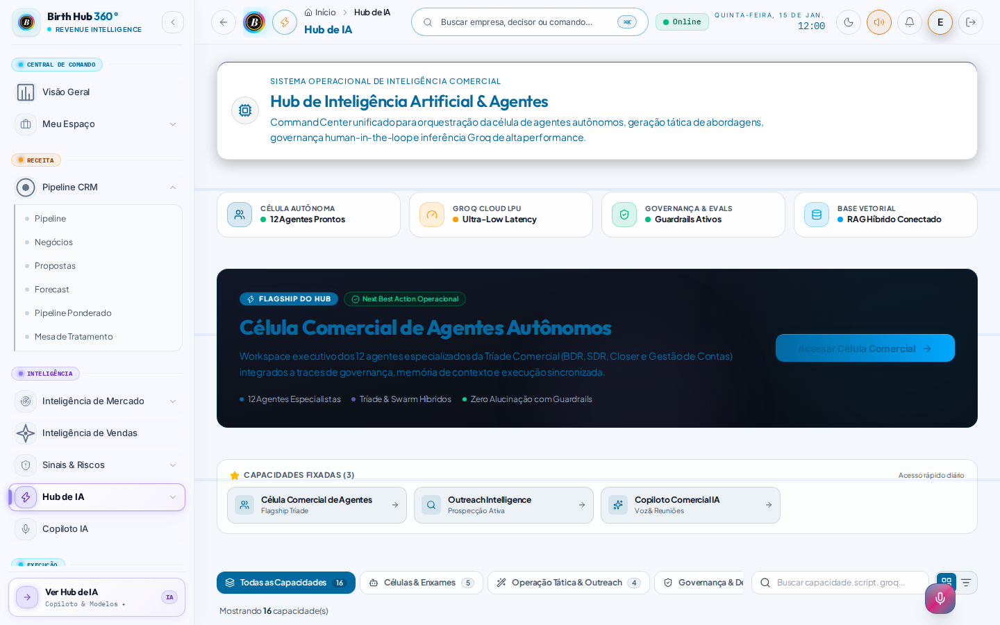
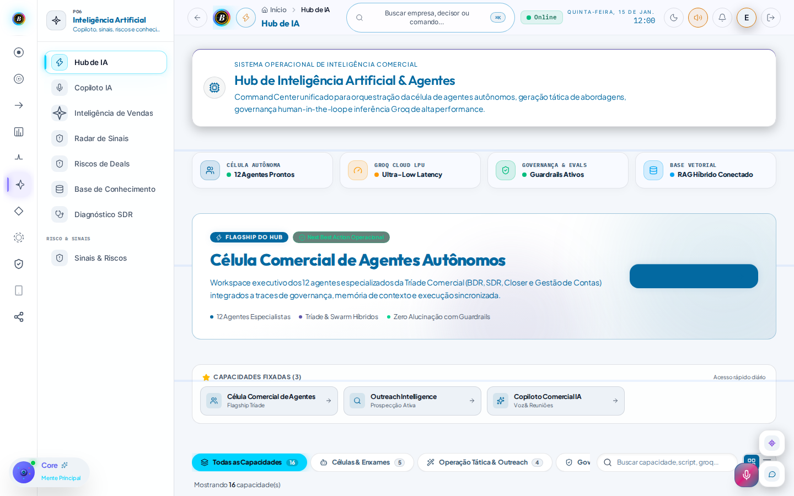
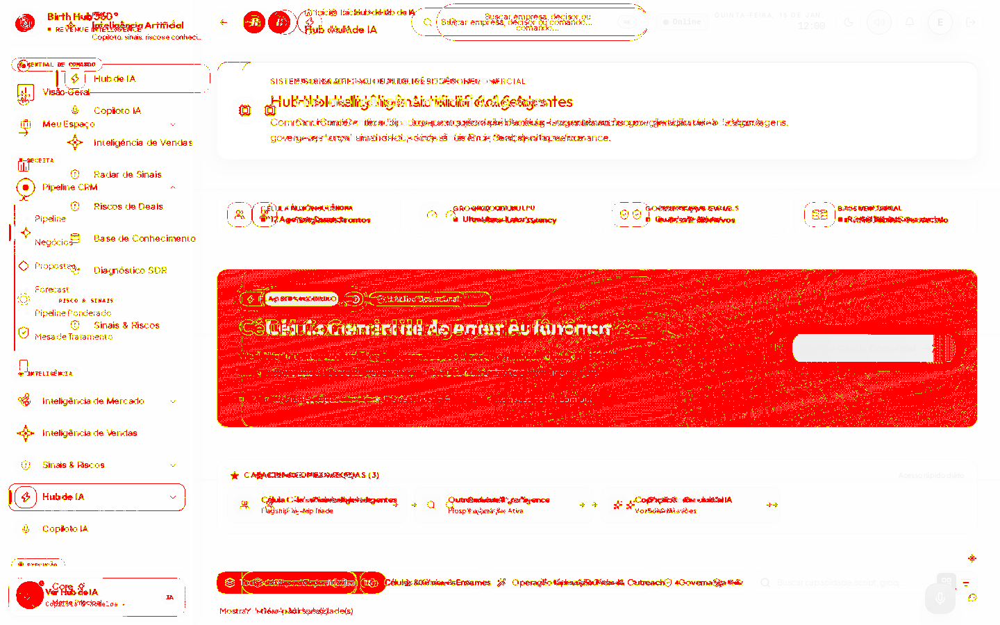
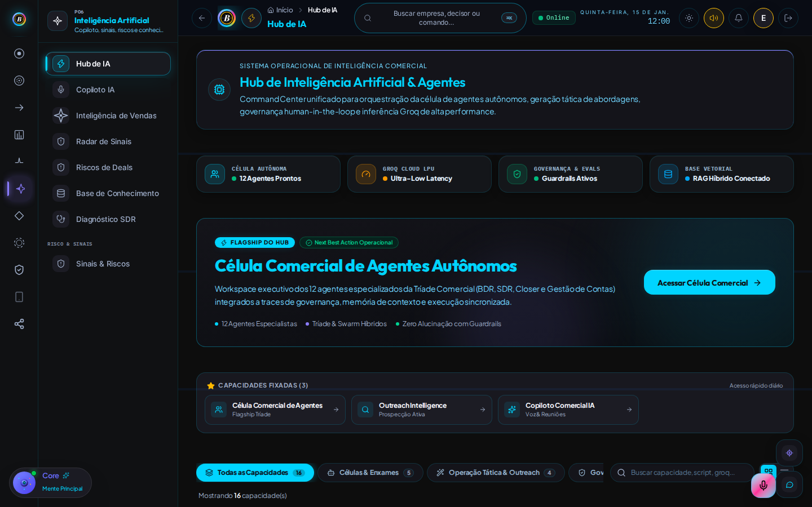

# Handoff — CTA "Acessar Célula Comercial" invisível no Hub de IA (tema light)

- De: 00 — Coordenador
- Para: 02 — Produto e UX
- Onda: vr-regressao-20261111
- Status: aberto
- Prioridade: alto
- Sprint destino: ciclo atual (não atualizar baseline light do Hub de IA até corrigir)

## Problema

No Hub de Inteligência (`/app/intelligence`), tema **light**, o botão
"Acessar Célula Comercial" do banner flagship renderiza como um
**retângulo sólido sem texto visível**. O mesmo CTA no tema **dark**
mostra o rótulo e o ícone normalmente.

Isso foi encontrado no diagnóstico só-leitura das 88 falhas pré-existentes
de regressão visual Playwright (11 telas × 2 temas × 4 viewports) contra
a `main`. Não é flakiness (0 flaky; retries de CI também falham; o mesmo
88/88 se repetiu nos PRs #220, #221 e #222). Também não é mismatch
darwin/win vs linux: as 88 baselines oficiais já são `*-linux.png`.

A diferença percebida pelo Playwright no tema light chega a **ratio
0,20–0,26** (até 255 320 pixels no desktop light), em grande parte
pelo redesenho do chrome (rail de módulos + `ModuleAgentWidget`) **e**
pela falha de contraste/rótulo do CTA no banner, que no baseline era um
botão azul com texto visível sobre um hero escuro.

## Arquivo(s) envolvido(s)

- `src/features/intelligence/components/IntelligenceHub.tsx` (CTA por volta
  da linha 626; banner flagship com `bg-brand` + `text-on-brand` e
  `bg-gradient-to-r` sem stops `from-`/`to-`)
- Tokens de marca: `src/styles/globals.css`, `src/styles/official-identity.css`
  (`--brand` / `--on-brand` / `text-on-brand`)
- Recortes de evidência (anexos deste handoff):
  - `.agents/handoffs/evidencias-vr-20261111/hub-ia-light-desktop-expected.png`
  - `.agents/handoffs/evidencias-vr-20261111/hub-ia-light-desktop-actual.png`
  - `.agents/handoffs/evidencias-vr-20261111/hub-ia-light-desktop-diff.png`
  - `.agents/handoffs/evidencias-vr-20261111/hub-ia-dark-desktop-actual.png`
    (controle: no dark o rótulo "Acessar Célula Comercial →" está visível)

## Evidência

- Run de CI (ubuntu-latest, Node 22, Playwright 1.63.0, só Chromium),
  PR #222 (reencrypt, sem mudança de UI) sobre a main de então
  (`prBaseHash` `5d75ffa99`):
  https://github.com/marcelinhomarkss-rgb/Birthub-360/actions/runs/42980628002
  (11/11/2026, ~04:35–04:59 America/Sao_Paulo).
- Artefato baixado em `/workspace/vr-artifacts/run-42980628002`
  (report HTML + actual/expected/diff). Análise agregada em
  `/workspace/vr-artifacts/analysis.json`. Recortes em
  `/workspace/vr-artifacts/review-images/` e cópias versionadas neste
  diretório de evidências.
- Confirmação visual (desktop/laptop/tablet light): o botão aparece como
  bloco azul-escuro vazio. No dark, o mesmo botão é ciano com texto
  legível. Medidas Playwright (tema light): desktop 255 320 px (ratio
  0,20), laptop 227 754 (0,22), tablet 198 204 (0,26).
- Hipótese não vinculante (verificar): conflito de tokens `--brand` /
  `--on-brand` no tema light (ex. texto escuro sobre fundo `#0369a1`)
  ou estilo do `Button` cobrindo `text-on-brand`. O dark não reproduz
  o problema.

## Alteração necessária

- Restaurar contraste e visibilidade do rótulo "Acessar Célula Comercial"
  (e do ícone) no tema light, no desktop e nos breakpoints menores,
  sem quebrar o dark (que hoje está correto).
- Validar o par `bg-brand` + `text-on-brand` no tema light (WCAG AA).
- **Não** atualizar as baselines light do Hub de IA (`intelligence-light-*-linux.png`)
  até o CTA estar visível. Também **não** mexer em Login, na landing
  nem nos CSS do PR #214.

## Teste esperado

- Tema light, viewports desktop/laptop/tablet (e conferir mobile): o CTA
  exibe "Acessar Célula Comercial" com contraste adequado.
- Tema dark: o CTA continua visível, sem regressão.
- Clique no CTA continua abrindo a Célula Comercial (`handleOpenTool('commercial_cell')`).
- Depois da correção, a suíte `npm run test:visual` pode receber update
  **somente** das baselines `intelligence-light-*` (não deste PR de docs).

## Contexto adicional

- A suíte visual está em `visual-regression/visual.spec.ts` /
  `playwright.visual.config.ts`. `maxDiffPixels` já é 1300; não aumentar
  threshold nem pular/desativar testes.
- As outras falhas das 88 (chrome global, Workspace, CRM, Dashboard, etc.)
  seguem em lotes separados de baseline; Login/landing ficam retidos
  por causa do #214.
- Este handoff é só documentação + evidência. Nenhuma linha de produto
  foi alterada aqui.

## Resolução
(preenchido pelo agente destino ao resolver)
