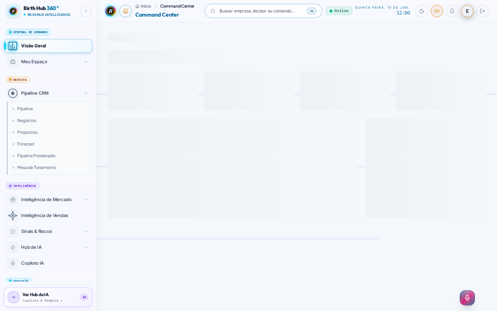
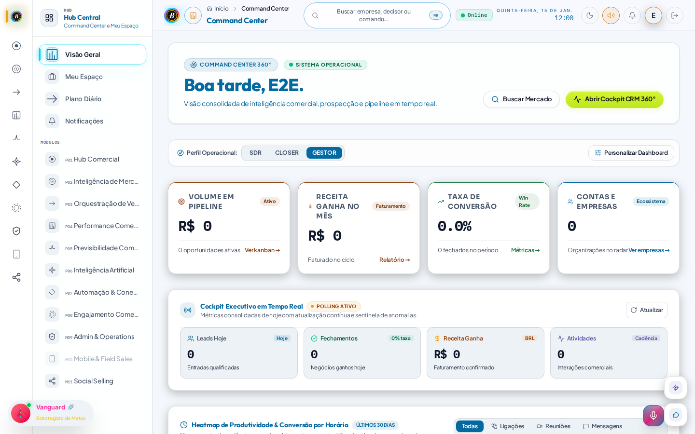

# Handoff — `data-testid="dashboard-greeting"` sumiu do dashboard (máscara visual inerte)

- De: 00 — Coordenador
- Para: 02 — Produto e UX
- Onda: vr-regressao-20261111
- Status: resolvido
- Prioridade: normal
- Sprint destino: junto da atualização de baselines do Dashboard (lote posterior; não este PR)

## Problema

A suíte de regressão visual mascara o cumprimento do dashboard com
`page.getByTestId('dashboard-greeting')` para o texto dinâmico
("Bom dia" / "Boa tarde" / "Boa noite" + nome) não entrar no snapshot.

Esse `data-testid="dashboard-greeting"` **não existe mais** no componente
atual. A máscara vira no-op e o texto **"Boa tarde, E2E."** (relógio
fixo da suíte: 15:00 UTC / 12:00 America/Sao_Paulo em 15/01/2026) é capturado no PNG.

Enquanto o relógio da suíte permanecer fixo o snapshot é determinístico,
mas a máscara deixou de cumprir o contrato: qualquer mudança de
saudação, nome ou horário quebra o visual sem ser mudança de layout.
O testid ainda é referenciado em:

- `visual-regression/visual.spec.ts` (`MASKS.dashboard`)
- `tests/e2e/visual.spec.ts` (suíte antiga, fora do workflow Visual
  Regression Tests)

O seletor não aparece em nenhum arquivo de produto (`src/`).

## Arquivo(s) envolvido(s)

- `src/features/dashboard/components/SinglePageDashboard.tsx`
  - `greeting()` por volta da linha 52
  - `<h1>` com `{greeting()}, {firstName}.` por volta da linha 856 —
    é neste heading que o `data-testid="dashboard-greeting"` deve voltar
- `visual-regression/visual.spec.ts` (máscara; **não alterar** a
  tolerância `maxDiffPixels` / threshold e não pular testes)
- Recortes de evidência:
  - `.agents/handoffs/evidencias-vr-20261111/dashboard-light-desktop-expected.png`
    (baseline de 01/11/2026: a máscara ainda "comia" o greeting; o
    miolo do dashboard estava essencialmente vazio/skeleton)
  - `.agents/handoffs/evidencias-vr-20261111/dashboard-light-desktop-actual.png`
    (CI 11/11/2026: "Boa tarde, E2E." visível no header, junto do
    cockpit/KPIs novos)

## Evidência

- Run de CI: https://github.com/marcelinhomarkss-rgb/Birthub-360/actions/runs/42980628002
  (11/11/2026, America/Sao_Paulo). Artefato em
  `/workspace/vr-artifacts/run-42980628002`. Recortes originais em
  `/workspace/vr-artifacts/review-images/Dashboard-light-desktop__{expected,actual}.png`.
- Grep no `src/`: não há `data-testid="dashboard-greeting"`.
  `revenue-signal-orb` ainda existe (`DeferredRevenueSignalOrb.tsx`);
  as outras máscaras (`clock-calendar-widget`, `dashboard-analytics-chart`)
  merecem a mesma conferência quando o lote do Dashboard for atualizado.
- O conteúdo novo do dashboard (cockpit, KPIs, heatmap, rail, widget de
  personagem) é mudança de produto já na main — a atualização das 8
  baselines do Dashboard é lote separado. Este handoff cobre só a
  restauração do testid / da máscara.

## Alteração necessária

- Recolocar `data-testid="dashboard-greeting"` no elemento que contém a
  saudação + nome (o `<h1>` em `SinglePageDashboard.tsx`, ou um wrapper
  estável que cubra exatamente essa região).
- Confirmar que `page.getByTestId('dashboard-greeting')` volta a resolver
  na suíte `npm run test:visual` (temas light e dark, 4 viewports).
- **Não** atualizar baselines neste handoff. **Não** mexer em Login, na
  landing, nos CSS do PR #214, nem nas baselines `intelligence-light-*`.

## Teste esperado

- Com a suíte visual, a região da saudação volta a ser mascarada
  (o texto "Boa tarde, E2E." / equivalente não aparece no PNG).
- O cumprimento em si continua visível para o usuário na UI real.
- Sem aumento de `maxDiffPixels` e sem `test.skip` / disable da suíte.

## Contexto adicional

- Relógio da suíte: `VISUAL_REFERENCE_TIME = '2026-01-15T15:00:00.000Z'`
  em `visual-regression/deterministic-state.ts`. Por isso a saudação
  atual é "Boa tarde" mesmo com "12:00" no topbar (America/Sao_Paulo).
- Diagnóstico completo das 88 falhas: o dashboard mudou de fato (cockpit
  de 03/11/2026 e chrome de 09–10/11). Restaurar o testid é higiene
  obrigatória **antes ou junto** do lote de baselines do Dashboard,
  para o snapshot não ficar frágil.
- Este handoff é só documentação + evidência.

## Resolução

Resolvido de fato antes deste handoff ser triado: o `data-testid="dashboard-greeting"`
foi readicionado em `SinglePageDashboard.tsx` pelo commit `285400c12`
(`fix(qa): alinhar E2E modular`, 2026-11-12). Verificado pelo Agente 24 na revisão
do PR #223 (parecer `.agents/reviews/24-revisao-pr223-20261113-24.md`) — handoff
encerrado como obsoleto para evitar retrabalho do Agente 02.
