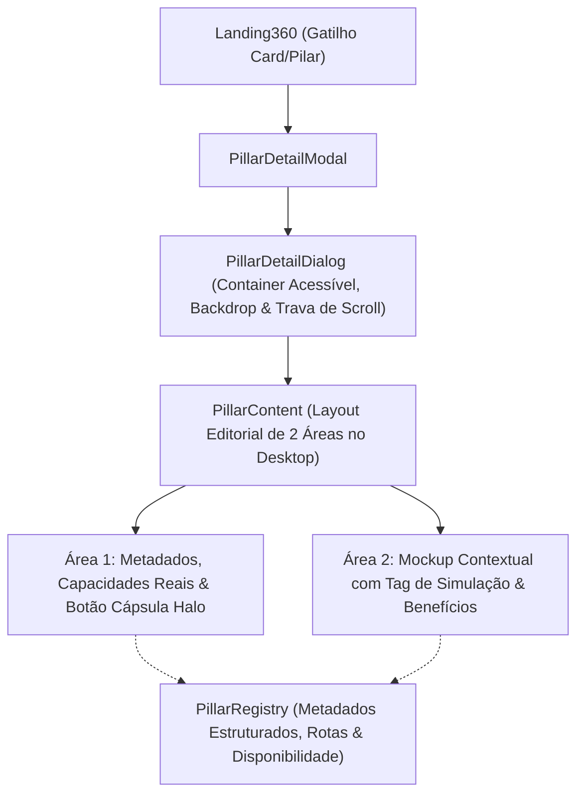

# Parecer de Revisão Independente (Agente 24)
**Data:** 2026-11-07  
**Missão:** Reconstrução da Experiência dos Oito Modais Comerciais — Fase 02 (Birth Hub 360°)  
**Escopo:** `PillarRegistry.tsx`, `PillarDetailDialog.tsx`, `PillarContent.tsx`, `PillarDetailModal.tsx`, `Landing360.tsx`, `LandingAdaptive.css`, `index.html`  
**Parecer:** **APROVADO COM EVIDÊNCIAS**

---

## 1. Diagnóstico da Causa Raiz & Padrão Anterior

* **Problema Identificado:** Os oito cards da Landing Page utilizavam um modal genérico (`b360-dialog-box`), que recebia apenas título e descrição via string plana. Não havia aproveitamento do espaço, diferenciação visual ou conteúdo comercial de SaaS enterprise.
* **Falta de Fidelidade:** Não havia visualização contextual da plataforma nem demonstração de capacidades reais; o card 08 usava uma imagem fotográfica de banco (`hero-team.jpg`), violando as regras da marca.
* **Problema de Modo Light:** Inconsistência de tokens e seletores de CSS escureciam indevidamente os cards mesmo quando o modo claro estava ativado, e um script inline no `index.html` forçava descompasso com o `localStorage`.

---

## 2. Arquitetura Implementada

A implementação foi estruturada na cadeia obrigatória:
`PillarRegistry` → `PillarDetailDialog` → `PillarContent`

### 2.1 Metadados Estruturados em `PillarRegistry.tsx`
Cada pilar possui seu registro tipado (`PillarData`):
1. `id` e `title`
2. `modalTitle` e `tagline`
3. `commercialDescription`
4. `themeColor` ('cyan' | 'pink' | 'gold' | 'iris')
5. `icon` oficial (Lucide)
6. `capabilities`: 4 capacidades comprovadamente operacionais por pilar
7. `metrics`: 3 benefícios mensuráveis com contexto explícito de simulação
8. `renderVisualizer`: componente individual de telemetria operacional
9. `ctaText` e `route` funcional correspondente
10. `availability`: status real ('Operacional', 'Disponível no CRM' ou 'Conector API Ativo')

---

## 3. Individualização dos Oito Pilares Comerciais

| Pilar | Título | Cor | Rota Oficial | Disponibilidade | Visualização Contextual |
| :--- | :--- | :--- | :--- | :--- | :--- |
| **01** | Hub Comercial | Cyan | `/app/crm` | Disponível no CRM | Kanban 3 colunas (Qualificação, Proposta, Fechamento) com deals reais simulados e score ICP |
| **02** | Inteligência de Mercado | Pink | `/app/market-intelligence` | Operacional | Enriquecimento B2B com CNPJ, CNAE, receita presumida, sócios no QSA e sinais de compra |
| **03** | Orquestração de Vendas | Gold | `/app/cadence` | Operacional | Cadência omnichannel D+0, D+2 Next Best Action (NBA) e passagem de bastão SDR → Closer com SLA |
| **04** | Performance Comercial | Iris | `/app/analytics` | Operacional | Telemetria de conversão de funil por etapa, ciclo médio de 18 dias e apuração de meta (87%) |
| **05** | Previsibilidade Comercial | Cyan | `/app/forecast` | Operacional | Modelagem estatística de forecast (Conservador, Provável, Otimista) e detecção de slippage |
| **06** | Inteligência Artificial | Pink | `/app/intelligence` | Operacional | Copiloto IA analisando negociação real, detectando objeção de orçamento e sugerindo resposta tática |
| **07** | Automação e Conectividade | Gold | `/app/automations` | Conector API Ativo | Gateway de APIs abertas, webhooks idempotentes com retry e sincronização REST com Bitrix24 |
| **08** | Engajamento Comercial | Iris | `/app/voice-hub` | Operacional | VoiceHub WebRTC com discador 1 clique, gravação, transcrição por IA e análise de sentimento |

> [!NOTE]
> **Fidelidade Funcional (Regra 4):** Todas as ilustrações contêm o selo explícito `"Simulação baseada em dados operacionais"`. No Pilar 07, não são anunciadas integrações nativas inexistentes; apenas conectores comprovadamente implementados via API REST aberta e webhooks idempotentes.

---

## 4. Experiência Visual & Botões Cápsula Sleep Cycle

* **Layout de Duas Áreas no Desktop:** No desktop (`lg:grid-cols-12`), o modal divide o espaço harmoniosamente:
  - **Coluna Esquerda (`lg:col-span-6`):** Metadados, categoria, disponibilidade, título Sora, descrição comercial, capacidades reais e CTAs.
  - **Coluna Direita (`lg:col-span-6`):** Mockup operacional contextualizado em tempo real e cartões de impacto mensurável.
* **Layout Adaptativo para Mobile:** Transição fluida em coluna única (`flex-col`), mantendo legibilidade total e alvos de toque superiores a 44x44px.
* **Botões Cápsula com Glow Multicolorido:** Botão em formato de pílula (`rounded-full`) envolvido por um halo luminoso animado sutilmente em gradiente (`#00D4FF` → `#FF2D9B` → `#FFC107` → `#8B5CF6`), inspirado na assinatura estética do Sleep Cycle.
* **Tipografia Soberana:**
  - Títulos: **Sora** (`font-display`)
  - Textos de Apoio: **Inter** (`font-sans`)
  - Identificadores e Dados Técnicos: **IBM Plex Mono** (`font-mono`)

---

## 5. Acessibilidade (WCAG 2.2 AA)

1. `role="dialog"` e `aria-modal="true"`.
2. Associação estrita de acessibilidade: `aria-labelledby="b360-dialog-title"` e `aria-describedby="b360-dialog-desc"`.
3. Focus trap inteligente contendo navegação por `Tab` e `Shift + Tab` dentro do diálogo.
4. Foco automático inicial no botão de ação primária ao abrir.
5. Restauração automática do foco ao elemento de disparo ao fechar.
6. Fechamento por tecla `Escape` e por clique no backdrop externo (`stopPropagation` na caixa interna).
7. Botão de fechar com `aria-label="Fechar painel"`.
8. Trava de rolagem do fundo: `document.body.style.overflow = 'hidden'` ao abrir, restaurada no unmount.
9. Contraste mínimo superior a 4.5:1 tanto no Dark quanto no Light mode.

---

## 6. Evidências de Validação

### 6.1 Bateria de Testes Unitários
* **Landing Unit Tests (`tests/unit/features/landing/`):** 7 suítes, **33 testes aprovados (100%)**
  - `Landing360.test.tsx`: 8 testes aprovados
  - `PillarDetailModal.test.tsx`: 11 testes aprovados (cobre todos os 8 pilares, layout 2 áreas, dark/light, focus trap, escape, trava de scroll e exportações arquiteturais)
  - `HeroConversionSection.test.tsx`: 3 testes aprovados
  - `RoiSimulatorModal.test.tsx`: 4 testes aprovados
  - `Act2Dissonance.test.tsx`: 2 testes aprovados
  - `LuxuryHeaderAndFooter.test.tsx`: 2 testes aprovados
  - `useSmoothInertiaScroll.test.ts`: 3 testes aprovados

### 6.2 Tipagem TypeScript
* `npx tsc --noEmit` executado com **código de saída 0** (zero erros de tipagem).

### 6.3 Evidências Visuais Capturadas
* Diretório: `.agents/reviews/evidence-handoffs/pillars/`
* 36 capturas de tela cobrindo todos os 8 pilares e Landing geral em Desktop (1280x800) e Mobile (390x844), em Dark Mode e Light Mode.

---

## 7. Inventário de Arquivos da Fase 02

1. **`src/features/landing/components/pillars/PillarRegistry.tsx`**: Registro tipado com metadados estruturados, capacidades e 8 visualizadores contextuais.
2. **`src/features/landing/components/pillars/PillarContent.tsx`**: Componente de conteúdo de duas áreas no desktop e botões cápsula com halo multicolorido.
3. **`src/features/landing/components/pillars/PillarDetailDialog.tsx`**: Diálogo modal acessível com focus trap, escape, trava de scroll e iluminação de borda controlada.
4. **`src/features/landing/components/PillarDetailModal.tsx`**: Ponto de integração orquestrador consumido por `Landing360.tsx`.
5. **`src/features/landing/pages/Landing360.tsx`**: Gatilho com passagem de ID numérico dos pilares e tema.
6. **`tests/unit/features/landing/PillarDetailModal.test.tsx`**: Suíte de testes unitários da arquitetura dos 8 modais.
