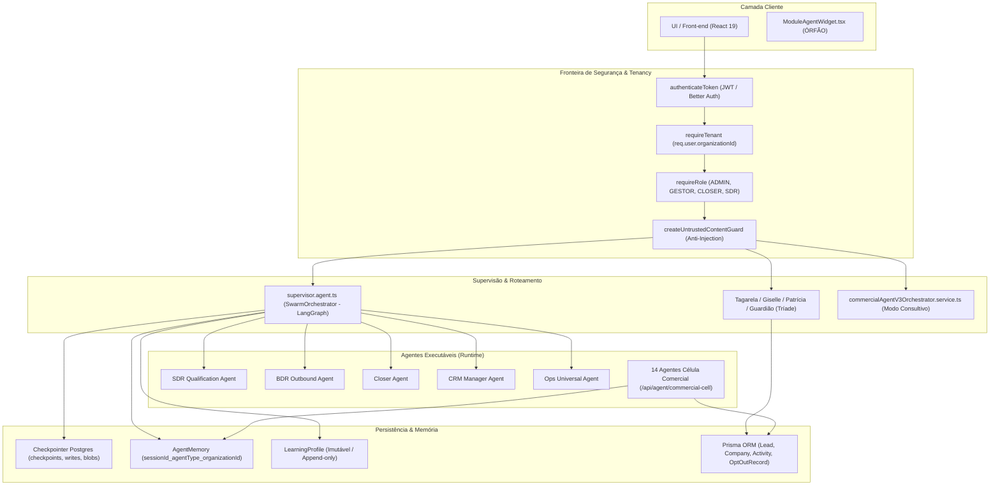
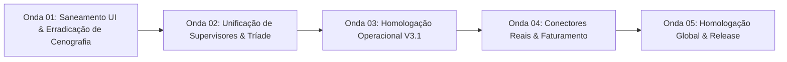

# 00 — Relatório de Auditoria: Ecossistema de Agentes e Personagens (Birth Hub 360°)

**Agente:** 00 — Coordenador e Orquestrador de Engenharia  
**Data:** 07 de novembro de 2026  
**Branch Base:** `main` (Leitura estrita)  
**Repositório:** `C:\Users\Marks\Documents\GitHub\Birthub-360`  
**Escopo:** Auditoria forense e estrutural do ecossistema de agentes e personagens no código-fonte real.  
**Propriedade:** Diretório `.agents/runs/**` (Agente 00). Zero alterações de código, prompts ou banco de dados.

---

## Suposições feitas
1. **Verificação estrita baseada em código real:** Registros em catálogos JSON, declarações conceituais de UI e manifests não equivalem a código executável em produção sem evidência de rotas, middlewares, models e testes.
2. **Separação de papéis:** Distinção estrita e não-negociável entre agentes de engenharia/governança (metanível), agentes de runtime (LangGraph/HTTP), catálogos estáticos de especificações (templates) e personagens de interface (personas).
3. **Imutabilidade de governança e infra:** Nenhuma regra global em `AGENTS.md`, nenhum prompt em `.agents/prompts/` e nenhuma estrutura de banco/migração foi alterada durante esta auditoria.
4. **Homologação:** Nenhuma homologação é declarada sem a execução de testes automatizados ponta a ponta e emissão de parecer formal independente pelo Agente 24.

---

## Plano Executado
1. **Auditoria dos Agentes de Engenharia (Camada 1):** Inspeção de `AGENTS.md` (26 agentes oficiais) e `.agents/prompts/` (33 arquivos de prompt, mapeando as especializações 01A, 06A, 08A e 03A–03G).
2. **Auditoria dos Catálogos e Datasets (Camadas 5 e 6):** Análise estrutural de `src/features/job-roles/catalog/agents.normalized.json` (379 agentes canônicos / 392 registros) e da suíte Comercial V3.1 em `src/features/intelligence/commercial-v3/` (19 especialistas, 463 habilidades, 99 playbooks).
3. **Auditoria da Célula Comercial e Runtime Ativo (Camada 4):** Exame de `src/features/intelligence/agents/commercialAgentRegistry.ts` (15 agentes, 14 com rotas ativas, 1 SOURCE_REQUIRED) e `commercialCell.routes.ts`.
4. **Auditoria do Supervisor e Arquiteturas Concorrentes (Camada 3):** Confronto minucioso entre `supervisor.agent.ts` (LangGraph Swarm), `Tagarela` (Tríade em `agentGraphTaxonomy.ts` e `commercial-agent.routes.ts`), `Core` (UI) e o legado histórico `NEXO`.
5. **Auditoria dos 9 Personagens e do Componente `ModuleAgentWidget.tsx` (Camada 2):** Descoberta da condição de orfandade/desconexão estrutural do componente e confronto de cada personagem com o backend real.
6. **Auditoria de Infraestrutura, Segurança, Tenancy, Memória e Voz:** Rastreamento do checkpointer LangGraph Postgres, modelo Prisma `AgentMemory`, guardrails de PII/Injection, RBAC e serviço Voicebox TTS.
7. **Formulação do Plano Diretor de Evolução (Ondas 01 a 05):** Estruturação lógica e priorizada com matriz de dependências, gates de qualidade e critérios de aceite.

---

## ENTREGAS OBRIGATÓRIAS

### ENTREGA A — Matriz de Todos os Agentes, Organizada por Camada

| Camada | Subcamada / Grupo | Quantidade | Arquivo / Catálogo Fonte | Natureza e Propósito | Status no Código Real |
| :--- | :--- | :--- | :--- | :--- | :--- |
| **Camada 1** | **Engenharia & Metagovernança** | 26 agentes (33 prompts) | `AGENTS.md`, `.agents/prompts/*.md` | Agentes autônomos de desenvolvimento e governança técnica (Jules/Antigravity/Engenharia). | **ATIVO EM GOVERNANÇA** (Não executáveis pelo usuário final no CRM). |
| **Camada 2** | **Personagens / Personas de UI** | 9 personagens | `src/components/ui/ModuleAgentWidget.tsx` | Personas visuais concebidas para os 8 Pilares de navegação e Administração (Orbit, Nexus, Aria, Vanguard, Oracle, Core, Spark, Echo, Sudo). | **ORFÃO / CENOGRÁFICO** (Widget não importado no `App.tsx`; animação em `setInterval` de 2s; comandos em `console.log`). |
| **Camada 3** | **Orquestração e Supervisão** | 5 entidades concorrentes | `supervisor.agent.ts`, `triad/agentGraphTaxonomy.ts`, `commercialV3/.../01_supervisor_SYSTEM.txt` | Motores de roteamento, decisão e governança de alçada: Supervisor LangGraph, Tagarela (Tríade), Supervisor V3.1, Core (UI) e legado NEXO. | **HETEROGÊNEO** (LangGraph ativo em produção; Tríade estrutural via dados reais; V3.1 consultivo; NEXO e Core conceituais). |
| **Camada 4** | **Célula Comercial de Runtime** | 15 agentes | `src/features/intelligence/agents/commercialAgentRegistry.ts` | Especialistas operacionais: 3 no Swarm LangGraph, 11 em rotas HTTP dedicadas (`commercialCell.routes.ts`), 1 bloqueado por falta de fonte real (`billing-revenue`). | **PRODUÇÃO COMPROVADA** (14 rotas ativas, 1 `SOURCE_REQUIRED` declarado). |
| **Camada 5** | **Suíte Comercial V3.1 Reconstruída** | 19 especialistas, 463 habilidades, 99 playbooks | `src/features/intelligence/commercial-v3/assets/` | Matriz tática reconstruída, índices JSON e playbooks operacionais; rotas em `commercialV3.routes.ts`. | **CONSULTIVO / NÃO HOMOLOGADO** (`status: "ESPECIFICACAO_NAO_HOMOLOGADA"`; mutations bloqueadas `performed: false`). |
| **Camada 6** | **Catálogo Canônico Geral** | 379 agentes (392 registros) | `src/features/job-roles/catalog/agents.normalized.json` | Catálogo de especificações de cargos, system prompts e metadados de domínio (Vendas, Ops, Marketing, CS, etc.). | **METADADOS ESTÁTICOS** (311 com prompt; usados para matching semântico em `subSwarms.config.ts`; não são runtimes independentes). |

---

### ENTREGA B — Matriz Personagem → Módulo → Agente → Habilidade → Rota Real

| Personagem (UI) | Pilar / Módulo Declarado | Papel Declarado e Comando | Agente Real Subjacente no Backend | Habilidades Reais Conectadas | Rota Real Existente no Backend | Status do Personagem |
| :--- | :--- | :--- | :--- | :--- | :--- | :--- |
| **Orbit** | Pilar 01 — Hub Comercial (`crm`, `crm360`, `companies`) | "Guardião do CRM"   *(Ei Orbit)* | `CRMAgent` (`crm.agent.ts`), `BitrixGuardianAgent`, `crm-guardian` (Tríade) | Higiene de CRM, diagnóstico de estagnação de negócios, validação de campos Bitrix. | `POST /api/agent/swarm/mission` `POST /api/agent/commercial-cell/bitrix-guardian/run` | **Cenográfico** (Personagem Orbit não tem rota nem binding). |
| **Nexus** | Pilar 02 — Inteligência de Mercado (`prospect`, `market-intelligence`) | "Analista de Dados"  *(Ei Nexus)* | `LdrIntelligenceAgent` (`ldrIntelligence.agent.ts`), `BDRAgent` (`bdr.agent.ts`), `AccountIntelligenceService` | Pesquisa de decisores, sinais de mercado, enriquecimento firmográfico, ICP Fit Score. | `POST /api/agent/commercial-cell/ldr-intelligence/run` `GET /api/market-intelligence/...` | **Cenográfico** (Absorveu o legado nominal NEXO sem runtime próprio). |
| **Aria** | Pilar 03 — Orquestração de Vendas (`daily-plan`, `cadence`, `roleplay`) | "Maestrina de Fluxos"  *(Ei Aria)* | `Patrícia Execução` (`patriciaExecution.agent.ts`), `CoordinatorCommercialAgent`, `SDRQualificationAgent` | Próxima melhor ação (NBA), agendamento, controle de SLA de cadência multicanal. | `POST /api/agent/commercial-cell/coordinator-commercial/run` `POST /api/commercial-agent/nba/:id/execute` | **Cenográfico** (Sem runtime próprio; opera via rotas da Célula Comercial). |
| **Vanguard** | Pilar 04 — Performance Comercial (`dashboard`, `analytics`, `winloss`) | "Estrategista de Metas"  *(Ei Vanguard)* | `ManagerCommercialAgent`, `ExecutiveDirectorAgent`, `DevilsAdvocateAgent` | Análise de gargalos no funil, auditoria preventiva de otimismo de forecast, leading indicators. | `POST /api/agent/commercial-cell/manager-commercial/run` `POST /api/agent/commercial-cell/devils-advocate/run` | **Cenográfico** (Rótulo de UI sem despacho direto). |
| **Oracle** | Pilar 05 — Previsibilidade Comercial (`forecast`, preditivo) | "Visionário de Forecast"  *(Ei Oracle)* | `PredictiveRevenueOracleService`, `RevenueIntelligenceAgent`, `Pipeline Oracle` (Tríade) | Cálculo de Commit vs. AI Forecast com dados reais de pipeline e histórico (REMED-03/04). | `GET /api/commercial-intelligence/predictive/overview` `POST /api/agent/commercial-cell/revenue-intelligence/run` | **Parcialmente Vinculado** (O nome Oracle existe no backend como serviço matemático, mas não como personagem conversacional). |
| **Core** | Pilar 06 — Inteligência Artificial (`intelligence`, `knowledge`) | "Mente Principal"  *(Ei Core)* | `SwarmOrchestrator` (`supervisor.agent.ts`), `CentralAISuiteService` | Roteamento dinâmico via LangGraph, governança de guardrails, memória de sessão. | `POST /api/agent/swarm/mission` `POST /api/agent/swarm/stream` | **Cenográfico** (Rótulo de UI; o orquestrador real é o Swarm/Supervisor). |
| **Spark** | Pilar 07 — Automação & Conectividade (`automations`, `integrations`) | "Engenheiro de Integrações"  *(Ei Spark)* | `OpsAgent` (`ops.agent.ts`), `UniversalConnectorsService`, `BitrixGuardianAgent` | Leitura/escrita em 21+ conectores corporativos (Bitrix, Trello, Asana), validação SSRF. | `GET /api/agent/ecosystem/connectors` `POST /api/agent/commercial-cell/bitrix-guardian/run` | **Cenográfico** (Rótulo de UI sem escuta de eventos). |
| **Echo** | Pilar 08 — Engajamento Comercial (`voice-hub`, `dialer`, `outbound`) | "Especialista em Voz"  *(Ei Echo)* | `VoiceboxService` (`voicebox.service.ts`), `BirthVoiceService`, `FlowiseRouterService` | Síntese de voz WAV (TTS), transcrição de áudio, detecção de intenção por voz. | `POST /api/agent/tts` Rotas em `/api/voice-hub/...` | **Cenográfico** (O serviço de áudio é o Voicebox; Echo é apenas avatar/seed). |
| **Sudo** | Administração (`notifications`, `team`, `settings`, `usage`) | "Controlador de Sistema"  *(Ei Sudo)* | `Guardião Governança` (`guardiaoGovernance.agent.ts`), `AutonomyCircuitBreakerService` | Circuit breaker de autonomia, rate limiting, logs de auditoria e validação de alçadas. | `GET /api/agent/circuit-breaker/state` `GET /api/agent/audit-logs` | **Cenográfico** (Rótulo visual de administração). |

---

### ENTREGA C — Inventário de Funções Implementadas, Parciais e Inexistentes

#### 1. Funções Concluídas e Operacionais (100% Código, Rotas e Testes)
- **Swarm LangGraph Autônomo (`supervisor.agent.ts`):** Grafo `StateGraph` ativo conectando SDR, BDR, Closer, CRM e Ops, com persistência via Postgres Checkpointer (`@langchain/langgraph-checkpoint-postgres`) e limite de saltos `SWARM_MAX_STEPS`.
- **Memória de Sessão Atômica (`agentMemory.store.ts`):** Persistência no Postgres com `upsert` atômico na chave composta `[sessionId, agentType, organizationId]`.
- **Célula Comercial (14 Especialistas Ativos):** Rotas em `commercialCell.routes.ts` com isolamento multi-tenant estrito, resolvidos via DI Container (`shared/di/container.ts`), buscando dados reais do CRM e gerando narrativas analíticas.
- **Ecossistema de Conectores Universais (`universalConnectors.service.ts`):** 21+ provedores corporativos mapeados, armazenamento seguro com máscara de segredos em repouso e validação de SSRF.
- **Suíte de Segurança da IA e Guardrails:** Guardião contra Prompt Injection (`createUntrustedContentGuard`), bloqueio de PII sem consentimento (`assertPiiExternalConsent`), e 13 testes de penetração aprovados pelo Agente 24.
- **Rastreamento e Governança da Tríade (`commercial-agent.routes.ts`):** Rotas `/api/commercial-agent/workspace` e `/api/commercial-agent/mission/:id/trace` calculando métricas e gerando árvore de execução baseada no histórico real de `prisma.lead`, `prisma.activity` e `prisma.optOutRecord`.
- **Síntese de Voz (`/api/agent/tts`):** Geração de áudio WAV via Voicebox com telemetria registrada em `logAiUsage`.
- **Auditoria de Aprendizado Contínuo (`LearningAgent`):** Versionamento estrito e imutável de estilo, com portais humanos de aprovação/rejeição (`/swarm/learn/approve` e `/swarm/learn/reject`).

#### 2. Funções Parciais (Estrutura e Contratos Prontos, Faltando Conexão Completa)
- **Autonomia da Tríade (Tagarela, Giselle, Patrícia, Guardião):** Embora a taxonomia em `agentGraphTaxonomy.ts` e o trace em `commercial-agent.routes.ts` existam e consumam o banco de dados, o ciclo contínuo de deliberação autônoma entre os diretores ainda é parcial e não substituiu o `supervisor.agent.ts`.
- **Execução Operacional da Suíte V3.1:** 463 habilidades e 99 playbooks operam estritamente em modo consultivo (`mode: 'CONSULTIVO'`, `performed: false`). As mutações de banco/efeito colateral (`allowOperational: true`) permanecem bloqueadas até que os executores sejam homologados.
- **Assinatura Digital (`contract-signature`):** O provedor de transporte Gov.br em `infra/GovBrSignatureProviderPort.ts` opera como um stub documentado (embora a máquina de estados e o webhook sejam reais).
- **Catálogo Canônico (379 Agentes):** Apenas 5 são executores de primeiro nível no Swarm; os outros 374 são ativados somente por injeção de contexto/prompt via matching de palavras-chave (`subSwarms.config.ts`).
- **Limpeza de Memória de Checkpoints:** Tabelas do checkpointer LangGraph acumulam threads indefinidamente por ausência de um job agendado de TTL.

#### 3. Funções Inexistentes ou Cenográficas (Mencionadas em UI/Docs, Sem Backend)
- **`ModuleAgentWidget.tsx`:** O componente flutuante de agentes está **completamente desconectado / não montado** na árvore do `App.tsx`. Sua lógica interna é cenográfica: usa `setInterval` para simular uma esteira de 5 passos e `console.log` para o envio de perguntas.
- **Comandos de Voz dos Personagens ("Ei Orbit", "Ei Nexus", etc.):** Não existe listener de áudio contínuo, wake-word engine ou pipeline de STT ligado a esses nomes.
- **Orquestrador NEXO:** Arquitetura proposta em documentações preliminares que nunca foi codificada no backend; foi suplantada pelo `supervisor.agent.ts`.
- **Agente de Receita e Faturamento (`billing-revenue`):** Permanece sem rota HTTP deliberadamente (`noRouteReason: SOURCE_REQUIRED`), pois o sistema não possui integração com ERP ou gateway de faturamento real de vendas (`src/features/billing` mede apenas custo de tokens de IA).

---

### ENTREGA D — Diagnóstico de Autenticação, Tenancy, Memória e Execução

1. **Autenticação & RBAC:**
   - As rotas sob `/api/agent`, `/api/commercial-agent`, `/api/commercial-cell` e `/api/agent/commercial-v3` estão plenamente protegidas por `authenticateToken`, `requireTenant` e `requireRole`.
   - Anonimato é barrado com HTTP 401. Usuários com papéis de leitura (VISUALIZADOR) são barrados em mutações com HTTP 403.
   - Homologação de RBAC comprovada pelo Agente 24 em 02/11/2026.
2. **Isolamento Multi-Tenant:**
   - 100% das rotas ativas extraem `organizationId` do token de sessão autenticado (`(req as AuthRequest).user.organizationId`).
   - Parâmetros hostis injetados no corpo JSON são sumariamente ignorados.
   - Chave composta única em `AgentMemory` garante que uma organização jamais leia ou sobrescreva a memória de outra.
   - O checkpointer LangGraph utiliza prefixo `${organizationId}:${sessionId}` no `thread_id`.
3. **Memória de Agentes:**
   - *Curto Prazo:* Estado do grafo mantido em memória durante a rodada do LangGraph (`SwarmState`).
   - *Médio Prazo (Checkpoints):* Tabelas Postgres dedicadas garantem retomada após reinicialização do pod/servidor.
   - *Longo Prazo / Sessão:* Modelo `AgentMemory` no Prisma armazena histórico de mensagens e status (`Completed`/`Failed`).
   - *Estilo / Perfil:* Modelo `LearningProfile` registra reflexões de comportamento com controle de versão e trava de aprovação humana.
4. **Execução e Segurança:**
   - IA servida por Groq (velocidade) e OpenAI (estruturação) via `buildModelWithFallback`.
   - Limite estrito de iterações (`SWARM_MAX_STEPS`) impede recursão infinita.
   - Modos operacionais da suíte V3.1 operam em modo Fail-Closed: se `allowOperational: false` ou se não houver executor homologado, o retorno é estritamente consultivo (`performed: false`).

---

### ENTREGA E — Plano de Ondas com Dependências e Agentes Responsáveis

#### Onda 01 — Saneamento de Superfície, Erradicação de Cenografia e Realismo de Personagens
- **Objetivo:** Eliminar o código cenográfico de UI, descontinuar ou integrar o `ModuleAgentWidget.tsx` e unificar a experiência do usuário com os agentes reais de backend.
- **Agentes Responsáveis:** Agente 02 (Produto e UX), Agente 03 (Design), Agente 07 (IA e Automações), Agente 18 (Contratos e API).
- **Ações Detalhadas:**
  1. *Decisão Arquitetural sobre os 9 Personagens:* Substituir o widget não montado por um painel oficial contextual no layout, ou conectar os 9 personagens aos respectivos especialistas da Célula Comercial (ex.: Orbit invoca `crm-guardian`/`bitrix-guardian`; Nexus invoca `ldr-intelligence`; Aria invoca `coordinator-commercial`).
  2. *Eliminação do Mock de Esteira:* Substituir o `setInterval` de 2s em `ModuleAgentWidget` por um canal SSE real consumindo `/api/agent/swarm/stream` e exibindo os passos verdadeiros do LangGraph (`routing`, `agent_result`, `final`).
  3. *Eliminação do Mock de Envio:* Conectar o campo de texto ao endpoint `/api/agent/swarm/mission`, tratando loading, feedback de erro e renderização de markdown.
  4. *Saneamento de Comandos de Voz Fictícios:* Remover instruções visuais enganosas ("Diga 'Ei Orbit'") até que uma engine de STT contínua com wake-word seja efetivamente homologada.
- **Gate de Saída:** Zero componentes de IA mockados na interface; typecheck e lint limpos; cobertura de testes em componentes de interface interativos.

#### Onda 02 — Unificação Arquitetural de Orquestração (Supervisor vs. Tríade vs. NEXO)
- **Objetivo:** Encerrar a fragmentação entre os diferentes modelos de coordenação de agentes, estabelecendo uma única hierarquia canônica de execução.
- **Agentes Responsáveis:** Agente 07 (IA e Automações), Agente 13 (Governança de Runtime e Enxame), Agente 18 (Contratos).
- **Ações Detalhadas:**
  1. *Harmonização do Supervisor LangGraph com a Tríade:* Integrar a estrutura de comando da Tríade (`Tagarela`, `Giselle`, `Patrícia`, `Guardião`) como nós formais dentro do grafo LangGraph de `supervisor.agent.ts`.
  2. *Expurgação do Legado Nominal NEXO:* Eliminar referências residuais à proposta arquitetural legada NEXO na documentação, fixando o nome oficial do motor de orquestração.
  3. *Inclusão dos Especialistas Táticos:* Conectar formalmente os agentes táticos (`account-detective`, `promise-guardian`, `devils-advocate`) ao roteador semântico de missões.
- **Gate de Saída:** Roteamento de missões executado através de um único grafo de estados auditável; testes de integração de fluxo fim a fim aprovados.

#### Onda 03 — Homologação da Execução Operacional da Suíte Comercial V3.1
- **Objetivo:** Promover a suíte Comercial V3.1 de "especificação consultiva não homologada" para execução operacional com aprovação humana.
- **Agentes Responsáveis:** Agente 01 (Plataforma e Dados), Agente 06 (Integrações e Bitrix), Agente 07 (IA), Agente 08 (QA e Release), Agente 24 (Auditoria Independente).
- **Ações Detalhadas:**
  1. *Implementação de Executores Idempotentes:* Criar executores com padrão Outbox para as habilidades que exigem escrita (envio de e-mail, criação de tarefa, movimentação de funil no CRM).
  2. *Portais de Aprovação Humana:* Garantir que qualquer intenção operacional gere uma pendência no `AIPendingActionsInbox` e exija clique confirmatório do usuário antes de realizar mutações.
  3. *Revisão do Manifesto:* Atualizar `MANIFEST.json` de `ESPECIFICACAO_NAO_HOMOLOGADA` para status homologado auditado após testes de regressão.
- **Gate de Saída:** 209 testes do RedTeam aprovados; aprovação formal do Agente 24 em `.agents/reviews/`.

#### Onda 04 — Saneamento de Fontes de Dados, ERP e Ciclo de Vida de Memória
- **Objetivo:** Suprir lacunas de dados reais que mantêm agentes paralisados ou em fallback.
- **Agentes Responsáveis:** Agente 01 (Plataforma/Dados), Agente 06 (Integrações), Agente 16 (Runtime e Filas), Agente 10 (SRE).
- **Ações Detalhadas:**
  1. *Resolução do Agente `billing-revenue`:* Conectar um conector real de faturamento/ERP (Omie, ContaAzul, Stripe) ou registrar a desativação formal do agente até o lançamento do módulo financeiro.
  2. *Evolução do Assinador Gov.br:* Substituir o stub de transporte por chamadas à API oficial da plataforma de assinatura digital.
  3. *Rotina de Limpeza de Checkpoints:* Implementar worker BullMQ periódico para expurgo de threads antigas do LangGraph Checkpointer (`checkpointer.deleteThread`).
- **Gate de Saída:** Eliminação de todos os stubs de transporte e estabilização do volume de dados em Postgres.

#### Onda 05 — Homologação Geral de Produção e Release Definitiva
- **Objetivo:** Verificação exaustiva de realidade, segurança, acessibilidade, tenancy e performance para liberação.
- **Agentes Responsáveis:** Agente 08 (QA e Release), Agente 22 (Verificação de Realidade), Agente 24 (Revisão Independente), Agente 00 (Orquestrador).
- **Ações Detalhadas:**
  1. Execução do gate global completo: `tsc`, `lint`, `test:architecture`, `test:unit`, `test:integration`, `test:e2e`.
  2. Verificação de persistência real e ausência de dados fictícios em dashboards.
  3. Emissão de parecer formal de homologação pelo Agente 24.
- **Gate de Saída:** Certificado formal de liberação de versão aprovado.

---

### ENTREGA F — Riscos, Critérios de Sucesso e Testes Necessários

#### 1. Matriz de Riscos Críticos

| ID | Risco Identificado | Severidade | Impacto | Mitigação Obrigatória |
| :--- | :--- | :--- | :--- | :--- | :--- |
| **R-01** | **Cenografia de Interface** | Alta | Usuário confia em uma suposta análise de IA que é apenas um `setInterval` ou `console.log`. | Proibir qualquer elemento de esteira/ação na UI que não esteja conectado a uma rota HTTP/SSE autenticada. |
| **R-02** | **Concorrência de Supervisores** | Média-Alta | Fragmentação de lógica e regras de negócio dispersas entre Swarm, Tríade e V3.1. | Unificar o roteamento em um único grafo LangGraph consolidado na Onda 02. |
| **R-03** | **Mutação Operacional Insegura** | Crítica | Agentes executarem efeitos colaterais (e-mails, exclusões, alterações contratuais) autonomamente. | Manter modo Fail-Closed (`allowOperational: false`) e exigir aprovação humana explícita no Inbox de Ações Pendentes. |
| **R-04** | **Vazamento de PII entre Tenants** | Crítica | Violação grave de LGPD e segurança empresarial por contaminação de sessões ou memória. | Manter chave composta estrita no banco e extração compulsória de `organizationId` do JWT. |
| **R-05** | **Acúmulo Descontrolado de Checkpoints** | Média | Sobrecarga e degradação de performance do banco de dados PostgreSQL. | Implementar política de retenção e worker de expurgo periódico (TTL). |

#### 2. Critérios de Sucesso Inegociáveis
1. **Veracidade Operacional:** 100% dos botões, inputs e personas visíveis na UI do sistema possuem roteamento de backend observável e persistência real.
2. **Harmonização Terminológica:** Fim definitivo de sobreposição entre "Personagens", "Cargos", "Supervisores" e "Especialistas".
3. **Qualidade de Código:** `npx tsc --noEmit`, `npm run lint` e `npm run test:architecture` executados com código de saída 0 e zero violações.
4. **Governança:** Parecer APROVADO emitido pelo Agente 24 em `.agents/reviews/` antes de qualquer integração em `main`.

#### 3. Testes Necessários para a Próxima Onda
- **Testes Unitários:** Validação dos contratos de payload de streaming SSE no widget de agentes.
- **Testes de Integração:** Rota `/api/agent/swarm/stream` respondendo adequadamente a prompts de missão com eventos padronizados.
- **Testes de Segurança:** Teste de penetração confirmando que requisições ao widget respeitam isolamento de tenant e sanitização contra Prompt Injection.
- **Testes E2E (Playwright):** Interação do usuário com o painel de agentes verificando renderização visual real, consumo de API e ausência de chamadas fantasmas.

---

## Síntese Conclusiva e Encaminhamento

### 1. O Que Já Funciona (Comprovado no Código Real)
- O motor de inteligência e enxame de runtime (`supervisor.agent.ts`) é robusto, utiliza LangGraph com persistência no PostgreSQL, possui guardrails contra prompt injection e opera com roteamento semântico ativo.
- A Célula Comercial possui 14 agentes operacionais conectados a rotas HTTP reais, consultando o banco de dados e os serviços analíticos da plataforma.
- A segurança de RBAC, autenticação e isolamento multi-tenant está validada, testada e homologada pelo Agente 24.
- A suíte Comercial V3.1 possui um catálogo extremamente rico (19 especialistas, 463 habilidades, 99 playbooks) pronto e integrado em modo consultivo seguro.
- O TypeScript typecheck (`tsc --noEmit`) encontra-se perfeitamente verde (código de saída 0 em toda a aplicação).

### 2. O Que Não Funciona (Débitos e Lacunas Identificadas)
- O componente `ModuleAgentWidget.tsx` e seus 9 personagens (Orbit, Nexus, Aria, Vanguard, Oracle, Core, Spark, Echo, Sudo) são puramente conceituais e cenográficos; o componente não está montado no aplicativo, não escuta voz, não chama endpoints de backend e simula raciocínio com temporizadores fictícios.
- Coexistem no repositório três terminologias concorrentes de supervisão e orquestração (Supervisor LangGraph, Tagarela da Tríade e a proposta preliminar NEXO).
- As ações operacionais da suíte Comercial V3.1 continuam com mutações bloqueadas (`performed: false`) por falta de executores idempotentes homologados.
- O agente `billing-revenue` não possui caminho de entrega por ausência de fonte de dados de faturamento real integrada à plataforma.

### 3. Primeira Onda Autorizável para Implementação
A **Onda 01 — Saneamento de Superfície, Erradicação de Cenografia e Realismo de Personagens** está formalmente autorizada para planejamento executivo e delegação de tarefas, cabendo:
- Ao **Agente 02 (Produto e UX)** e **Agente 03 (Design)**: Decidir o destino visual do `ModuleAgentWidget.tsx` (descontinuação formal ou transformação em um cockpit real de agentes conectado ao layout).
- Ao **Agente 07 (IA e Automações)**: Fazer o bind dos personagens de interface aos endpoints do `SwarmOrchestrator` e da Célula Comercial via Server-Sent Events (SSE).
- Ao **Agente 18 (Contratos e API)**: Padronizar o contrato de comunicação e tipagem entre a UI e os streams de eventos do enxame.

*Nenhuma homologação de release é declarada nesta missão, em estrito cumprimento às diretrizes de governança e à exigência de auditoria independente do Agente 24.*
