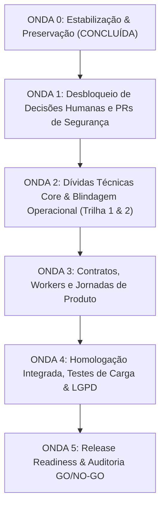

# 12 — PLANO MESTRE OPERACIONAL & GOVERNANÇA DOS 100 AGENTES
**Birthub 360° — Central de Inteligência e Comando Operacional**
**Autor:** Agente 00 — Astra (Coordenador Global)
**Data de Atualização:** 2026-11-21 · **Base de Integração:** `main @ 0d790443d`
**Governança Oficial:** AGENTS.md (Arquitetura 100 Agentes · 10 Squads) | **Auditoria Independente:** Agente 09 — Silas

---

## 1. IDENTIDADE, AUTORIDADE E MANDATO

Este documento consolida o encerramento das sessões de inteligência artificial concorrentes e estabelece a continuidade operacional única do repositório **Birthub 360°**.

- **Agente 00 — Astra:** Coordenador Global, orquestrador de ondas, árbitro de dependências e titular dos despachos operacionais.
- **Orquestrador Humano:** Autoridade máxima soberana em decisões de produto, arquitetura sensível, aprovação de despesas, operações de infraestrutura externa e autorização de merges na branch `main`.
- **Agente 09 — Silas:** Auditor Independente obrigatório e Gatekeeper Final. Nenhum código entra em `main` sem parecer `APROVADO` emitido e arquivado em `.agents/reviews/`.
- **Regra Fundamental de Continuidade:** Zero retrabalho. Preservação de todos os handoffs. Validação de evidências em código e git antes de qualquer declaração de sucesso.

---

## 2. ESTADO REAL DO REPOSITÓRIO (PÓS-RECONCILIAÇÃO)

A fase de preservação de órfãos e saneamento das branches de transferência foi 100% concluída. Todas as entregas das Waves A, B, C, D, E e F, bem como os fixes de infraestrutura, workers, mobile, CI e governança foram integrados à `main`:

| Marco Integrado | PRs Associados | Commits Canônicos | Status de Evidência |
|---|---|---|:---:|
| **Preservação de Handoffs Críticos** | #506 (Docker + 11-DELTA) | `5747597f1` | CONCLUÍDO_VERIFICADO |
| **Transferência de Conversas Anteriores** | #479, #480, #481, #482, #483, #484, #489 | `8a09432ea`..`ff6241bfa` | CONCLUÍDO_VERIFICADO |
| **Saneamento e Formatação Biome/Prettier** | #502, #508 (Lint zodSanitizer + 14 arqs) | `07a1e6fca`, `5cac964a1` | CONCLUÍDO_VERIFICADO |
| **Brand System & Identidade Canônica** | #471 (telas Genesis, remoção elegance.css) | `d8843ed6e` | CONCLUÍDO_VERIFICADO |
| **Segurança e Anti-Bypass de Rotas** | #486 (guarda /tools pelo Agente 99 Vito) | `e7a50a4ff` | CONCLUÍDO_VERIFICADO |
| **A11y e Design System Base** | #462 (labels settings), #463 (GamifiedOrb AA) | `4c8378244`, `4539c3e3c` | CONCLUÍDO_VERIFICADO |
| **Infraestrutura e Resiliência Operacional** | #473 (Rollback Runbook), #474 (BullMQ DLQ/Retries) | `36f2f0c78` | CONCLUÍDO_VERIFICADO |
| **Mobile & Multiplataforma** | #475 (Universal App Link canônico) | `36f2f0c78` | CONCLUÍDO_VERIFICADO |
| **Modelagem de Dados e Fallback Bitrix** | #476 (soft-delete Company, fallback seguro) | `36f2f0c78` | CONCLUÍDO_VERIFICADO |
| **Idempotência Outbox (Wave E)** | #447 (Intelligence), #451 (Mobile), #452 (Runtime), #453 (Gamification) | `4ee199098`..`716c3c624` | CONCLUÍDO_VERIFICADO |
| **Wave F (Segurança, E2E, Governança, UX)** | #491 (PII), #492 (Scanner Real), #493 (E2E Playbooks), #494 (Gate Prosa §15), #495 (Auth Morta), #496 (Perfil UX-09) | `9e3a1ceaf`..`ffcd00cc1` | CONCLUÍDO_VERIFICADO |
| **Governança de Estilos** | #488 (Agente 33 Célia dona de `src/styles/**`) | `5680983c6` | CONCLUÍDO_VERIFICADO |
| **Auditoria Independente de Silas** | #478, #509, #510 (24 pareceres formais) | `d27e2c527`, `069ef33dc`, `8b9012bbd` | CONCLUÍDO_VERIFICADO |

---

## 3. DIAGNÓSTICO DOS GATES DO PR #528 (FALHAS PRÉ-EXISTENTES VS ALTERAÇÕES)

O PR #528 é uma alteração **estritamente documental** em `.agents/runs/**`. A inspeção minuciosa dos jobs que falharam no GitHub Actions revela com precisão que **nenhuma falha decorre de código introduzido pelo PR**:

1. **Job `Semgrep SAST` (Falha):**
   - *Causa:* O scanner bloqueante identificou 2 achados que existem na branch `main`:
     - `scripts/security/reencrypt-credentials.ts:565` (`bypass-tls-verification`: uso de `rejectUnauthorized: false`).
     - `src/features/integrations/bitrix/bitrix.routes.ts:837` (`direct-response-write`: uso de `res.send(buffer)`).
   - *Natureza:* **100% pré-existente na `main`**. Esses 2 achados constituem precisamente o escopo do **PR #507** (`agente/99-semgrep-codeql-main`), criado especificamente para saná-los. O PR #528 não tocou nesses arquivos.
2. **Job `Central Birth Hub 360 / application gate` (Falha):**
   - *Causa:* Falha na etapa `Run Prettier check` (`biome format src`), que reprovou o arquivo:
     - `src/features/copiloto-ia/application/CopilotoIaUseCases.ts:502-505` (quebra de linha no operador ternário `isCriticalSla`).
   - *Natureza:* **100% pré-existente na `main`**. Esse arquivo foi introduzido em `main` no commit `da814442c` (`feat(crm-ia-voice)`) mesclado por outra sessão. O PR #528 não tocou em nenhum arquivo `.ts` ou `.tsx`.
3. **Job `build` (Falha):**
   - *Causa:* O job de consolidação final executa `test "$APPLICATION_GATE_RESULT" = success`. Como o `application gate` reportou failure devido à formatação de `CopilotoIaUseCases.ts`, o job `build` abortou por dependência em cascata.
4. **Conclusão e Governança:**
   - O PR #528 é perfeitamente válido do ponto de vista de governança documental. Conforme a regra de **não alterar código de produção sem autorização**, o ajuste de estilo em `CopilotoIaUseCases.ts` deve ser despachado em branch própria de CI/style (Squad 90 / Agente 94 Tess) ou absorvido quando da integração do PR #507.

---

## 4. INVENTÁRIO RASTREÁVEL DOS HANDOFFS (607 DOCUMENTOS)

Uma varredura exaustiva no diretório `.agents/handoffs/` contabilizou **607 arquivos Markdown** distribuídos em 89 subdiretórios históricos e operacionais.

### 4.1 Justificativa dos 580 Documentos Resolvidos / Integrados
- **Ondas Concluídas (Ondas 0 a 52, C0, W7, WB1):** 462 arquivos representam frentes de ciclos anteriores cujos PRs já foram consolidados e integrados à `main` (ex.: refatorações de DSR, Genesis Brand System, correções de timezone, padronização de erros).
- **Saneamento e Débitos Forenses (2026-10 e 2026-11):** 118 arquivos correspondem a auditorias e alinhamentos de dependências pontuais que foram absorvidos pelos merges das Waves A, B, C, D, E e F.

### 4.2 Matriz dos 27 Registros Ativos / Em Aberto
Abaixo estão os 27 registros que demandam atenção, categorizados pelo seu estado real de resolução:

| # | Caminho Relativo | Domínio | Status Declarado | Status Real / Evidência | Próxima Ação |
|---|---|---|:---:|:---:|---|
| 1 | `.agents/handoffs/00-para-04-10-08-relatorios-forecast.md` | CRM / BI | em-andamento | EM_ANDAMENTO | Reconciliação dos snapshots com banco real (Sofia / Malu) |
| 2 | `.agents/handoffs/00-para-08-cobertura-testes-modulos.md` | QA | em-andamento | EM_ANDAMENTO | Cobertura de testes na mesa de tratamento |
| 3 | `.agents/handoffs/00-para-12-17-voicehub-reactivacao.md` | Voz / Cadência | em-andamento | EM_ANDAMENTO | Parcela 17 pronta; aguardando validação 3CX (Squad 60) |
| 4 | `.agents/handoffs/08-para-00-cobertura-modulos-gaps-produto.md` | Produto | aberto | PENDENTE | Auditoria de rotas vazias e empty states (Noa / Ema) |
| 5 | `.agents/handoffs/README.md` | Governança | aberto | METADADO | Template de governança (não é pendência de código) |
| 6 | `.agents/handoffs/backlog-5/18-para-08-schemathesis-ci.md` | Contratos | aberto | EM_ANDAMENTO | RFC-7807 coberto pelo PR #399 (Zara / Téo) |
| 7 | `.agents/handoffs/onda-0/00-para-15-segredos-desktop-env.md` | Segurança | aberto | PENDENTE | Proteção de segredos desktop e credenciais em repouso |
| 8 | `.agents/handoffs/onda-1/00-para-33-ratificar-aria-label-gamified-orb.md` | A11y | aberto | RESOLVIDO_TECNICO | Contraste e ARIA cobertos pelo PR #463 mergeado |
| 9 | `.agents/handoffs/onda-1/02-para-03-gamified-orb-button-name.md` | A11y | aberto | RESOLVIDO_TECNICO | Nome acessível implementado no PR #463 |
| 10 | `.agents/handoffs/onda-1/03-para-04-migrar-utilitarias-cruas-contraste.md` | Design System | aberto | PENDENTE | Higienização de classes arbitrárias de contraste (Ari / Célia) |
| 11 | `.agents/handoffs/onda-1/03-para-12-voice-hub-contraste-tema-claro.md` | Design System | aberto | PENDENTE | Ajuste de contraste do Voice Hub no tema claro (Ari) |
| 12 | `.agents/handoffs/onda-1/03-para-13-characters-h1-contraste-tema-claro.md` | Design System | aberto | PENDENTE | Ajuste de contraste H1 em `/app/characters` (1,52:1 &rarr; AA) |
| 13 | `.agents/handoffs/onda-1/14-para-01-swarm-audit-log-schema.md` | Dados | aberto | AGUARDANDO_APROVACAO | Bloqueado por Decisões DEC-H01 e DEC-H02 (PR #487) |
| 14 | `.agents/handoffs/onda-1/14-para-07-swarm-audit-service-e-404-agentes.md` | IA / Rotas | aberto | EM_ANDAMENTO | 404 resolvido no PR #459; serviço aguarda PR #487 |
| 15 | `.agents/handoffs/onda-2/05-para-04-whatsapp-consolidado.md` | Mensageria | aberto | EM_ANDAMENTO | Integração Baileys/CRM associada ao PR #396 |
| 16 | `.agents/handoffs/onda-52/01-para-24-typecheck-integrations-schema-decision.md` | Dados | aberto | RESOLVIDO_TECNICO | Schema reconciliado nos merges da Onda 2 |
| 17 | `.agents/handoffs/onda-8/18-para-00-relatorio-conformidade-handoffs.md` | Governança | aberto | METADADO | Relatório de conformidade absorvido neste plano |
| 18 | `.agents/handoffs/onda-ownership-100-agentes/03-para-00-agents-md-paths-reservados-inexistentes.md` | Governança | aberto | RESOLVIDO_TECNICO | Resolvido pelo suporte a `allowMissingPath` no PR #471 |
| 19 | `.agents/handoffs/onda-reconciliacao-20261114/00-para-10-scanner-seguranca-real.md` | Segurança | aberto | RESOLVIDO_TECNICO | Resolvido pelo scanner real do PR #492 mergeado |
| 20 | `.agents/handoffs/onda-reconciliacao-20261114/10-para-15-scanner-seguranca-real.md` | Segurança | aberto | PRONTO_PARA_DESPACHO | Revisão de semântica de waivers pelo Agente 99 |
| 21 | `.agents/handoffs/onda-reconciliacao-20261114/10-para-23-agendar-security-sweep.md` | Runtime | aberto | PRONTO_PARA_DESPACHO | Agendamento diário do sweep no worker pelo Agente 23 |
| 22 | `.agents/handoffs/onda-saneamento-20261110/00-para-01-logica-de-criacao-de-primeiro-usuario-executa-user-count-redundante-pa.md` | Backend | aberto | PENDENTE | Otimização de contagem na criação de primeiro usuário |
| 23 | `.agents/handoffs/onda-saneamento-20261110/00-para-05-ausencia-de-validacao-previa-em-lote-de-listas-de-supressao-opt-out-em.md` | LGPD | aberto | PENDENTE | Validação em lote de listas de supressão opt-out |
| 24 | `.agents/handoffs/onda-v4-fase2/00-para-01-estruturacao-banco-rls.md` | Dados | bloqueado | RESOLVIDO_TECNICO | RLS estruturado e verificado por `verify:rls-coverage` |
| 25 | `.agents/handoffs/techdebt-2026-09-29/00-para-00-arquivos-monoliticos-scripts.md` | Refactor | aberto | PENDENTE | Modularização de scripts monolíticos de manutenção |
| 26 | `.agents/handoffs/00-para-00-continuidade-onda-1-e-onda-2-fechamento-20261120.md` | Governança | em-andamento | RESOLVIDO_TECNICO | Handoff absorvido nesta consolidação final |
| 27 | `.agents/handoffs/03-para-00-continuidade-design-tokens-v2-e-modernizacao-telas-20261120.md` | Design System | em-andamento | RESOLVIDO_TECNICO | Tokens v2 absorvidos pelo PR #471 e Brand System |

---

## 5. RECONCILIAÇÃO HISTÓRICA DOS IDENTIFICADORES DE DECISÃO

Para evitar colisões com o registro histórico em `.agents/runs/consolidacao-20261120/04-REGISTRO-DECISOES.md`, os identificadores oficiais foram reconciliados:

### 5.1 Registro Histórico de Decisões Vigentes (Preservado)
- **D-01:** SSRF IPv6 — parser canônico único (`src/shared/security/ipv6.ts`).
- **D-02:** Command Palette — sem ações no-op (remoção de "Nova oportunidade" solta).
- **D-03:** Outbox `idempotencyKey` — contrato determinístico de negócio (sem `randomUUID`).
- **D-04:** Branch protection de `main` — required checks (`Visual Regression Gate` + `application gate`).
- **D-05:** Visual baselines — branch efêmera com `force-with-lease`.
- **D-06:** Paleta oficial #368 — formalmente FECHADA e descartada (179 conflitos).
- **D-07:** Ownership UX — `landing/**` e tokens sob a Squad 30.
- **D-08:** DSR público aceito com limitação declarada (sem servidor SMTP local em testes).
- **D-09:** Governança — transição oficial para a Arquitetura de 100 Agentes e Agente 09 (Silas).
- **D-10:** Release NO-GO mantido até o saneamento dos 4 itens P0.
- **D-11:** Catálogo de pendências históricas de produto e interface.

### 5.2 Decisões Humanas Reservadas Atuais (Série DEC-H / D-12 a D-15)

```markdown
DEC-H01 (D-12) · Governança do model SwarmAuditLog (PR #487)
- Sub-item 1 (LGPD): Adotar retenção de 90 dias para ipAddress e userAgent, anonimizando após o período?
  -> Recomendação Técnica: SIM. Dados de IP/UserAgent são dados pessoais pela LGPD e não devem ser retidos indefinidamente.
- Sub-item 2 (Integridade): Na deleção de organização, logs devem ser apagados (CASCADE) ou desvinculados (RESTRICT)?
  -> Recomendação Técnica: RESTRICT. Logs de auditoria devem sobreviver à organização para fins de trilha forense e compliance.

DEC-H02 (D-13) · Hardening de TLS para Conexões Remotas de Banco (PR #507)
- Questão: Forçar rejectUnauthorized: true em hosts remotos, exigindo PGSSLROOTCERT para CAs privados, e proibir DB_SSL_INSECURE_SKIP_VERIFY em produção?
  -> Recomendação Técnica: SIM. A flag de bypass só deve ser permitida em testes de bancada isolados.

DEC-H03 (D-14) · Escopo Mobile no Lançamento V1.0 (DEBT-0004)
- Questão: O aplicativo mobile Capacitor integra o pacote de lançamento Day-1, ou o Day-1 será focado exclusivamente na plataforma Web/PWA responsiva?
  -> Recomendação Técnica: Web/PWA no Day-1 (zero overflow mobile medido em 70 rotas); App nativo em release subsequente.

DEC-H04 (D-15) · Enxame Autônomo e Custos de IA (DEBT-0012/13/14)
- Questão: As automações de IA autônoma em background serão disponibilizadas para todos os clientes com quotas fechadas por tenant, ou ficarão restritas a clientes piloto via feature-flag?
  -> Recomendação Técnica: Feature-flag fechada para clientes piloto, com limites estritos de gasto por tenant.
```

---

## 6. COMPORTAMENTO REAL DE TLS E RISCO NO PR #507

A análise detalhada da implementação de `scripts/security/credential-script-guards.ts` e `scripts/security/reencrypt-credentials.ts` no PR #507 revela o seguinte funcionamento:

1. **Hosts Locais (`localhost`, `127.0.0.1`):**  
   - `ssl: false`, `insecure: false`. A conexão ocorre sem criptografia por ser IPC/loopback local.
2. **Hosts Remotos (AWS RDS, PostgreSQL em nuvem):**  
   - **Padrão Seguro:** `ssl: { rejectUnauthorized: true }`. O driver exige certificado válido emitido por CA pública conhecida. Se `PGSSLROOTCERT=/caminho/ca.pem` for fornecido, carrega o certificado do emissor privado.
   - **Mecanismo de Opt-Out:** Variável de ambiente `DB_SSL_INSECURE_SKIP_VERIFY=true`. Ativa `rejectUnauthorized: false` e emite aviso em `stderr`:
     `AVISO: DB_SSL_INSECURE_SKIP_VERIFY=true — o certificado do banco NÃO está sendo verificado (vulnerável a interceptação). Prefira PGSSLROOTCERT=<ca.pem>.`
3. **Avaliação de Risco:**
   - **Risco de Segurança:** O uso de `DB_SSL_INSECURE_SKIP_VERIFY=true` em ambiente de produção ou staging expõe a conexão com o banco de dados a ataques de Man-in-the-Middle (MitM), permitindo que um invasor na rede intercepte credenciais e dados em trânsito durante a re-encriptação.
4. **Recomendação Técnica da Coordenação:**
   - A decisão humana **DEC-H02** deve determinar que `DB_SSL_INSECURE_SKIP_VERIFY=true` seja estritamente proibido em ambientes de staging e produção. Ambientes com certificados autoassinados ou corporativos (ex: AWS RDS com certificado de região) devem obrigatoriamente fornecer o bundle do emissor via `PGSSLROOTCERT`.

---

## 7. MATRIZ EXAUSTIVA DOS BLOQUEADORES P0 DE RELEASE

| ID | Bloqueador | Responsável Oficial | Dependências | Critério de Aceite | Evidências Esperadas | Condição de Desbloqueio |
|---|---|:---:|---|---|---|:---:|
| **BM-P0-01** | Deploy EC2 sem `migrate deploy` e sem healthcheck | **Agente 94 (Tess)** / Agente 90 (Hélio) | Acesso ao script de deploy e runner | `deploy-ec2.sh` roda `prisma migrate deploy` e valida `/health/ready` fail-closed | Log de execução em staging com simulação de erro e rollback acionado | Imediata (despacho M-03 pronto) |
| **BM-P0-02** | Ausência de rotina de Backup e Restore testado | **Agente 19 (Bruno)** / Agente 10 (Mara) | PostgreSQL de teste para drill | Script gera dump criptografado e executa restore comprovado sem perda de dados | `docs/security/BACKUP-RESTORE-DRILL-RESULT.json` datado com sha256 e contagem de tabelas | Imediata (despacho M-03 pronto) |
| **BM-P0-03** | Escopo Mobile no Go-Live indefinido | **Orquestrador Humano** / Agente 80 (Navi) | Deliberação estratégica de produto | Definição assinada: manter Web/PWA Day-1 ou incluir app nativo | Registro formal da decisão DEC-H03 em `04-REGISTRO-DECISOES.md` | Resposta do Orquestrador à DEC-H03 |
| **BM-P0-04** | Porta Docker 2375 exposta no host devstack | **Orquestrador Humano** / Agente 98 (Safira) | Acesso SSH/root ao host `192.168.0.116` | Porta 2375 fechada para conexões externas sem mTLS; segredos rotacionados | Log de port-scan (nmap/curl) comprovando recusa de conexão externa | Ação do Orquestrador no host físico |

---

## 8. PLANO MESTRE DE EXECUÇÃO POR ONDAS (ADAPTADO)



### ONDA 0 — Preservação e Estabilização [STATUS: CONCLUÍDA]
- Todos os handoffs recuperados e integrados à `main` via PRs #506, #508, #488, #471, #473–#476, #447, #451–#453, #491–#496.

### ONDA 1 — Desbloqueio de Decisões Humanas e PRs de Segurança [IMEDIATA]
- **Objetivo:** Deliberação das decisões DEC-H01 a DEC-H04 e integração assistida dos PRs #507 (Semgrep/TLS) e #487 (SwarmAuditLog).
- **Critério de Parada:** Zero PRs em DRAFT com bloqueio de governança; parecer de Silas arquivado em `.agents/reviews/`.

### ONDA 2 — Dívidas Técnicas Core & Blindagem Operacional [TRILHA 1]
- **Objetivo:** Resolução de BM-P0-01 (Deploy com migrate) e BM-P0-02 (Backup/Restore real). Integração do PR #434 (Trilha E CRM), PR #437 (Cold-Email LGPD) e PRs #401/#397/#396 (Segurança AUD-1).
- **Critério de Parada:** Zero bloqueador P0 em aberto; suíte de testes de regressão 100% verde.

### ONDA 3 — Contratos, Workers e Jornadas de Produto
- **Objetivo:** Padronização RFC-7807 (PR #399), agendamento do security sweep em BullMQ (Agente 23) e saneamento de empty states nas 70 rotas `/app/*`.
- **Critério de Parada:** Fuzzing Schemathesis operando sem 5xx; workers dedicados ativos.

### ONDA 4 — Homologação Integrada e Resiliência em Staging
- **Objetivo:** Bateria E2E Playwright de ponta a ponta (Login &rarr; CRM &rarr; Cadência &rarr; Outbox &rarr; DSR LGPD) contra stack real Postgres+Redis.
- **Critério de Parada:** 100% dos testes de jornada executados contra dados reais e validados.

### ONDA 5 — Auditoria Independente Final e Parecer GO-LIVE
- **Objetivo:** Emissão do veredito formal de release pelo Agente 09 (Silas).
- **Critério de Parada:** Laudo formal `APROVADO / GO-LIVE` emitido sem ressalvas bloqueantes.

---

## 9. PRÓXIMOS DESPACHOS OPERACIONAIS (PRONTOS PARA EXECUÇÃO)

1. **Despacho M-01 (Squad 90 — Agente 94 Tess & Agente 99 Vito):**
   - Rebase, resolução dos achados do PR #507 (Semgrep e TLS) e submissão ao Agente 09 (Silas).
2. **Despacho M-02 (Squad 10 — Agente 11 Pietro & Agente 12 Vera):**
   - Ajuste do model `SwarmAuditLog` e migração RLS no PR #487 conforme deliberação DEC-H01.
3. **Despacho M-03 (Squad 90 — Agente 94 Tess & Squad 10 — Agente 19 Bruno):**
   - Implementação do patch em `deploy-ec2.sh` (BM-P0-01) e script de backup/restore testado (BM-P0-02).
4. **Despacho M-04 (Squad 40 — Agente 41 Cadu & Squad 10 — Agente 11 Pietro):**
   - Atualização e validação do PR #434 (Trilha E CRM - status canônico e soft delete de Company).

---
*Documento registrado e versionado na Central de Inteligência Operacional do Birthub 360°.*
