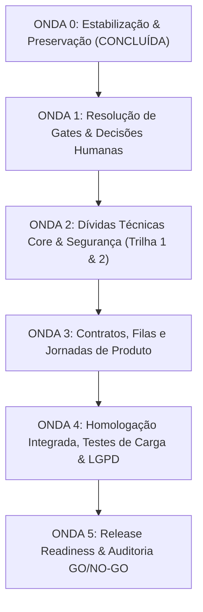

# 12 — PLANO MESTRE OPERACIONAL & GOVERNANÇA DOS 100 AGENTES
**Birthub 360° — Central de Inteligência e Comando Operacional**
**Autor:** Agente 00 — Astra (Coordenador Global)
**Data de Atualização:** 2026-11-21 · **Base de Integração:** `main @ 23ea16de5`
**Governança Oficial:** AGENTS.md (Arquitetura 100 Agentes · 10 Squads) | **Auditoria Independente:** Agente 09 — Silas

---

## 1. IDENTIDADE, AUTORIDADE E MANDATO

Este documento consolida o encerramento das sessões de inteligência artificial concorrentes e estabelece a continuidade operacional única do repositório **Birthub 360°**.

- **Agente 00 — Astra:** Coordenador Global, orquestrador de ondas, árbitro de dependências e titular dos despachos operacionais.
- **Orquestrador Humano:** Autoridade máxima soberana em decisões de produto, arquitetura sensível, aprovação de despesas, operações de infraestrutura externa e autorização de merges na branch `main`.
- **Agente 09 — Silas:** Auditor Independente obrigatório e Gatekeeper Final. Nenhum código entra em `main` sem parecer `APROVADO` emitido e arquivado em `.agents/reviews/`.
- **Regra Fundamental de Continuidade:** Zero retrabalho. Preservação de todos os handoffs. Validação de evidências em código e git antes de qualquer declaração de sucesso.

---

## 2. ESTADO REAL DO REPOSITÓRIO (PÓS-RECONCILIAÇÃO)

A fase de preservação de órfãos e saneamento das branches de transferência foi 100% concluída. Todas as entregas das Waves A, B, C, D, E e F, bem como os fixes de infraestrutura, workers, mobile, CI e governança foram integrados à `main`:

| Marco Integrado | PRs Associados | Commits Canônicos | Status de Evidência |
|---|---|---|:---:|
| **Preservação de Handoffs Críticos** | #506 (Docker + 11-DELTA) | `5747597f1` | CONCLUÍDO_VERIFICADO |
| **Transferência de Conversas Anteriores** | #479, #480, #481, #482, #483, #484, #489 | `8a09432ea`..`ff6241bfa` | CONCLUÍDO_VERIFICADO |
| **Saneamento e Formatação Biome/Prettier** | #502, #508 (Lint zodSanitizer + 14 arqs) | `07a1e6fca`, `5cac964a1` | CONCLUÍDO_VERIFICADO |
| **Brand System & Identidade Canônica** | #471 (telas Genesis, remoção elegance.css) | `d8843ed6e` | CONCLUÍDO_VERIFICADO |
| **Segurança e Anti-Bypass de Rotas** | #486 (guarda /tools pelo Agente 99 Vito) | `e7a50a4ff` | CONCLUÍDO_VERIFICADO |
| **A11y e Design System Base** | #462 (labels settings), #463 (GamifiedOrb AA) | `4c8378244`, `4539c3e3c` | CONCLUÍDO_VERIFICADO |
| **Infraestrutura e Resiliência Operacional** | #473 (Rollback Runbook), #474 (BullMQ DLQ/Retries) | `36f2f0c78` | CONCLUÍDO_VERIFICADO |
| **Mobile & Multiplataforma** | #475 (Universal App Link canônico) | `36f2f0c78` | CONCLUÍDO_VERIFICADO |
| **Modelagem de Dados e Fallback Bitrix** | #476 (soft-delete Company, fallback seguro) | `36f2f0c78` | CONCLUÍDO_VERIFICADO |
| **Idempotência Outbox (Wave E)** | #447 (Intelligence), #451 (Mobile), #452 (Runtime), #453 (Gamification) | `4ee199098`..`716c3c624` | CONCLUÍDO_VERIFICADO |
| **Wave F (Segurança, E2E, Governança, UX)** | #491 (PII), #492 (Scanner Real), #493 (E2E Playbooks), #494 (Gate Prosa §15), #495 (Auth Morta), #496 (Perfil UX-09) | `9e3a1ceaf`..`ffcd00cc1` | CONCLUÍDO_VERIFICADO |
| **Governança de Estilos** | #488 (Agente 33 Célia dona de `src/styles/**`) | `5680983c6` | CONCLUÍDO_VERIFICADO |
| **Auditoria Independente de Silas** | #478, #509, #510 (24 pareceres formais) | `d27e2c527`, `069ef33dc`, `8b9012bbd` | CONCLUÍDO_VERIFICADO |

---

## 3. INVENTÁRIO E CLASSIFICAÇÃO DOS HANDOFFS

Foram mapeados **605 arquivos de handoff** em `.agents/handoffs/`. Destes, a grande maioria representa histórico superado ou concluído de ciclos anteriores (Waves A a E). A triagem ativa identificou as seguintes frentes em aberto que compõem o Backlog Mestre:

1. **`14-para-01-swarm-audit-log-schema.md` / PR #487 (DRAFT):**  
   - *Status:* `AGUARDANDO_APROVACAO` (Bloqueado por 2 decisões humanas: LGPD sobre IP/UserAgent e integridade `onDelete: Cascade` vs `RESTRICT`).
   - *Domínio:* Squad 10 (Pietro/Vera) & Squad 00 (Íris/Silas).
2. **`10-para-23-agendar-security-sweep.md` (novo do PR #492):**  
   - *Status:* `PRONTO_PARA_DESPACHO`. Agendar o sweep periódico de segurança no BullMQ worker (`src/workers/`) respeitando a modularidade de `securitySweepScanner.ts`.
   - *Domínio:* Squad 20 (Pina Agente 23).
3. **`10-para-15-scanner-seguranca-real.md` (novo do PR #492):**  
   - *Status:* `PRONTO_PARA_DESPACHO`. Revisão de semântica de waivers GHSA/CVE e rating de compliance.
   - *Domínio:* Squad 90 (Vito Agente 99 / Safira Agente 98).
4. **`00-para-04-10-08-relatorios-forecast.md`:**  
   - *Status:* `EM_ANDAMENTO`. Reconciliação dos snapshots semanais com banco real sem heurística em memória.
   - *Domínio:* Squad 40 (Sofia Agente 46 / Malu Agente 49).
5. **`00-para-12-17-voicehub-reactivacao.md`:**  
   - *Status:* `EM_ANDAMENTO` (Parcela 17 concluída; falta validação de sinalização de áudio 3CX pelo Squad 60).
   - *Domínio:* Squad 60 (Aurora Agente 60 / Nando Agente 61).
6. **`08-para-00-cobertura-modulos-gaps-produto.md`:**  
   - *Status:* `PENDENTE`. Auditoria de rotas vazias e jornadas com empty states incompletos.
   - *Domínio:* Squad 30 (Ema Agente 32) & Squad 00 (Luma Agente 05).
7. **`18-para-08-schemathesis-ci.md` / PR #399:**  
   - *Status:* `EM_ANDAMENTO`. Validação do contrato RFC-7807 e execução contínua de fuzzing Schemathesis.
   - *Domínio:* Squad 20 (Zara Agente 21) & Squad 00 (Téo Agente 04).

---

## 4. MATRIZ DE DE-PARA: ROSTER LEGADO → ARQUITETURA 100 AGENTES

| Papel / Domínio | ID Legado | Squad Novo | Agente Oficial (100) | Nome | Arquivos / Responsabilidade |
|---|:---:|:---:|:---:|---|---|
| Coordenador Global | 00 | Squad 00 | **00** | **Astra** | Orquestração, ondas, AGENTS.md, package.json |
| Auditor Independente | 24 | Squad 00 | **09** | **Silas** | Auditoria final, `.agents/reviews/**` (VETO POWER) |
| QA & Test Harness | 08 / 14 | Squad 00 | **01 / 02** | **Ória / Bento** | Protocolos de teste, mocks, vitest configs |
| Testes Unitários | 08 | Squad 00 | **03** | **Nina** | Suítes `vitest.unit`, cobertura estrutural |
| Testes Integração / Contratos | 08 / 18 | Squad 00 | **04** | **Téo** | Suítes `vitest.integration`, Schemathesis |
| Automação E2E / Visual | 08 / 03 | Squad 00 | **05** | **Luma** | Playwright, regressão visual, fluxos reais |
| Verificação de Realidade | 22 | Squad 00 | **06** | **Gael** | Persistência real, anti-mocking em prod |
| LGPD & Privacidade | 21 | Squad 00 | **07** | **Íris** | Guardrails PII, bases legais, DSR |
| Anonimização & Expurgo | 21 / 01A | Squad 00 | **08** | **Dora** | Sanitização ponta a ponta, expurgo seguro |
| Schema Prisma | 01 | Squad 10 | **11** | **Pietro** | `prisma/schema.prisma` |
| Migrações & Rollouts | 01 | Squad 10 | **12** | **Vera** | `prisma/migrations/**`, zero downtime |
| Multi-Tenancy & RLS | 01 / 01A | Squad 10 | **13** | **Nilo** | Políticas RLS, `scripts/security/check-rls*` |
| Seeds & Ambientes | 01A | Squad 10 | **14** | **Bia** | `prisma/seed.ts`, fixtures sintéticas |
| Retenção & Expurgo Banco | 01A | Squad 10 | **15** | **Olavo** | Jobs de expurgo no banco, retention workers |
| Query Tuning & N+1 | 01A | Squad 10 | **16** | **Cora** | Índices, queries Prisma, otimização |
| Cache & Redis | 16 | Squad 10 | **17** | **Remo** | Redis locks, estratégias de cache |
| Integridade & Backup | 10 | Squad 10 | **19** | **Bruno** | `scripts/security/backup-database.ts`, DR |
| Backend & Contratos | 00 / 18 | Squad 20 | **20** | **Ciro** | Coordenador de Backend e APIs |
| OpenAPI & Schemas Zod | 18 | Squad 20 | **21** | **Zara** | `docs/openapi.yaml`, contratos Zod |
| Camada HTTP & Rotas | 00 / 02 | Squad 20 | **22** | **Hugo** | `src/bootstrap/routes.ts`, middlewares |
| Runtime & Filas BullMQ | 16 | Squad 20 | **23** | **Pina** | `src/lib/queue/**`, `src/workers/**` |
| Resiliência & DLQ | 16 | Squad 20 | **24** | **Ivo** | Retries, Dead-Letter Queues, idempotência |
| App Shell & Rotas Frontend | 02 | Squad 30 | **31** | **Noa** | `src/App.tsx`, sidebar, navegação principal |
| Design System & Estilos | 03 | Squad 30 | **33** | **Célia** | `src/components/ui/**`, `src/styles/**` |
| Acessibilidade WCAG 2.2 | 03 | Squad 30 | **34** | **Ari** | ARIA, contraste, navegação por teclado |
| Motion & Microinterações | 03 | Squad 30 | **35** | **Mia** | Framer Motion, reduced motion |
| Landing & Conversão | 03 / 11 | Squad 30 | **36** | **Léo** | `landing/**`, SEO, identity |
| CRM Core (Leads/Deals) | 04 | Squad 40 | **41 / 42** | **Cadu / Lívia** | `src/features/crm/**`, kanban, pipeline |
| Cadências Comerciais | 17 | Squad 40 | **44** | **Lola** | `src/features/cadence/**`, réguas de contato |
| Integrações Bitrix24 | 06 / 06A | Squad 50 | **51–54** | **Bela / Lino / Vega / Rita** | `src/features/integrations/bitrix/**` |
| WhatsApp & Omnichannel | 06 | Squad 50/60 | **56 / 66** | **Luna / Kiko** | Baileys, Meta API, Inbox |
| Telefonia VoIP / 3CX | 12 | Squad 60 | **61 / 62** | **Nando / Sol** | WebRTC, SIP, gravação de áudio |
| IA & Enxame Autônomo | 07 / 13 | Squad 70 | **71–74** | **Clara / Ada / Numa / Luca** | `src/features/ai-*`, copilotos, prompts |
| Guardrails de IA | 07 | Squad 70 | **77** | **Gaia** | PII redaction, jailbreak guards |
| Mobile & Capacitor | 09 | Squad 80 | **81–86** | **Enzo / Davi / Ceci / Bóris** | `capacitor.config.ts`, `android/**`, `ios/**` |
| Infraestrutura AWS & Deploy | 10 | Squad 90 | **91 / 94** | **Terra / Tess** | Terraform, deploy scripts, CI/CD |
| AppSec & Secret Scanning | 15 | Squad 90 | **98 / 99** | **Safira / Vito** | Rotação de chaves, Semgrep, Trivy |

---

## 5. BACKLOG MESTRE UNIFICADO (PRIORIZADO)

### P0 — Crítica (Bloqueadores Reais de Lançamento e Integridade)
- **BM-P0-01 (DEBT-0001):** Deploy EC2 sem `migrate deploy` e sem healthcheck fail-closed.  
  - *Dono:* Agente 94 (Tess) / Agente 90 (Hélio). *Arquivos:* `deploy-ec2.sh`, `docs/deploy/*`.  
  - *Critério de Aceite:* `deploy-ec2.sh` executa obrigatoriamente a migração do Prisma e valida `/health/ready` antes de chavear tráfego.
- **BM-P0-02 (DEBT-0002):** Rotina de Backup/Restore automatizada com evidência de restauração.  
  - *Dono:* Agente 19 (Bruno) / Agente 10 (Mara). *Arquivos:* `scripts/security/backup-database.ts`.  
  - *Critério de Aceite:* Script gera dump criptografado e executa restore comprovado em banco descartável com relatório versionado.
- **BM-P0-03 (DEBT-0004):** Decisão formal sobre o escopo do aplicativo Mobile no lançamento.  
  - *Dono:* Orquestrador Humano / Agente 80 (Navi).  
  - *Critério de Aceite:* Deliberação assinada: manter no Go-Live com backend e biometria validados OU desacoplar do Day-1.
- **BM-P0-04 (SEC-HOST-01):** Remoção de exposição da porta Docker `192.168.0.116:2375` e rotação de segredos devstack.  
  - *Dono:* Orquestrador Humano / Agente 98 (Safira).  
  - *Critério de Aceite:* Porta não acessível externamente sem TLS mútuo; chaves de dev/staging rotacionadas.

### P1 — Alta (Funcionalidades Essenciais, Segurança e Qualidade)
- **BM-P1-01 (PR #487):** Desbloqueio e integração do model `SwarmAuditLog` e migração RLS.  
  - *Dono:* Agente 11 (Pietro) / Agente 12 (Vera) / Agente 07 (Íris).  
  - *Critério de Aceite:* Decisão humana validada (retenção 90 dias com anonimização; integridade CASCADE vs RESTRICT); parecer favorável de Silas.
- **BM-P1-02 (PR #507):** Resolução de achados estáticos de segurança (Semgrep/CodeQL) em main.  
  - *Dono:* Agente 99 (Vito) / Agente 55 (Ícaro).  
  - *Critério de Aceite:* Verificação de TLS em conexões remotas de banco; sanitização recursiva de e-mail; zero erros nos scanners.
- **BM-P1-03 (PR #434 - DEBT-0017/18/19):** CRM Trilha E (status canônico de mesa, isolamento de tenant em Contact e soft delete de Company).  
  - *Dono:* Agente 41 (Cadu) / Agente 11 (Pietro).  
  - *Critério de Aceite:* Não permitir exclusão física de Company com entidades vinculadas; tenantId validado em todas as mutações.
- **BM-P1-04 (PR #437 - DEBT-0011):** Persistência e deduplicação de cold-email com trilha LGPD.  
  - *Dono:* Agente 43 (Amon) / Agente 07 (Íris).  
  - *Critério de Aceite:* Registro de disparo com base legal no banco e respeito a listas de opt-out.
- **BM-P1-05 (PR #401 - AUD-1):** SSRF Guard no crawler/scraper e RBAC na rota `/enrich`.  
  - *Dono:* Agente 97 (Rocco) / Agente 99 (Vito).  
  - *Critério de Aceite:* Bloqueio comprovado de 169.254.169.254 e faixas privadas; rota protegida por permissão admin/analista.
- **BM-P1-06 (PR #397 - AUD-1):** Hardening de cookies de sessão (`SECURE_COOKIES` secure-by-default) e sanitização global.  
  - *Dono:* Agente 96 (Nera) / Agente 22 (Hugo).  
  - *Critério de Aceite:* Flag `Secure` e `SameSite=Lax/Strict` forçados em produção.
- **BM-P1-07 (PR #396 - AUD-1):** Sanitização de erro de provider Bitrix, 501 honesto no sync e RBAC nas rotas WhatsApp.  
  - *Dono:* Agente 53 (Vega) / Agente 56 (Luna).  
  - *Critério de Aceite:* Falha de terceiro não vaza stack trace nem PII; rotas de WhatsApp protegidas por tenant e role.

### P2 — Média (Confiabilidade, Contratos de API e Desempenho)
- **BM-P2-01 (PR #399):** Envelope de erro unificado (RFC-7807), contrato Zod e runner Schemathesis.  
  - *Dono:* Agente 21 (Zara) / Agente 04 (Téo).  
  - *Critério de Aceite:* Respostas de erro padronizadas em todas as rotas da API; testes de contrato passando.
- **BM-P2-02 (PR #403):** Correção de testes flaky E2E e de integração na suíte contínua.  
  - *Dono:* Agente 02 (Bento) / Agente 05 (Luma).  
  - *Critério de Aceite:* Execução determinística da suíte em CI sem necessidade de retries aleatórios.
- **BM-P2-03 (PR #386):** Saneamento final de handoffs de QA.  
  - *Dono:* Agente 01 (Ória).  
  - *Critério de Aceite:* Matriz de testes de QA 100% conciliada com os novos endpoints.
- **BM-P2-04 (Handoff 10→23):** Agendamento periódico do `securitySweepScanner` no BullMQ worker.  
  - *Dono:* Agente 23 (Pina).  
  - *Critério de Aceite:* Job diário disparado via BullMQ que executa audit/SBOM sem bloquear a thread principal.

### P3 — Baixa (Refinamentos Visuais e Documentação)
- **BM-P3-01 (PR #367 & #353):** Arquivamento e consolidação de matrizes de documentação de integrações.  
  - *Dono:* Agente 39 (Tina) / Agente 50 (Atlas).
- **BM-P3-02 (Dependabot):** Atualização agrupada de dependências dev/runtime (PRs #497 a #501).  
  - *Dono:* Agente 94 (Tess).

---

## 6. PLANO MESTRE DE EXECUÇÃO POR ONDAS



### ONDA 0 — PRESERVAÇÃO E ESTABILIZAÇÃO (STATUS: 100% CONCLUÍDA)
- **Objetivo:** Recuperar arquivos órfãos, resolver conflitos de branches e unificar a memória em Git.
- **Entregas Realizadas:** PRs #479, #480, #481, #482, #483, #484, #489, #506, #508, #488, #471, #473-#476, #447, #451-#453, #491-#496 integrados à `main`.
- **Resultado:** Zero risco de perda de contexto; linter e testes de arquitetura 100% verdes na `main`.

### ONDA 1 — DESBLOQUEIO DE DECISÕES HUMANAS E CI (IMEDIATA)
- **Objetivo:** Obter deliberações do Orquestrador Humano para destravar os PRs em DRAFT e unificar a esteira de CI.
- **Missões:**
  1. *Decisão Humana D-01:* Aprovação da política do PR #487 (SwarmAuditLog: retenção 90 dias; CASCADE vs RESTRICT).
  2. *Decisão Humana D-02:* Aprovação da estratégia de TLS no PR #507 (skip verify apenas para dev local com opt-out explícito).
  3. *Decisão Humana D-03:* Escopo Mobile oficial para o Go-Live (Day-1 vs Day-30).
  4. *Integração do PR #507 e #487* após parecer de Silas (Agente 09).
- **Critério de Parada:** Zero PRs em DRAFT com bloqueio de governança.

### ONDA 2 — DÍVIDAS TÉCNICAS CORE & SEGURANÇA APLICADA (SQUADS 10, 20, 90)
- **Objetivo:** Sanear integridade de banco de dados, deploy automatizado e blindagem de rotas.
- **Missões:**
  1. *Agente 94 (Tess) & Agente 90 (Hélio):* Atualização de `deploy-ec2.sh` com migrate deploy fail-closed e healthcheck `/health/ready` (BM-P0-01).
  2. *Agente 19 (Bruno) & Agente 10 (Mara):* Implementação e ensaio real de backup/restore criptografado (BM-P0-02).
  3. *Agente 41 (Cadu) & Agente 11 (Pietro):* Integração do PR #434 (Trilha E CRM - status canônico e soft delete de Company).
  4. *Agente 43 (Amon) & Agente 07 (Íris):* Integração do PR #437 (Persistência cold-email com trilha LGPD).
  5. *Agente 97 (Rocco) & Agente 99 (Vito):* Integração dos PRs de segurança AUD-1 (#401, #397, #396).
- **Critério de Parada:** Todas as dívidas P0 e P1 de infraestrutura e dados eliminadas com testes de regressão verdes.

### ONDA 3 — CONTRATOS, WORKERS E JORNADAS DE PRODUTO (SQUADS 20, 30, 40, 50)
- **Objetivo:** Estabilizar contratos de API, consumo assíncrono de eventos e eliminar inconsistências de UI.
- **Missões:**
  1. *Agente 21 (Zara) & Agente 04 (Téo):* Integração do PR #399 (Envelope RFC-7807 + Schemathesis contínuo).
  2. *Agente 23 (Pina):* Agendamento do sweep diário no BullMQ (Handoff 10→23).
  3. *Agente 31 (Noa) & Agente 33 (Célia):* Auditoria de consistência das 70 rotas `/app/*` e empty states honestos.
  4. *Agente 44 (Lola) & Agente 46 (Sofia):* Fechamento da reconciliação de forecast e cadência sem dados simulados.
- **Critério de Parada:** Zero chamada de API fora do contrato RFC-7807; workers de mensageria 100% dedicados.

### ONDA 4 — HOMOLOGAÇÃO INTEGRADA, RESILIÊNCIA E LGPD (SQUAD 00)
- **Objetivo:** Execução das suítes de ponta a ponta contra ambientes de dados reais (sem mocks de produto).
- **Missões:**
  1. *Agente 05 (Luma):* Execução de E2E crítico (Login → Cadastros CRM → Cadência → Outbox → DSR LGPD).
  2. *Agente 06 (Gael):* Auditoria forense de persistência real e ausência de dados órfãos pós-exclusão.
  3. *Agente 07 (Íris) & Agente 08 (Dora):* Auditoria de ponta a ponta dos canais de opt-out e expurgo programado.
  4. *Agente 02 (Bento):* Integração do PR #403 (eliminação de flakiness em testes).
- **Critério de Parada:** 100% dos testes E2E e de integração passando em stack real Postgres+Redis.

### ONDA 5 — AUDITORIA INDEPENDENTE FINAL E PARECER GO/NO-GO
- **Objetivo:** Emissão do veredito formal de release pelo Agente 09 (Silas).
- **Missões:**
  1. *Agente 09 (Silas):* Auditoria integral dos critérios do GO-LIVE checklist.
  2. *Agente 00 (Astra):* Apresentação do Dossiê Final de Release ao Orquestrador Humano.
- **Critério de Parada:** Parecer formal `APROVADO / GO-LIVE` emitido sem ressalvas bloqueantes.

---

## 7. MATRIZ DE RISCOS ATUALIZADA

| ID | Risco Identificado | Severidade | Probabilidade | Impacto | Mitigação / Plano de Ação | Responsável |
|---|---|:---:|:---:|:---:|---|:---:|
| **R-01** | Deploy em produção sem migração de banco | **CRÍTICA** | Média | Alto | BM-P0-01: Inclusão obrigatória de `prisma migrate deploy` em `deploy-ec2.sh` fail-closed | Agente 94 (Tess) |
| **R-02** | Perda irreversível de dados em incidente de banco | **CRÍTICA** | Baixa | Extremo | BM-P0-02: Automação de dump diário e drill de restore testado em banco descartável | Agente 19 (Bruno) |
| **R-03** | Vulnerabilidade de XSS ou bypass de TLS | **ALTA** | Baixa | Alto | BM-P1-02 (PR #507): Verificação estrita de certificados e sanitização recursiva de HTML | Agente 99 (Vito) |
| **R-04** | Violação de LGPD por persistência indevida de PII | **ALTA** | Média | Alto | PR #487: Política de retenção de 90 dias com job automático de anonimização | Agente 07 (Íris) |
| **R-05** | Inconsistência de multi-tenancy em deleção de empresa | **MÉDIA** | Baixa | Médio | PR #434: Substituição de hard-delete por soft-delete em `Company` | Agente 41 (Cadu) |
| **R-06** | Falhas transitórias e flakiness em CI bloqueando merges | **MÉDIA** | Média | Baixo | PR #403: Reestabilização dos timers e fixtures do Playwright | Agente 02 (Bento) |

---

## 8. REGISTRO DE DECISÕES HUMANAS RESERVADAS

As seguintes decisões são prerrogativa exclusiva do **Orquestrador Humano**:

```
DECISÃO D-01: Governança do model SwarmAuditLog (PR #487)
- Questão 1 (LGPD): Adotar retenção de 90 dias para ipAddress e userAgent, anonimizando após o período? [Recomendação: SIM]
- Questão 2 (Integridade): Manter onDelete: Cascade ao deletar organização, ou preservar auditoria desvinculada (RESTRICT)? [Recomendação: RESTRICT]

DECISÃO D-02: Hardening de TLS para Conexões Remotas de Banco (PR #507)
- Questão: Forçar rejeição de certificados autoassinados em conexões não-locais, exigindo PGSSLROOTCERT para certificados privados? [Recomendação: SIM]

DECISÃO D-03: Escopo Mobile para o Lançamento V1.0 (DEBT-0004)
- Questão: O aplicativo mobile Capacitor integra o pacote de lançamento Day-1, ou o Day-1 será focado exclusivamente na plataforma Web/PWA responsiva? [Recomendação: Web/PWA no Day-1; Mobile App em release subsequente]

DECISÃO D-04: Enxame Autônomo e Custos de IA (DEBT-0012/13/14)
- Questão: As funcionalidades de IA autônoma em background serão disponibilizadas com quotas estritas por tenant no lançamento, ou permanecerão em feature-flag fechada para clientes piloto? [Recomendação: Feature-flag para pilotos com quotas fechadas]
```

---

## 9. CHECKLIST MESTRE DE PRONTIDÃO DE LANÇAMENTO (RELEASE READINESS)

- [x] **Governança:** AGENTS.md e MATRIZ_PROPRIEDADE.md atualizados para 100 Agentes.
- [x] **Gate de Propriedade:** `verify:ownership-coverage` validado (23 escopos íntegros).
- [x] **Qualidade Estática:** `biome lint` e `biome format` sem erros em 2422 arquivos.
- [x] **Idempotência Outbox:** DomainEventMesh com idempotencyKey determinística em todos os domínios core.
- [x] **Scanner de Segurança:** `ContinuousSecurityAuditService` operando com scanner real (CycloneDX + npm audit).
- [x] **Acessibilidade Básica:** Contraste do GamifiedOrb e labels de configurações em conformidade WCAG 2.2 AA.
- [ ] **Deploy Resiliente:** Script `deploy-ec2.sh` com migrate deploy e healthcheck fail-closed validado.
- [ ] **Backup e Recuperação:** Teste de restore documentado em `BACKUP-RESTORE-DRILL-RESULT.json`.
- [ ] **Decisões D-01 a D-04:** Deliberações humanas formalizadas no registro de decisões.
- [ ] **Saneamento de PRs Restantes:** PRs #487, #507, #434, #437, #401, #397, #396 e #399 integrados com parecer de Silas.
- [ ] **Homologação E2E:** Suíte de jornadas essenciais executada contra stack real em ambiente de staging.
- [ ] **Parecer GO-LIVE:** Relatório final emitido e homologado pelo Agente 09 (Silas).

---

## 10. PRÓXIMOS DESPACHOS OPERACIONAIS (PRONTOS PARA EXECUÇÃO)

Assim que o Orquestrador Humano aprovar este plano, o Agente 00 (Astra) disparará imediatamente o **Lote 1 da Onda 1 & Onda 2**:

1. **Missão M-01 (Squad 90 - Agente 94 Tess & Agente 99 Vito):**
   - *Objetivo:* Rebase, validação e preparação do PR #507 (Segurança Semgrep/CodeQL e TLS).
   - *Entrega esperada:* Branch alinhada com `main`, checks verdes e solicitação de parecer a Silas.
2. **Missão M-02 (Squad 10 - Agente 11 Pietro & Agente 12 Vera):**
   - *Objetivo:* Aplicação das deliberações D-01 no PR #487 (SwarmAuditLog: ajuste de FK e política de retenção).
   - *Entrega esperada:* Migration testada em banco descartável e parecer de Silas.
3. **Missão M-03 (Squad 40 - Agente 41 Cadu & Squad 10 - Agente 11 Pietro):**
   - *Objetivo:* Rebase e validação do PR #434 (CRM Trilha E - status canônico e soft delete de Company).
   - *Entrega esperada:* Testes unitários e de integração verdes e envio para auditoria independente.
4. **Missão M-04 (Squad 90 - Agente 94 Tess & Agente 19 Bruno):**
   - *Objetivo:* Elaboração do patch de `deploy-ec2.sh` (BM-P0-01) e script de backup/restore testado (BM-P0-02).
   - *Entrega esperada:* PR com documentação de teste e rollback em `docs/deploy/`.

---
*Documento registrado e versionado na Central de Inteligência Operacional do Birthub 360°.*
