# BIRTHUB 360° — ARQUITETURA E CONTRATOS DO ENXAME DE AGENTES DE IA (P06)

**Versão do Documento:** 4.0.0 — Oficial Definitiva  
**Data:** 08 de Novembro de 2026  
**Status:** Especificação Mestra de Engenharia de Produto  
**Governança:** Autoridade Global de Arquitetura Multiagente  

---

## 1. VISÃO GERAL DA ARQUITETURA MULTIAGENTE

O **Birthub 360°** opera sobre uma arquitetura de inteligência artificial em **Enxame Hierárquico Coordenado (Coordinated Hierarchical Swarm)**. Diferente de soluções genéricas baseadas em um único chatbot monolítico ou cadeias rígidas, o ecossistema do Birthub 360° desacopla responsabilidades cognitivas em **24 agentes especializados**, governados por um orquestrador mestre: o **Supervisor Geral (supervisor.agent)**.

### Princípios Inegociáveis do Enxame:
1. **Coordenação Centralizada e Descentralização Tática:** Nenhuma requisição transversal de negócio é executada sem o conhecimento do Supervisor Geral. Os agentes especialistas executam tarefas táticas com autonomia restrita e respondem ao Supervisor.
2. **Contratos Estritos de Entrada e Saída (Typed Schemas):** Toda comunicação inter-agentes utiliza payloads JSON validados contra esquemas semânticos padronizados. Alucinações de formato são rejeitadas pelo barramento de orquestração.
3. **Limites Rígidos de Autonomia (Human-in-the-Loop Obrigatório):** Toda ação que altere estado financeiro, envie mensagens não-revisadas em massa, conceda descontos acima da alçada ou rescinda contratos exige aprovação explícita de uma persona humana autorizada.
4. **Isolamento Multi-Tenant e Governança LGPD:** Nenhuma memória, contexto de RAG ou telemetria de um tenant pode ser acessada ou compartilhada com outro. Segredos e PII são ofuscados antes do envio a provedores de LLM externos.
5. **Roteamento Híbrido e FinOps (Local/Edge vs Nuvem):** Tarefas de baixa latência e sensíveis (transcrição local em campo, parsing de OCR) rodam em Edge/Local. Sínteses estratégicas e raciocínio complexo rodam em modelos de fronteira em nuvem, com controle rigoroso de orçamento de tokens por tenant.

```mermaid
flowchart TD
    User([Usuário / Evento de Domínio]) --> Supervisor[00. Supervisor Geral<br/>supervisor.agent]
    
    subgraph Core_Intelligence [Núcleo Estratégico & Gestão]
        Supervisor --> RevIntel[01. Revenue Intelligence<br/>revenueIntelligence.agent]
        Supervisor --> Forecast[02. Forecast Predictor<br/>forecast.agent]
        Supervisor --> CRMHealth[03. Pipeline Health Inspector<br/>crm.agent]
        Supervisor --> SellerCoach[04. Seller Coach & Academy<br/>learning.agent]
        Supervisor --> DevilsAdvocate[05. Devil's Advocate<br/>devilsAdvocate.agent]
        Supervisor --> Research[06. Deep Research<br/>research.agent]
    end

    subgraph Hunters_Market [Prospecção & Mercado]
        Supervisor --> Hunter[07. Hunter Prospecting<br/>hunterProspecting.agent]
        Supervisor --> DataEnricher[08. Data Enricher & QSA<br/>dataEnricher.agent]
        Supervisor --> LDR[09. LDR Market Sensing<br/>ldrIntelligence.agent]
        Supervisor --> AccountDet[10. Account Detective<br/>accountDetective.agent]
        Supervisor --> SocialSelling[11. Social Selling Copilot<br/>socialSelling.agent]
    end

    subgraph Deal_Closing [Negociação & Fechamento]
        Supervisor --> Qualify[12. Qualification Specialist<br/>qualification.agent]
        Supervisor --> Pricing[13. Proposal & Pricing<br/>pricing.agent]
        Supervisor --> ContractGuard[14. Contract Guardian<br/>contractGuardian.agent]
        Supervisor --> NegCopilot[15. Negotiation Copilot<br/>negotiation.agent]
    end

    subgraph Realtime_Engagement [Engajamento em Tempo Real]
        Supervisor --> VoiceAssist[16. Voice In-Call Assistant<br/>voiceInCall.agent]
        Supervisor --> WhatsAppCo[17. WhatsApp Copilot<br/>whatsappCopilot.agent]
        Supervisor --> MobileEdge[18. Mobile Edge AI<br/>mobileEdgeAi.agent]
    end

    subgraph Retention_Ops [Pós-Venda, Operações & Guardiões]
        Supervisor --> Success[19. Customer Success Copilot<br/>success.agent]
        Supervisor --> ChurnPrev[20. Churn Prevention<br/>churnPrevention.agent]
        Supervisor --> ChurnRet[21. Churn Retention Tactical<br/>churnRetention.agent]
        Supervisor --> BillingOps[22. Billing & Revenue Ops<br/>billingRevenue.agent]
        Supervisor --> BitrixGuard[23. Bitrix Guardian<br/>bitrixGuardian.agent]
        Supervisor --> OpsAuto[24. Ops & Quality Guardian<br/>qualityOps.agent]
    end

    DevilsAdvocate -.-> |Questionamento Crítico| Forecast
    DevilsAdvocate -.-> |Auditoria de Risco| CRMHealth
    BitrixGuard -.-> |Anti-Loop & Idempotência| CRMHealth
```



---

## 2. MATRIZ CONTRATUAL DOS 24 AGENTES ESPECIALISTAS

### GRUPO 1: COORDENAÇÃO, ESTRATÉGIA E NÚCLEO COGNITIVO

#### 00. SUPERVISOR GERAL (`supervisor.agent`)
- **Propósito:** Ponto focal de orquestração do enxame. Decompõe metas de negócio em planos táticos de execução, delega tarefas a agentes especialistas, sintetiza resultados consolidados e media conflitos contextuais.
- **Modelo:** Claude 3.5 Sonnet / GPT-4o (Nuvem de Alta Capacidade).
- **Gatilhos:** Ações do usuário em cockpits, eventos transversais de webhook, chamadas de API do sistema e comandos de voz globais.
- **Ferramentas Autorizadas:** `dispatch_subagent`, `read_tenant_memory`, `emit_event`, `request_human_approval`, `query_knowledge_base`.
- **Entrada Padronizada:**
```json
{
  "tenant_id": "string (UUID)",
  "session_id": "string",
  "initiator_persona": "DIRETOR | GESTOR | CLOSER | SDR | REVOPS",
  "intent": "string",
  "context": {
    "deal_id": "string (optional)",
    "company_id": "string (optional)",
    "parameters": "object"
  }
}
```
- **Saída Padronizada:**
```json
{
  "status": "COMPLETED | DELEGATED | AWAITING_HUMAN_APPROVAL | ERROR",
  "plan_executed": [
    { "step": 1, "agent": "string", "action": "string", "status": "string" }
  ],
  "synthesis": "string",
  "requires_approval": {
    "action_id": "string (optional)",
    "description": "string (optional)",
    "approver_role": "string (optional)"
  }
}
```
- **Autonomia & HITL:**
  - *Autônomo:* Roteamento de agentes, consultas de leitura e consolidação de relatórios.
  - *Exige Aprovação Humana:* Disparo de ações de escrita em massa, alterações de políticas de workflow e execução de comandos financeiros.

---

#### 01. REVENUE INTELLIGENCE AGENT (`revenueIntelligence.agent`)
- **Propósito:** Análise global dos fluxos de caixa comercial, cohort de receita, velocidade de pipeline e correlação entre esforço comercial e geração de caixa.
- **Modelo:** GPT-4o / Claude 3.5 Sonnet.
- **Ferramentas:** `query_metrics_timeseries`, `calculate_cohort`, `read_deal_history`, `export_report_data`.
- **Autonomia:** 100% Autônomo em geração de diagnósticos e recomendações analíticas.

---

#### 02. FORECAST PREDICTOR (`forecast.agent`)
- **Propósito:** Cálculo do forecast de receita utilizando múltiplos modelos (ponderado por estágio, probabilidade calculada por IA, categorias Commit/Best Case) e simulação Monte Carlo.
- **Modelo:** GPT-4o com scripts analíticos em Python sandboxed.
- **Ferramentas:** `run_monte_carlo_simulation`, `read_historical_win_rate`, `calibrate_forecast_model`.
- **Limites:** Nunca altera metas corporativas; emite alertas de desvio de meta para a Diretoria.

---

#### 03. PIPELINE HEALTH INSPECTOR (`crm.agent`)
- **Propósito:** Auditoria contínua da saúde das oportunidades no Kanban. Detecta estagnação temporal em estágios, inconsistência de valores e probabilidades infladas.
- **Modelo:** Gemini 1.5 Flash / Claude 3.5 Haiku (Rápido / Baixo Custo).
- **Ferramentas:** `read_kanban_deals`, `update_deal_health_score`, `flag_stagnant_opportunity`.
- **Autonomia:** Atualiza o `health_score` e tags de alerta no card de forma totalmente autônoma.

---

#### 04. SELLER COACH & ACADEMY (`learning.agent`)
- **Propósito:** Avaliação pedagógica da atuação dos vendedores, análise de fala/argumentação em reuniões, identificação de gaps em playbooks e sessões de roleplay simuladas.
- **Modelo:** Claude 3.5 Sonnet.
- **Ferramentas:** `read_call_transcripts`, `generate_roleplay_persona`, `evaluate_pitch_adherence`.
- **Autonomia:** Fornece feedbacks privados diretamente no Workspace individual do vendedor.

---

#### 05. DEVIL'S ADVOCATE (`devilsAdvocate.agent`)
- **Propósito:** Agente tático de questionamento cético. Desafia as premissas otimistas do vendedor sobre deals classificados como "fechamento certo", buscando riscos ocultos.
- **Modelo:** Claude 3.5 Sonnet (Temperatura calibrada para rigor analítico).
- **Ferramentas:** `inspect_deal_interactions`, `compare_competitor_signals`, `generate_risk_checklist`.
- **Autonomia:** Emite pareceres críticos consultivos aos gestores antes de reuniões de forecast.

---

#### 06. DEEP RESEARCH AGENT (`research.agent`)
- **Propósito:** Realiza investigações profundas e contextuais sobre contas estratégicas, concorrência, balanços públicos, movimentos de M&A e tecnologias adotadas.
- **Modelo:** Gemini 1.5 Pro (Janela de contexto longa de 1M+ tokens).
- **Ferramentas:** `web_search_trusted_domains`, `fetch_public_financial_filings`, `synthesize_dossier`.
- **Autonomia:** Constrói dossiês documentais salvos no Account 360 da empresa.

---

### GRUPO 2: PROSPECÇÃO, MERCADO E DESCOBERTA

#### 07. HUNTER PROSPECTING AGENT (`hunterProspecting.agent`)
- **Propósito:** Descoberta automatizada de empresas com perfil aderente ao ICP, mapeamento de decisores em fontes públicas e formulação de estratégias de abordagem inicial.
- **Modelo:** GPT-4o-mini / Gemini 1.5 Flash.
- **Ferramentas:** `query_google_places`, `query_apollo`, `query_hunter`, `query_github_signals`.
- **Autonomia:** Insere leads descobertos no `Lead Approval Deck`. Não inicia disparos sem aprovação prévia.

---

#### 08. DATA ENRICHER & QSA AGENT (`dataEnricher.agent`)
- **Propósito:** Higienização, deduplicação e enriquecimento cadastral de CNPJ, endereço oficial, sócios e administradores (QSA), capital social e filiais.
- **Modelo:** Mistral / Llama 3 locais ou Gemini Flash.
- **Ferramentas:** `consult_receita_federal_cnpj`, `ocr_business_card`, `deduplicate_company_records`.
- **Autonomia:** Atualiza campos cadastrais de forma contínua com proveniência e carimbo de data.

---

#### 09. LDR MARKET SENSING (`ldrIntelligence.agent`)
- **Propósito:** Identificação de sinais quentes de compra no mercado (vagas abertas em TI/Vendas, novos executivos admitidos, expansão de fábricas, notícias setoriais).
- **Modelo:** Claude 3.5 Haiku.
- **Ferramentas:** `query_gdelt_news`, `monitor_job_openings`, `score_buying_intent`.
- **Autonomia:** Gera tags de "Sinal de Compra Ativo" associadas às contas-alvo.

---

#### 10. ACCOUNT DETECTIVE (`accountDetective.agent`)
- **Propósito:** Reconstrução visual e hierárquica do organograma de tomadores de decisão dentro de grandes corporações (quem reporta a quem, quem tem poder de veto, quem é o sponsor técnico).
- **Modelo:** GPT-4o / Claude 3.5 Sonnet.
- **Ferramentas:** `map_org_chart_hierarchy`, `link_decision_makers`, `render_visual_orgchart`.
- **Autonomia:** Mantém atualizado o componente `VisualOrgChart` da conta.

---

#### 11. SOCIAL SELLING COPILOT (`socialSelling.agent`)
- **Propósito:** Criação de abordagens ultra-personalizadas para LinkedIn/redes sociais, sugestão de tópicos de autoridade para postagens e monitoramento de engajamento social.
- **Modelo:** Claude 3.5 Sonnet.
- **Ferramentas:** `generate_social_approach`, `suggest_editorial_calendar`, `track_profile_changes`.
- **Autonomia:** O rascunho é criado no `ApproachGeneratorCard`; o envio físico é 100% dependente do clique humano.

---

### GRUPO 3: QUALIFICAÇÃO, NEGOCIAÇÃO E PROPOSTAS

#### 12. QUALIFICATION SPECIALIST (`qualification.agent`)
- **Propósito:** Aplicação de metodologias de qualificação estruturada (BANT, MEDDIC, GPCTBA/C&I), cálculo do score de ICP e recomendação de descarte ou avanço de lead.
- **Modelo:** GPT-4o.
- **Ferramentas:** `evaluate_qualification_criteria`, `assign_icp_score`, `recommend_stage_advance`.
- **Autonomia:** Autônomo na geração do score explicável. O descarte definitivo é validado pelo SDR/Closer.

---

#### 13. PROPOSAL & PRICING AGENT (`pricing.agent`)
- **Propósito:** Cálculo dinâmico de propostas comerciais com base em tabela de preços, margem de contribuição, impostos e alçadas de desconto permitidas por perfil.
- **Modelo:** GPT-4o com validação determinística de cálculo em backend.
- **Ferramentas:** `calculate_proposal_totals`, `verify_discount_tier`, `generate_proposal_pdf`.
- **Limites e HITL:** Descontos acima de 10% exigem obrigatoriamente aprovação eletrônica do Gestor Comercial; acima de 25%, da Diretoria.

---

#### 14. CONTRACT GUARDIAN (`contractGuardian.agent`)
- **Propósito:** Validação de minutas contratuais, verificação de cláusulas de SLA, conformidade jurídica com termos de serviço, detecção de riscos de responsabilidade e versionamento com diff.
- **Modelo:** Claude 3.5 Sonnet (Especializado em análise documental jurídica).
- **Ferramentas:** `compare_contract_diff`, `flag_non_standard_clauses`, `prepare_digital_signature`.
- **Autonomia:** Emite alertas de risco jurídico; a liberação para assinatura digital exige clique do Jurídico ou Diretor.

---

#### 15. NEGOTIATION COPILOT (`negotiation.agent`)
- **Propósito:** Suporte ao Closer durante reuniões e conversas de negociação, sugerindo concessões recíprocas ("se conceder prazo, peça volume"), ancoragem de preço e respostas a pedidos agressivos de desconto.
- **Modelo:** GPT-4o em streaming de baixa latência.
- **Ferramentas:** `retrieve_tradeoff_matrix`, `calculate_net_present_value`, `suggest_counter_offer`.
- **Autonomia:** Apresenta sugestões em tempo real no cockpit do Closer sem intervenção direta no cliente.

---

### GRUPO 4: ENGAJAMENTO EM TEMPO REAL E DISPOSITIVOS

#### 16. VOICE IN-CALL ASSISTANT (`voiceInCall.agent`)
- **Propósito:** Processamento em tempo real do stream de áudio WebRTC de chamadas e reuniões: transcrição de voz para texto, detecção de objeções ao vivo, sugestão de respostas em HUD flutuante e resumo automático pós-chamada.
- **Modelo:** Whisper / Deepgram para ASR + Gemini 1.5 Flash para geração ultrarrápida de insights (<500ms).
- **Ferramentas:** `stream_audio_transcript`, `extract_action_items`, `push_realtime_hint_to_hud`.
- **Autonomia:** O HUD exibe cartões de ajuda discretos na tela do operador; o resumo pós-chamada preenche a timeline automaticamente.

---

#### 17. WHATSAPP COPILOT (`whatsappCopilot.agent`)
- **Propósito:** Classificação de mensagens recebidas no canal WhatsApp Business, sugestão de réplicas no tom correto da marca, triagem de intenção e disparo de respostas aprovadas.
- **Modelo:** Claude 3.5 Haiku / GPT-4o-mini.
- **Ferramentas:** `read_whatsapp_thread`, `suggest_message_reply`, `trigger_whatsapp_template`.
- **Autonomia & HITL:** Em horário comercial, todas as respostas sugeridas aguardam confirmação do atendente ("1-clique para enviar"). Fora de horário, mensagens padronizadas de expectativa são disparadas de forma autônoma se configuradas.

---

#### 18. MOBILE EDGE AI (`mobileEdgeAi.agent`)
- **Propósito:** Execução local no dispositivo móvel Android (Capacitor) para transcrição de áudio em campo, categorização de notas de visita e validação offline antes da sincronização.
- **Modelo:** Modelos quantizados on-device (Edge NPU/CPU).
- **Ferramentas:** `record_field_audio`, `transcribe_edge_offline`, `queue_offline_sync`.
- **Autonomia:** 100% autônomo na operação do dispositivo físico; respeita filas de sincronização com o backend.

---

### GRUPO 5: RETENÇÃO, PÓS-VENDA, INTEGRAÇÕES E GOVERNANÇA

#### 19. CUSTOMER SUCCESS COPILOT (`success.agent`)
- **Propósito:** Acompanhamento de clientes no período pós-venda, onboarding técnico, métricas de adoção do produto, mapeamento de oportunidades de upsell e cross-sell.
- **Modelo:** GPT-4o.
- **Ferramentas:** `read_customer_usage_metrics`, `schedule_quarterly_review`, `create_expansion_opportunity`.
- **Autonomia:** Notifica o time de CS sobre contas aptas a upgrade com base em histórico real de uso.

---

#### 20. CHURN PREVENTION AGENT (`churnPrevention.agent`)
- **Propósito:** Monitoramento preditivo de queda no uso da plataforma, atrasos sistemáticos de pagamento ou ausência de login de patrocinadores executivos, emitindo alertas de risco de churn.
- **Modelo:** Gemini 1.5 Flash com modelo estatístico supervisionado.
- **Ferramentas:** `calculate_churn_probability`, `create_intervention_task`, `notify_account_sponsor`.
- **Autonomia:** Marca a conta com badge de risco e gera tarefa de intervenção prioritária para o gestor de CS.

---

#### 21. CHURN RETENTION TACTICAL (`churnRetention.agent`)
- **Propósito:** Condução tática de resgate de contas que solicitaram cancelamento. Formula planos de retenção personalizados (reestruturação de pagamento, pausa temporária, downgrade de plano).
- **Modelo:** Claude 3.5 Sonnet.
- **Ferramentas:** `generate_retention_offer`, `log_cancellation_reason`, `process_exit_survey`.
- **HITL:** Nenhuma condição financeira especial é aplicada sem anuência explícita do Gerente de CS ou Diretor.

---

#### 22. BILLING & REVENUE OPS AGENT (`billingRevenue.agent`)
- **Propósito:** Monitoramento de faturamento recorrente, auditoria de adimplência, disparo de alertas prévios de expiração de cartão e conciliação de contratos ativos com o ERP financeiro.
- **Modelo:** GPT-4o-mini.
- **Ferramentas:** `check_invoice_status`, `trigger_dunning_flow`, `reconcile_subscription`.
- **Autonomia:** Gerencia réguas de cobrança automatizadas conforme parametrização da organização.

---

#### 23. BITRIX GUARDIAN AGENT (`bitrixGuardian.agent`)
- **Propósito:** Guardião especializado da sincronização bidirecional com Bitrix24. Valida cada payload recebido ou enviado, aplica hash de integridade, bloqueia loops de eco e garante idempotência estrita.
- **Modelo:** Regras de infraestrutura determinísticas complementadas por modelo leve de triagem semântica.
- **Ferramentas:** `verify_sync_hash`, `block_echo_event`, `quarantine_corrupt_payload`, `retry_exponential_backoff`.
- **Autonomia:** 100% autônomo na proteção e autocura das rotas de integração Bitrix24.

---

#### 24. OPS & QUALITY GUARDIAN (`qualityOps.agent`)
- **Propósito:** Telemetria contínua do enxame de agentes. Mede taxa de erro de chamadas, latência p95/p99, acurácia de extrações, consumo financeiro de tokens e auditoria de conformidade LGPD.
- **Modelo:** Gemini 1.5 Flash.
- **Ferramentas:** `audit_agent_executions`, `aggregate_token_costs`, `scan_pii_leakage`, `quarantine_unhealthy_agent`.
- **Autonomia:** Desativa automaticamente ferramentas com taxas de erro críticas e notifica o administrador do sistema.

---

## 3. PROTOCOLO DE DELEGAÇÃO, HIERARQUIA E RESOLUÇÃO DE CONFLITOS

### 3.1. Roteiro de Delegação Hierárquica
Quando uma requisição complexa entra no sistema:
1. O **Supervisor Geral** recebe o input e valida o contexto multi-tenant.
2. É gerado um grafo de dependências acíclico (DAG) de execução.
3. Agentes executam em paralelo quando os dados são independentes (ex: `DataEnricher` e `LdrIntelligence`).
4. Agentes que dependem de resultados prévios recebem os artefatos estruturados validados.
5. Em caso de divergência de diagnóstico (ex: o Closer declara probabilidade de 90%, mas o `PipelineHealthInspector` calcula 25% e o `DevilsAdvocate` aponta ausência de decisor econômico), o Supervisor Geral emite um **Alerta de Inconsistência Crítica** para o Gestor Comercial com os três pontos de vista fundamentados.

### 3.2. Gerenciamento de Memória Contextual
- **Memória de Curto Prazo (Sessão):** Mantida no barramento de estado de execução Redis, expira após a conclusão da tarefa.
- **Memória de Médio Prazo (Entidade/Deal):** Associada ao ID do Deal e da Empresa, consultada via cache transacional.
- **Memória Histórica de Longo Prazo (RAG Corporativo):** Vetorizada no PostgreSQL com extensão `pgvector`, isolada estritamente pelo campo `organization_id` e respeitando as políticas de retenção da LGPD.

---

## 4. TELEMETRIA, FINOPS E GOVERNANÇA DE CUSTOS

1. **Cota de Tokens por Tenant:** Cada organização possui um teto mensal de tokens e minutos de voz conforme seu plano SaaS contratado.
2. **Degradação Elegante (Graceful Degradation):** Ao atingir 80% da cota, o sistema notifica o administrador. Ao atingir 100%, o sistema chaveia automaticamente para modelos locais ou desativa análises cosméticas, mantendo ativas apenas as operações comerciais essenciais.
3. **Auditoria de PII e Segurança:** Antes de qualquer envio de texto a provedores externos de IA, o agente de governança (`qualityOps.agent`) mascara automaticamente CPF, dados de cartão de crédito e senhas por meio de expressões regulares e modelos de sanitização estáticos.
