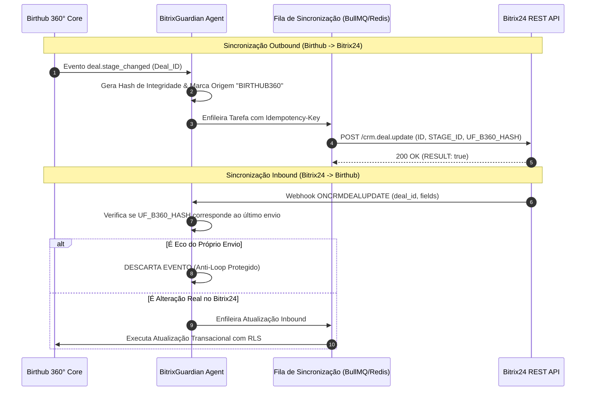
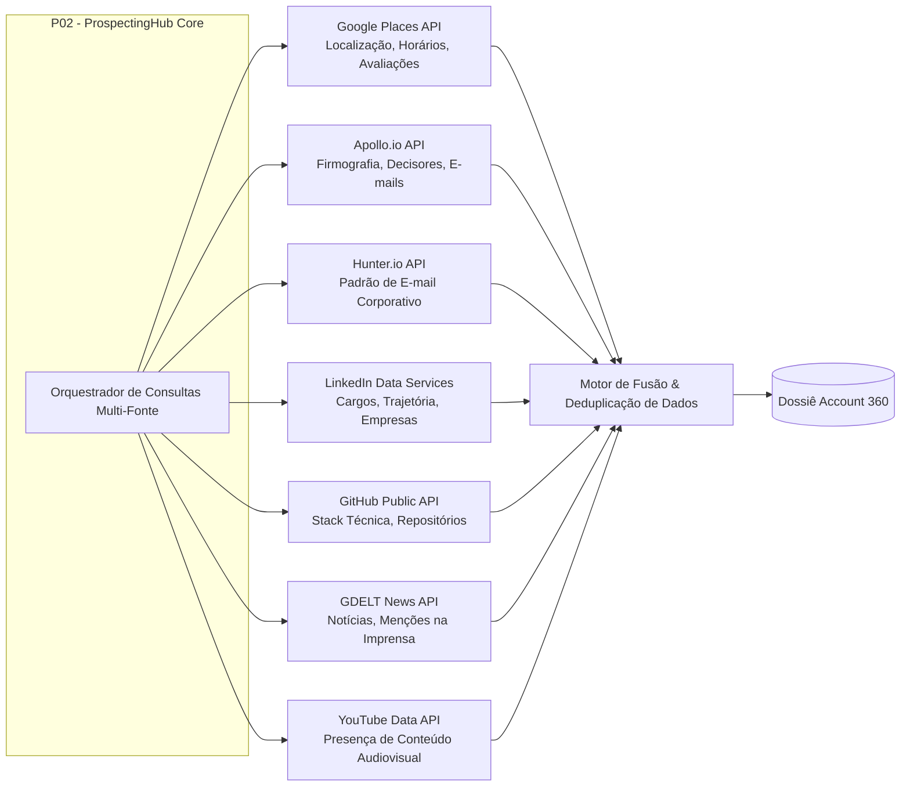

# BIRTHUB 360° — CONTRATOS DE INTEGRAÇÃO, APIS E ARQUITETURA DE EVENTOS (P07)

**Versão do Documento:** 4.0.0 — Oficial Definitiva  
**Data:** 08 de Novembro de 2026  
**Status:** Especificação Mestra de Engenharia de Produto  
**Governança:** Autoridade Global de Contratos e Integrações  

---

## 1. PADRÕES GLOBAIS DE APIS E COMUNICAÇÃO

Toda a superfície de comunicação externa e interna do **Birthub 360°** adere a padrões contratuais estritos para garantir previsibilidade, segurança, idempotência e observabilidade ponta a ponta.

### 1.1. Protocolos e Formatos
- **APIs RESTful:** Padrão OpenAPI 3.1 com payloads exclusivamente codificados em `application/json` (UTF-8).
- **Tempo Real & Telemetria:** Conexões bidirecionais via WebSockets seguras (`wss://`) com heartbeat a cada 30 segundos e reconexão automática com jitter.
- **Webhooks de Entrada e Saída:** Notificações assinadas criptograficamente com HMAC-SHA256 no cabeçalho `X-Birthub-Signature`.

### 1.2. Cabeçalhos HTTP Mandatórios
Em toda requisição aos endpoints da plataforma:
```http
Authorization: Bearer <jwt_token_ou_api_key>
X-Organization-Id: <uuid_do_tenant>
X-Request-Id: <uuid_unico_para_rastreamento_distribuido>
Idempotency-Key: <chave_opcional_para_requisicoes_post_put>
Content-Type: application/json
```

### 1.3. Padrão RFC 7807 para Tratamento de Erros
Todas as respostas de erro HTTP (4xx e 5xx) utilizam o formato `application/problem+json`:
```json
{
  "type": "https://api.birthub360.com/errors/deal-locked-under-approval",
  "title": "Oportunidade Bloqueada para Edição",
  "status": 409,
  "detail": "A oportunidade PROP-2026-0042 possui uma proposta em fluxo ativo de aprovação de desconto pela diretoria.",
  "instance": "/api/v1/deals/8f3b6a22-3c1a-4c9d-8d5a-1b4e9f7a6c3d",
  "code": "DEAL_APPROVAL_IN_PROGRESS",
  "timestamp": "2026-11-08T12:00:00Z",
  "invalid_params": []
}
```

### 1.4. Paginação Baseada em Cursor (Cursor-Based Pagination)
Evita perda ou duplicação de dados em listas de alta transacionalidade:
```json
{
  "data": [ ... ],
  "pagination": {
    "limit": 50,
    "has_more": true,
    "next_cursor": "eyJjcmVhdGVkX2F0IjoiMjAyNi0xMS0wOFQxMTowMDo..."
  }
}
```

---

## 2. CONTRATO DO CONECTOR BITRIX24 COM BITRIXGUARDIAN

O Birthub 360° possui sincronização bidirecional em tempo real com instalações de Bitrix24 na nuvem ou on-premise, governado pelo agente **BitrixGuardian**.



### 2.1. Políticas de Resiliência do Conector Bitrix24
1. **Proteção Contra Loop de Eco:** Todo registro sincronizado para o Bitrix grava um campo customizado (`UF_B360_SYNC_HASH`). Quando o Bitrix dispara seu webhook de retorno, o BitrixGuardian valida o hash e descarta o eco instantaneamente.
2. **Retentativas com Backoff Exponencial:**
   - Tentativa 1: Imediata.
   - Tentativa 2: 2 segundos.
   - Tentativa 3: 8 segundos.
   - Tentativa 4: 30 segundos.
   - Tentativa 5: 2 minutos.
   - Falha Final: O registro é movido para a Dead-Letter Queue (DLQ) e o gestor recebe alerta visual no dashboard de integrações.

---

## 3. CONECTORES DE INTELIGÊNCIA DE MERCADO (7 FONTES DO PROSPECTINGHUB)



### 3.1. Especificação dos Contratos das Fontes Externas

#### Fonte 1: Google Places API
- **Endpoint Utilizado:** `https://places.googleapis.com/v1/places:searchText`
- **Dados Capturados:** `displayName`, `formattedAddress`, `rating`, `userRatingCount`, `websiteUri`, `nationalPhoneNumber`, `businessStatus`.
- **Uso no Sistema:** Validação física da existência da empresa e avaliação de reputação inicial.

#### Fonte 2: Apollo.io API
- **Endpoint Utilizado:** `https://api.apollo.io/v1/organizations/enrich` e `https://api.apollo.io/v1/people/match`
- **Dados Capturados:** Faturamento estimado, número exato de colaboradores, tecnologias declaradas no site, lista de executivos C-Level com cargos e perfis de LinkedIn.

#### Fonte 3: Hunter.io API
- **Endpoint Utilizado:** `https://api.hunter.io/v2/domain-search`
- **Dados Capturados:** Padrão comum de e-mail corporativo (ex: `{first}.{last}@empresa.com.br`), lista de e-mails públicos encontrados e taxa de confiança de entrega (confidence score).

#### Fonte 4: GitHub Public API
- **Endpoint Utilizado:** `https://api.github.com/orgs/{org_name}`
- **Dados Capturados:** Número de repositórios públicos, linguagens de programação predominantes, atividade de commits recentes.
- **Uso no Sistema:** Sinal técnico para qualificação de ICP em empresas de base tecnológica.

#### Fonte 5: GDELT News API
- **Endpoint Utilizado:** `https://api.gdeltproject.org/api/v2/doc/doc`
- **Dados Capturados:** Artigos de notícias recentes mencionando o nome da empresa, sentimento da cobertura jornalística (positivo/negativo), temas associados (expansão, fusão, demissão).

---

## 4. CONTRATOS DO CANAL DE VOZ (P08 - VOICE HUB & WEBRTC)

### 4.1. Sinalização WebRTC e Controle de Chamadas (SIP/Voice Gateway)
- **Abertura de Sessão (SDP Offer/Answer):** Negociação de codecs de áudio de alta definição (`Opus`, 48kHz, mono) com criptografia ponta a ponta (`SRTP`).
- **Eventos de Telemetria de Chamada:**
```json
{
  "event": "call.ringing | call.answered | call.hold | call.hangup",
  "call_id": "c7a8b9f1-4e2d-4b8a-9c3f-1a2b3c4d5e6f",
  "organization_id": "8f3b6a22-3c1a-4c9d-8d5a-1b4e9f7a6c3d",
  "agent_user_id": "user-uuid",
  "contact_phone": "+5511999998888",
  "direction": "OUTBOUND",
  "timestamp": "2026-11-08T12:05:00Z"
}
```

### 4.2. Webhook de Áudio Gravado para Transcrição
Quando a chamada encerra, o Voice Gateway posta o arquivo de áudio:
```http
POST /api/v1/webhooks/voice-recording-completed
X-Birthub-Signature: sha256=abcdef...

{
  "call_id": "c7a8b9f1-4e2d-4b8a-9c3f-1a2b3c4d5e6f",
  "recording_url": "https://storage.birthub360.com/recordings/call_123.wav",
  "duration_seconds": 342,
  "channels": 2
}
```

---

## 5. BARRAMENTO DE EVENTOS DE DOMÍNIO INTERNO (EDA)

O Birthub 360° desacopla os módulos P01 a M11 por meio de uma arquitetura orientada a eventos.

### Catálogo de Tópicos e Payloads

| Tópico de Evento | Produtor | Consumidores | Efeito de Negócio |
|---|---|---|---|
| `deal.created` | P01 (Hub Comercial) | P03, P07, Bitrix24 | Inicia cadência de boas-vindas e espelha no CRM externo. |
| `deal.stage_changed` | P01 (Kanban) | P04, P05, P07, Bitrix24 | Recalcula probabilidade de forecast e métricas de conversão. |
| `deal.won` | P01 (Closer) | P04, P05, M09, CS | Dispara comemoração na War Room, emite contrato e inicia onboarding. |
| `proposal.version_created` | P01 (Propostas) | P06 (PricingAgent) | Audita alçada de descontos e notifica gestor se exceder margem. |
| `call.completed` | P08 (Voice Hub) | P06 (VoiceInCall), P01 | Inicia transcrição, gera resumo com IA e insere nota na timeline. |
| `contact.opt_out` | P08, P03 | P03 (CadenceHub), P07 | Pausa imediatamente todas as sequências de e-mail e WhatsApp do contato. |
| `agent.action_required` | P06 (Supervisor) | P01 (WorkspaceHome) | Exibe card de solicitação de aprovação humana no dashboard. |
