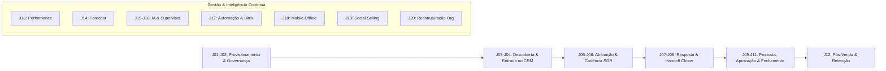

# BIRTHUB 360° — JORNADAS OPERACIONAIS DE PONTA A PONTA

**Versão do Documento:** 4.0.0 — Oficial Definitiva  
**Data:** 08 de Novembro de 2026  
**Status:** Especificação Mestra de Engenharia de Produto  
**Governança:** Autoridade Global de Processos e Experiência do Cliente  

---

## 1. VISÃO GERAL DAS JORNADAS DE REVENUE OPERATIONS

O **Birthub 360°** organiza o ciclo completo de receita em jornadas operacionais interligadas que conectam dados, tomadores de decisão, automações e enxames de inteligência artificial. Cada jornada detalhada a seguir especifica:
- **Atores & Personas Envolvidas**
- **Pré-Condições Obrigatórias**
- **Gatilho Desencadeador**
- **Fluxo Operacional Passo a Passo (com ramificações de decisão)**
- **Tratamento de Exceções e Falhas**
- **Regras de Negócio e Governança Aplicadas**
- **Agentes de IA e Automações Participantes**
- **Resultado Final Verificável**

---

## 2. ESPECIFICAÇÃO DAS 20 JORNADAS OPERACIONAIS

---

### JORNADA 01: EMPRESA CONTRATA E CONFIGURA O BIRTHUB 360 (ONBOARDING SAAS)
- **Personas:** Administrador da Conta (Founder/Diretor), `onboarding.agent`, `ops.agent`.
- **Pré-Condições:** Assinatura do contrato digital ou checkout no portal SaaS concluído.
- **Gatilho:** Confirmação do pagamento e geração automática do `organization_id`.
- **Passo a Passo:**
  1. O Administrador recebe e-mail com link assinado de primeiro acesso para definir senha master e MFA.
  2. O sistema ativa o `SetupWizard` guiado em 5 etapas:
     - *Passo 1 — Identidade Corporativa:* Upload de logo, nome fantasia, CNPJ oficial (validado na Receita Federal via `dataEnricher.agent`) e fuso horário padrão.
     - *Passo 2 — Definição do ICP:* Seleção de setores de atuação (CNAEs), porte de faturamento e limites geográficos.
     - *Passo 3 — Estrutura de Funil:* Escolha de template de funil comercial (Vendas Consultivas B2B, SaaS Recorrente, Vendas Rápidas ou Transacional).
     - *Passo 4 — Conectividade de Canais:* Conexão OAuth com Google Workspace / Microsoft 360 para calendário e e-mail.
     - *Passo 5 — Convite Inicial da Equipe:* Inserção de e-mails dos líderes de vendas (SDR Leader e Gestor Comercial).
  3. O `onboarding.agent` analisa os dados informados e gera 3 oportunidades de demonstração fictícias em um sandbox isolado para teste da equipe.
- **Exceções & Recuperação:** Se o CNPJ for inválido ou estiver suspenso na Receita Federal, o sistema alerta o usuário e permite continuidade com preenchimento manual pendente de validação.
- **Resultado Verificável:** Organização com RLS ativo, usuário Admin autenticado e primeiro pipeline publicado com estágios padronizados.

---

### JORNADA 02: ADMINISTRADOR CRIA EQUIPES E DEFINE PERMISSÕES (RBAC)
- **Personas:** Administrador da Conta, Gestor Comercial, RevOps.
- **Pré-Condições:** Organização ativada.
- **Gatilho:** Necessidade de cadastrar colaboradores e definir papéis hierárquicos.
- **Passo a Passo:**
  1. O Administrador acessa `/app/team` e clica em "Adicionar Colaborador".
  2. Informa Nome, E-mail, Celular e seleciona o Papel: SDR, BDR, Closer, Gestor Comercial ou RevOps.
  3. No modal de permissões, define alçadas:
     - Permissão de exportação de contatos (bloqueada para SDR/Closer por padrão).
     - Alçada máxima de concessão de desconto direto em propostas (ex: até 5% para Closer; até 15% para Gestor).
     - Acesso a módulos específicos via `ModuleAccessAdmin` (ex: habilitar `Voice Hub` e `Social Selling`).
  4. O sistema dispara convite com token criptografado para o colaborador.
- **Exceções:** Se o limite de assentos contratados no plano SaaS for atingido, o sistema impede a criação e abre modal de upgrade de plano (`billingRevenue.agent`).
- **Resultado Verificável:** Usuário cadastrado com papel atribuído, permissões gravadas e trilha de auditoria registrada em `audit_logs`.

---

### JORNADA 03: BDR IDENTIFICA E QUALIFICA UMA EMPRESA (PROSPECTINGHUB)
- **Personas:** BDR, `hunterProspecting.agent`, `dataEnricher.agent`, `ldrIntelligence.agent`.
- **Pré-Condições:** Critérios de ICP configurados na organização.
- **Gatilho:** BDR inicia pesquisa ativa de novas contas no `InteligenciaMercadoHub`.
- **Passo a Passo:**
  1. O BDR define filtros no `DiscoveryFilterPanel`: Estado = "SP", Setor = "Tecnologia", Faixa = "50-200 funcionários".
  2. O `QueryPlanner` aciona paralelamente as APIs do Google Places (localização), Apollo.io (firmografia) e Hunter.io (padrões de e-mail).
  3. Os resultados brutos são desduplicados pelo `dataEnricher.agent` contra a base existente de empresas para evitar prospecção de clientes ativos.
  4. O `qualification.agent` calcula o **Score Explicável de ICP** (ex: 88/100) e lista as justificativas (CNAE aderente, crescimento de headcount no LinkedIn de +22% no semestre).
  5. O `accountDetective.agent` extrai 3 tomadores de decisão (Diretor de TI, Gerente de Operações, CEO).
- **Exceções:** Se a empresa já existir no banco sob a carteira de outro vendedor, o sistema bloqueia a nova entrada e informa o proprietário atual.
- **Resultado Verificável:** Dossiê Account 360 criado na tabela `market_dossiers` com proveniência de dados registrada.

---

### JORNADA 04: CONTA QUALIFICADA ENTRA NO CRM (LEAD APPROVAL DECK)
- **Personas:** BDR Leader / Gestor Comercial, BDR, `supervisor.agent`.
- **Pré-Condições:** Empresa prospectada com ICP Score >= 70.
- **Gatilho:** BDR submete conta para o deck de aprovação.
- **Passo a Passo:**
  1. O Gestor Comercial abre a tela `/app/market-intelligence/deck` ("Lead Approval Deck").
  2. Visualiza cards com resumo do dossiê: Nome Fantasia, Receita Estimada, Decisores identificados e Sinais Quentes de Mercado.
  3. O Gestor avalia e clica em "Aprovar Conta" (ou rejeita informando o motivo de descarte).
  4. Ao aprovar, o sistema converte o dossiê em registros oficiais nas tabelas `companies`, `contacts` e cria um `deal` no primeiro estágio do funil ("Lead Qualificado").
  5. O evento `deal.created` é emitido no barramento.
- **Resultado Verificável:** Registro transacional persistido no PostgreSQL e oportunidade disponível no CRM.

---

### JORNADA 05: OPORTUNIDADE RECEBE RESPONSÁVEL E PRIORIDADE (DISTRIBUIÇÃO INTELIGENTE)
- **Personas:** Motor de Distribuição, Gestor Comercial, SDR selecionado.
- **Pré-Condições:** Novo deal criado no funil.
- **Gatilho:** Disparo do evento `deal.created`.
- **Passo a Passo:**
  1. O algoritmo de distribuição inteligente avalia regras ativas:
     - Regra de território (Estado = SP -> Equipe Sudeste).
     - Carga atual de trabalho dos operadores (número de leads abertos ativos).
     - Histórico de conversão por vertical de negócio.
  2. O sistema seleciona o SDR com maior capacidade e aderência.
  3. Define o SLA de Primeiro Contato: 15 minutos para leads inbound ou 2 horas para outbound aprovado.
  4. O SDR recebe notificação push na interface e alerta no celular.
- **Exceções:** Se nenhum operador estiver online ou disponível, a oportunidade é alocada na Fila Geral com notificação de alerta ao Gestor.
- **Resultado Verificável:** Campo `owner_user_id` do deal preenchido e tarefa inicial agendada no `WorkspaceHome` do vendedor.

---

### JORNADA 06: SDR EXECUTA UMA CADÊNCIA MULTICANAL (CADENCEHUB)
- **Personas:** SDR, `whatsappCopilot.agent`, `voiceInCall.agent`.
- **Pré-Condições:** Lead alocado ao SDR com dados de contato válidos.
- **Gatilho:** SDR clica em "Iniciar Dia de Prospecção" em seu Plano Diário.
- **Passo a Passo:**
  1. O sistema inscreve o contato na "Cadência Outbound Enterprise" (12 etapas em 21 dias).
  2. *Passo 1 (Dia 1 — E-mail de Apresentação):* O SDR revisa a mensagem gerada com variáveis dinâmicas e clica em enviar.
  3. *Passo 2 (Dia 1 — Conexão LinkedIn):* O sistema abre o atalho do perfil com a nota de conexão sugerida pelo `socialSelling.agent`.
  4. *Passo 3 (Dia 3 — Ligação Telefônica):* O `Voice Hub` disca via WebRTC automaticamente. O SDR visualiza no HUD os tópicos principais de abordagem.
  5. *Passo 4 (Dia 5 — WhatsApp):* Envio de mensagem contextual no WhatsApp Business.
- **Exceções:** Se o contato solicitar descadastramento (opt-out), o sistema pausa a cadência instantaneamente e marca `opt_out_communications = true`.
- **Resultado Verificável:** Histórico de execuções gravado em `cadence_enrollments` e timeline do deal atualizada.

---

### JORNADA 07: LEAD RESPONDE E INICIA UMA CONVERSA (VOICE / WHATSAPP)
- **Personas:** Tomador de Decisão, SDR, `whatsappCopilot.agent`.
- **Pré-Condições:** Cadência ativa em andamento.
- **Gatilho:** Recebimento de mensagem no WhatsApp: "Olá, vi seu e-mail. Como vocês tratam a integração com nosso ERP?".
- **Passo a Passo:**
  1. O webhook do WhatsApp Business captura a mensagem inbound.
  2. O `whatsappCopilot.agent` classifica a intenção como "Dúvida Técnica sobre Integração" com sentimento positivo (+0.75).
  3. O agente busca na Base de Conhecimento RAG os manuais de conectividade com o ERP citado e gera rascunho de resposta técnica e amigável.
  4. O SDR abre o `WorkspaceHome`, lê a resposta sugerida, faz um pequeno ajuste e clica em "Enviar".
  5. O lead replica: "Perfeito, podemos fazer uma demonstração nesta quinta-feira às 15h?".
  6. O SDR envia o link público do seu agendador integrado.
- **Resultado Verificável:** Reunião agendada automaticamente com convite de Google Meet disparado para ambas as partes.

---

### JORNADA 08: OPORTUNIDADE É TRANSFERIDA AO CLOSER (HANDOFF ESTRUTURADO)
- **Personas:** SDR, Closer, Gestor Comercial, `qualification.agent`.
- **Pré-Condições:** Demonstração agendada com decisor econômico ou influenciador qualificado.
- **Gatilho:** SDR clica no botão "Avançar para Reunião de Demonstração / Handoff".
- **Passo a Passo:**
  1. O sistema abre o formulário obrigatório de Handoff:
     - Dores confirmadas do cliente.
     - Expectativa de orçamento e prazos.
     - Decisores presentes na reunião.
  2. O `qualification.agent` valida se os critérios mínimos de MEDDIC foram atendidos.
  3. O deal é reatribuído ao Closer sênior da vertical correspondente.
  4. O Closer recebe o resumo executivo de 1 página contendo histórico, áudios prévios transcritos e notas estratégicas.
- **Resultado Verificável:** Registro de transferência gravado em `deal_stage_history`, novo Closer assumindo a propriedade do deal.

---

### JORNADA 09: CLOSER NEGOCIA E ELABORA PROPOSTA (VERSIONADOR COM DIFF)
- **Personas:** Closer, Tomador de Decisão, `pricing.agent`.
- **Pré-Condições:** Demonstração técnica realizada com sucesso.
- **Gatilho:** Cliente solicita envio de proposta formal de contratação.
- **Passo a Passo:**
  1. O Closer clica em "Criar Proposta" dentro da oportunidade no CrmBoard.
  2. Seleciona os itens de tabela: 50 Assentos do Plano Professional + Módulo Voice Hub + Setup de Implantação.
  3. O `pricing.agent` calcula o subtotal: R$ 18.500/mês + R$ 12.000 de setup.
  4. O Closer aplica 12% de desconto promocional no valor mensal.
  5. O sistema salva a proposta como `Versão 1 (PROP-2026-0042-V1)` e gera o documento PDF criptografado.
- **Resultado Verificável:** Versão 1 persistida na tabela `proposal_versions` com snapshot imutável dos itens.

---

### JORNADA 10: PROPOSTA PASSA POR APROVAÇÕES APLICÁVEIS (GOVERNANÇA)
- **Personas:** Closer, Gestor Comercial, `contractGuardian.agent`.
- **Pré-Condições:** Proposta gerada com desconto superior à alçada individual do Closer (alçada = 5%, desconto pedido = 12%).
- **Gatilho:** Closer clica em "Submeter para Aprovação Interna".
- **Passo a Passo:**
  1. O deal é bloqueado temporariamente para edições externas.
  2. Uma tarefa de alta prioridade surge no dashboard do Gestor Comercial.
  3. O Gestor abre a ferramenta de **Diff Visual de Propostas**, comparando o valor de tabela com a concessão proposta e a margem resultante.
  4. O `devilsAdvocate.agent` insere uma observação consultiva: "O cliente possui alto fit, mas o prazo de pagamento em 60 dias reduz o fluxo de caixa do trimestre".
  5. O Gestor clica em "Aprovar com Condição: Manter desconto se o pagamento for em até 30 dias".
  6. O Closer recebe notificação de liberação e atualiza os termos com o cliente.
- **Resultado Verificável:** Status da proposta alterado para `APPROVED` com registro do usuário aprovador e carimbo de tempo.

---

### JORNADA 11: NEGOCIAÇÃO É CONCLUÍDA (DEAL WON & ASSINATURA DIGITAL)
- **Personas:** Closer, Tomador de Decisão, `contractGuardian.agent`.
- **Pré-Condições:** Proposta aprovada aceita verbalmente pelo cliente.
- **Gatilho:** Envio de minuta final para formalização jurídica.
- **Passo a Passo:**
  1. O `contractGuardian.agent` gera o contrato definitivo combinando os itens da proposta aprovada com o template jurídico oficial da empresa.
  2. O sistema despacha o documento para assinatura digital via conector nativo (DocuSign/ClickSign).
  3. Todos os signatários assinam eletronicamente com validação de IP e certificado ICP-Brasil.
  4. O webhook de "Documento Assinado" retorna ao Birthub 360°.
  5. O Closer arrasta o card para o estágio **"Fechado Ganho (Won)"**.
  6. A tela dispara os efeitos comemorativos da **War Room Arena** com reprodução de sino e atualização das metas em tempo real.
- **Resultado Verificável:** Deal com status `WON`, receita realizada somada ao forecast e contrato anexado à conta.

---

### JORNADA 12: CLIENTE ENTRA NO RELACIONAMENTO PÓS-VENDA (CS & RETENÇÃO)
- **Personas:** Closer, Customer Success Manager (CSM), `success.agent`, `churnPrevention.agent`.
- **Pré-Condições:** Deal marcado como `WON`.
- **Gatilho:** Evento `deal.won` capturado pelo módulo pós-venda.
- **Passo a Passo:**
  1. O sistema cria automaticamente a conta como cliente ativo (`is_customer = true`).
  2. É agendada a reunião de Kickoff de Implantação no calendário do CSM alocado.
  3. O `success.agent` cria o plano de sucesso do cliente com marcos de entrega a 30, 60 e 90 dias.
  4. O `churnPrevention.agent` inicia o monitoramento de telemetria de uso e frequência de login dos usuários contratados.
- **Resultado Verificável:** Conta ativa no módulo de CS e fluxo de retenção inicializado.

---

### JORNADA 13: GESTOR ACOMPANHA PERFORMANCE E GARGALOS (ANALYTICS & WIN/LOSS)
- **Personas:** Gestor Comercial, RevOps, `revenueIntelligence.agent`.
- **Pré-Condições:** Histórico de operações comerciais ativas.
- **Gatilho:** Reunião semanal de pipeline review da gerência.
- **Passo a Passo:**
  1. O Gestor abre o `Command Center de Receita` e aplica o filtro do mês corrente.
  2. O gráfico de funil aponta uma queda abrupta de conversão: 65% de perda entre "Demonstração" e "Envio de Proposta".
  3. O Gestor clica no relatório de **Análise Causal de Win/Loss**.
  4. O sistema lista os principais motivos de perda catalogados: 54% "Preço fora do orçamento do cliente", 28% "Falta de integração técnica com ERP legado".
  5. O Gestor exporta o diagnóstico para a reunião de produto e alinha novos playbooks de ancoragem com a equipe de Closers.
- **Resultado Verificável:** Plano de ação de treinamento gerado e monitorado no `SellerCoachAgent`.

---

### JORNADA 14: DIRETORIA CONSULTA O FORECAST DE RECEITA (SIMULAÇÃO PREDITIVA)
- **Personas:** Diretor / Founder, `forecast.agent`.
- **Pré-Condições:** Metas trimestrais cadastradas no sistema.
- **Gatilho:** Fechamento de projeção financeira para o conselho.
- **Passo a Passo:**
  1. A Diretoria acessa o módulo de `Previsibilidade Comercial`.
  2. Visualiza a meta do trimestre: R$ 1.500.000.
  3. O sistema apresenta os três cenários:
     - *Pipeline Ponderado por Estágio:* R$ 1.420.000 (94% da meta).
     - *Compromissos Firmes (Commit):* R$ 1.180.000 (78% da meta).
     - *Projeção Preditiva de IA (Monte Carlo 10.000 iterações):* R$ 1.390.000 com intervalo de confiança de 90% entre R$ 1.310.000 e R$ 1.480.000.
  4. A Diretoria executa uma simulação: "O que acontece com o resultado se contratarmos 2 novos Closers no próximo mês?". O modelo preditivo calcula a rampa de vendas e projeta o retorno a partir do mês 3.
- **Resultado Verificável:** Relatório executivo de forecast emitido com explicabilidade total dos cálculos.

---

### JORNADA 15: AGENTES IDENTIFICAM OPORTUNIDADES E RISCOS DE MANEIRA AUTÔNOMA
- **Personas:** `pipelineHealthInspector`, `devilsAdvocate.agent`, Closer responsável.
- **Pré-Condições:** Oportunidade aberta no valor de R$ 150.000 estagnada há 18 dias no estágio de Negociação.
- **Gatilho:** Varredura diária noturna de integridade do pipeline.
- **Passo a Passo:**
  1. O `pipelineHealthInspector` detecta ausência de qualquer interação (e-mail, chamada ou WhatsApp) há mais de 14 dias (violação do SLA do estágio).
  2. O `devilsAdvocate.agent` cruza os dados com o LinkedIn e descobre que o Champion que conduzia a negociação trocou de empresa há 5 dias.
  3. O Health Score do deal é rebaixado de 85 para 25 (Risco Iminente de Perda).
  4. O agente gera um card de alerta prioritário no topo do Workspace do Closer: "Atenção: Seu interlocutor saiu da empresa. Recomenda-se acionar o Diretor Financeiro imediatamente via telefone".
- **Resultado Verificável:** Oportunidade sob risco identificada proativamente antes da perda definitiva.

---

### JORNADA 16: SUPERVISOR COORDENA AÇÕES ENTRE MÓDULOS SEM CONFLITO
- **Personas:** `supervisor.agent`, BDR, SDR, Closer.
- **Pré-Condições:** Múltiplas ações simultâneas ocorrendo sobre o mesmo grupo econômico.
- **Gatilho:** Um BDR tenta prospectar a filial de um cliente ativo que está em fase final de renovação contratual com o Closer da matriz.
- **Passo a Passo:**
  1. O BDR clica em "Iniciar Cadência na Filial Campinas".
  2. O `supervisor.agent` intercepta a requisição e consulta a entidade global `companies` e a árvore de filiais.
  3. Identifica que a matriz está no estágio "Fechamento" com o Closer Sênior.
  4. O Supervisor bloqueia a cadência fria de prospecção e emite a justificativa: "Ação Suspensa: Esta empresa pertence ao Grupo Econômico X, atualmente em negociação com o Closer João. A conta foi anexada ao deal principal para negociação conjunta de volume corporativo".
- **Resultado Verificável:** Conflito evitado e relacionamento corporativo protegido.

---

### JORNADA 17: AUTOMAÇÃO SINCRONIZA EVENTOS COM BITRIX24 EM TEMPO REAL
- **Personas:** `bitrixGuardian.agent`, Vendedor.
- **Pré-Condições:** Conector Bitrix24 ativo na organização.
- **Gatilho:** Vendedor conclui uma chamada no Birthub 360° e avança o estágio da oportunidade.
- **Passo a Passo:**
  1. O evento interno `deal.stage_changed` é capturado pelo motor de integração.
  2. O `bitrixGuardian.agent` calcula o hash do payload e adiciona o carimbo `origin_system: "BIRTHUB360"`.
  3. Envia requisição segura para a API do Bitrix24 atualizando o estágio correspondente.
  4. O Bitrix24 processa e emite seu webhook de confirmação.
  5. O BitrixGuardian reconhece o hash e descarta o eco, evitando looping de reprocessamento.
- **Resultado Verificável:** Dados idênticos e atualizados em ambos os sistemas em menos de 800 milissegundos.

---

### JORNADA 18: USUÁRIO MOBILE TRABALHA OFFLINE EM CAMPO E SINCRONIZA
- **Personas:** Closer Externo, App Móvel Android (Capacitor), `mobileEdgeAi.agent`.
- **Pré-Condições:** Vendedor em visita presencial em cliente fabril sem sinal de internet móvel.
- **Gatilho:** Início da reunião de vendas externa.
- **Passo a Passo:**
  1. O Closer abre o app no smartphone e ativa o `FieldMeetingRecorder`.
  2. O app grava a conversa presencial com o cliente em alta fidelidade.
  3. O `mobileEdgeAi.agent` executa transcrição e extração de compromissos localmente no processador do dispositivo.
  4. O Closer edita a oportunidade no app, alterando o valor e adicionando a nota da reunião. O dado é gravado no SQLite local.
  5. Ao sair da fábrica e reconectar ao 4G, o app dispara a fila de sincronização em background.
  6. O servidor recebe as atualizações sem conflitos de timestamp.
- **Resultado Verificável:** Visita presencial documentada, transcrita e sincronizada sem perda de nenhum dado.

---

### JORNADA 19: SOCIAL SELLING IDENTIFICA, NUTRE E CONVERTE EM PIPELINE
- **Personas:** BDR, `socialSelling.agent`, Decisor no LinkedIn.
- **Pré-Condições:** Módulo Social Selling ativo.
- **Gatilho:** `socialSelling.agent` detecta que um Diretor de Operações de uma conta-alvo publicou sobre dificuldades de controle de custos na cadeia de suprimentos.
- **Passo a Passo:**
  1. O alerta de oportunidade surge no `SocialSellingHub` do BDR.
  2. O BDR abre o `ApproachGeneratorCard`.
  3. A IA sugere um comentário público de alto valor técnico para a postagem do executivo e uma mensagem privada de conexão com tom consultivo e sem venda forçada.
  4. O BDR revisa, personaliza e publica no LinkedIn.
  5. O executivo responde à conexão: "Excelente insight. Estamos revendo nossos processos este mês".
  6. O BDR clica no botão "Converter em Lead no CRM". O sistema importa a conversa e cria a oportunidade no CrmBoard.
- **Resultado Verificável:** Relacionamento social transformado em oportunidade qualificada no funil.

---

### JORNADA 20: REESTRUTURAÇÃO ORGANIZACIONAL, TERRITÓRIOS E PERMISSÕES
- **Personas:** Diretor Comercial, RevOps, Administrador.
- **Pré-Condições:** Fusão de duas equipes comerciais e saída de um colaborador.
- **Gatilho:** Diretoria decide redividir os territórios dos vendedores.
- **Passo a Passo:**
  1. O RevOps acessa o painel de Governança de Carteiras em `/app/team`.
  2. Seleciona o colaborador desligado e clica em "Transferir Carteira em Lote".
  3. O assistente exibe a matriz de redistribuição: 42 contas ativas e 8 oportunidades em andamento.
  4. O RevOps define a regra de partilha (50% para Closer A, 50% para Closer B, balanceando por valor ponderado de pipeline).
  5. O sistema reatribui a propriedade de todas as empresas, contatos, tarefas futuras e deals em uma transação atômica segura no banco.
  6. As permissões de acesso do colaborador desligado são revogadas instantaneamente e todas as suas sessões ativas são invalidadas.
- **Resultado Verificável:** Carteira redistribuída de forma balanceada sem nenhum deal órfão, com log de auditoria completo.
