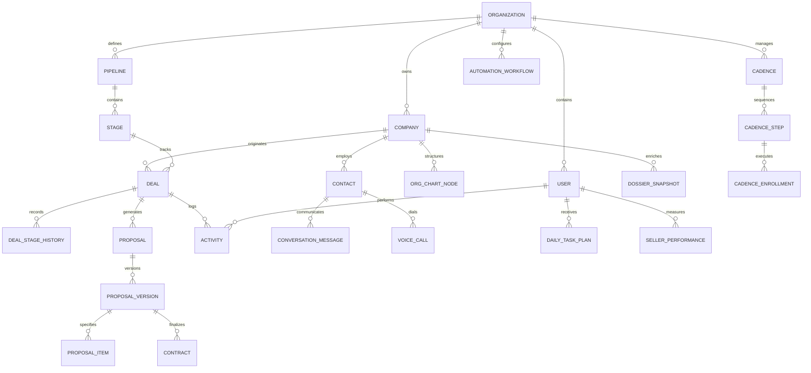

# BIRTHUB 360° — ARQUITETURA E MODELO DE DADOS CONCEITUAL E LÓGICO

**Versão do Documento:** 4.0.0 — Oficial Definitiva  
**Data:** 08 de Novembro de 2026  
**Status:** Especificação Mestra de Engenharia de Produto  
**Governança:** Autoridade Global de Dados e Tenancy  

---

## 1. DIRETRIZES FUNDAMENTAIS DO MODELO DE DADOS

O modelo de dados do **Birthub 360°** foi projetado para sustentar uma operação comercial de alta escala, multicanal e orientada por inteligência artificial, garantindo:
1. **Isolamento Multi-Tenant Inviolável:** Toda tabela com dados pertencentes a clientes possui a coluna obrigatória `organization_id UUID NOT NULL` com aplicação estrita de **PostgreSQL Row-Level Security (RLS)**.
2. **Histórico e Rastreabilidade Imutável (Event-Sourced & Append-Only):** Entidades críticas de negócio (mudança de estágio de deal, versões de proposta, logs de auditoria e execuções de automação) nunca sofrem `UPDATE` destrutivo em registros passados; novas linhas históricas são concatenadas.
3. **Conformidade Nativa com LGPD:** Campos de dados pessoais de titulares (nome, e-mail, telefone, CPF) possuem rotinas de anonimização com hashes irreversíveis e expiração automática conforme a política de retenção do tenant.
4. **Desempenho e Integridade Referencial:** Índices compostos cobrindo `(organization_id, id)` e `(organization_id, created_at)`, foreign keys com regras de integridade estritas e tipagem padronizada em todos os módulos.

---

## 2. DIAGRAMA ENTIDADE-RELACIONAMENTO (VISÃO GERAL)



---

## 3. ESPECIFICAÇÃO DETALHADA DAS ENTIDADES POR DOMÍNIO

### DOMÍNIO 1: MULTI-TENANCY, IDENTIDADE E SEGURANÇA (M09)

#### 1. `organizations` (Tenants)
- `id`: UUID PRIMARY KEY DEFAULT gen_random_uuid()
- `name`: VARCHAR(255) NOT NULL
- `slug`: VARCHAR(100) UNIQUE NOT NULL
- `legal_document`: VARCHAR(20) NOT NULL — CNPJ
- `plan_tier`: VARCHAR(50) NOT NULL — 'STARTER', 'PROFESSIONAL', 'ENTERPRISE', 'CUSTOM'
- `subscription_status`: VARCHAR(50) NOT NULL — 'TRIAL', 'ACTIVE', 'PAST_DUE', 'CANCELED'
- `token_quota_monthly`: BIGINT NOT NULL DEFAULT 5000000
- `token_usage_current`: BIGINT NOT NULL DEFAULT 0
- `voice_minutes_quota`: INTEGER NOT NULL DEFAULT 1000
- `voice_minutes_usage`: INTEGER NOT NULL DEFAULT 0
- `settings`: JSONB NOT NULL DEFAULT '{}'
- `created_at`: TIMESTAMPTZ NOT NULL DEFAULT now()
- `updated_at`: TIMESTAMPTZ NOT NULL DEFAULT now()

#### 2. `users`
- `id`: UUID PRIMARY KEY DEFAULT gen_random_uuid()
- `organization_id`: UUID NOT NULL REFERENCES organizations(id) ON DELETE CASCADE
- `email`: VARCHAR(255) NOT NULL
- `password_hash`: VARCHAR(255) NOT NULL
- `full_name`: VARCHAR(255) NOT NULL
- `role`: VARCHAR(50) NOT NULL — 'SUPER_ADMIN', 'ADMIN', 'GESTOR', 'CLOSER', 'SDR', 'BDR', 'CS', 'REVOPS'
- `is_active`: BOOLEAN NOT NULL DEFAULT true
- `phone`: VARCHAR(30)
- `preferences`: JSONB NOT NULL DEFAULT '{}'
- `last_login_at`: TIMESTAMPTZ
- `created_at`: TIMESTAMPTZ NOT NULL DEFAULT now()
- `updated_at`: TIMESTAMPTZ NOT NULL DEFAULT now()
- *Índice Único:* `(organization_id, email)`

#### 3. `module_access`
- `id`: UUID PRIMARY KEY DEFAULT gen_random_uuid()
- `organization_id`: UUID NOT NULL REFERENCES organizations(id) ON DELETE CASCADE
- `module_code`: VARCHAR(10) NOT NULL — 'P01', 'P02', 'P03', 'P04', 'P05', 'P06', 'P07', 'P08', 'M09', 'M10', 'M11'
- `is_enabled`: BOOLEAN NOT NULL DEFAULT true
- `feature_flags`: JSONB NOT NULL DEFAULT '{}'
- `enabled_at`: TIMESTAMPTZ NOT NULL DEFAULT now()
- *Índice Único:* `(organization_id, module_code)`

#### 4. `audit_logs`
- `id`: UUID PRIMARY KEY DEFAULT gen_random_uuid()
- `organization_id`: UUID NOT NULL REFERENCES organizations(id) ON DELETE CASCADE
- `user_id`: UUID REFERENCES users(id) ON DELETE SET NULL
- `action`: VARCHAR(100) NOT NULL — 'AUTH_LOGIN', 'DEAL_DELETED', 'EXPORT_CONTACTS', 'PERMISSION_CHANGED'
- `entity_type`: VARCHAR(100) NOT NULL
- `entity_id`: VARCHAR(255) NOT NULL
- `diff_before`: JSONB
- `diff_after`: JSONB
- `ip_address`: INET
- `user_agent`: TEXT
- `created_at`: TIMESTAMPTZ NOT NULL DEFAULT now()
- *Nota:* Tabela exclusivamente append-only (sem permissão de UPDATE ou DELETE).

---

### DOMÍNIO 2: HUB COMERCIAL E NEGÓCIOS (P01)

#### 5. `companies` (Contas)
- `id`: UUID PRIMARY KEY DEFAULT gen_random_uuid()
- `organization_id`: UUID NOT NULL REFERENCES organizations(id) ON DELETE CASCADE
- `trade_name`: VARCHAR(255) NOT NULL — Nome Fantasia
- `legal_name`: VARCHAR(255) — Razão Social
- `cnpj`: VARCHAR(20) — Sanitizado (apenas números)
- `industry`: VARCHAR(100) — CNAE / Segmento
- `headcount`: INTEGER — Faixa de Funcionários
- `estimated_revenue`: NUMERIC(15,2) — Faturamento Estimado
- `website`: VARCHAR(255)
- `phone`: VARCHAR(50)
- `address`: JSONB — CEP, Rua, Número, Cidade, Estado, País
- `owner_user_id`: UUID REFERENCES users(id) ON DELETE SET NULL
- `icp_score`: INTEGER DEFAULT 0 — 0 a 100
- `is_customer`: BOOLEAN NOT NULL DEFAULT false
- `created_at`: TIMESTAMPTZ NOT NULL DEFAULT now()
- `updated_at`: TIMESTAMPTZ NOT NULL DEFAULT now()
- *Índice Composto:* `(organization_id, cnpj)`, `(organization_id, owner_user_id)`

#### 6. `contacts` (Decisores e Stakeholders)
- `id`: UUID PRIMARY KEY DEFAULT gen_random_uuid()
- `organization_id`: UUID NOT NULL REFERENCES organizations(id) ON DELETE CASCADE
- `company_id`: UUID REFERENCES companies(id) ON DELETE CASCADE
- `full_name`: VARCHAR(255) NOT NULL
- `email`: VARCHAR(255)
- `phone`: VARCHAR(50)
- `mobile_whatsapp`: VARCHAR(50)
- `job_title`: VARCHAR(100)
- `department`: VARCHAR(100)
- `decision_power`: VARCHAR(50) — 'ECONOMIC_BUYER', 'TECHNICAL_BUYER', 'CHAMPION', 'USER', 'INFLUENCER', 'GATEKEEPER'
- `linkedin_url`: VARCHAR(255)
- `is_primary`: BOOLEAN NOT NULL DEFAULT false
- `opt_out_communications`: BOOLEAN NOT NULL DEFAULT false
- `created_at`: TIMESTAMPTZ NOT NULL DEFAULT now()
- `updated_at`: TIMESTAMPTZ NOT NULL DEFAULT now()
- *Índice Composto:* `(organization_id, email)`, `(organization_id, company_id)`

#### 7. `pipelines`
- `id`: UUID PRIMARY KEY DEFAULT gen_random_uuid()
- `organization_id`: UUID NOT NULL REFERENCES organizations(id) ON DELETE CASCADE
- `name`: VARCHAR(100) NOT NULL
- `description`: TEXT
- `is_default`: BOOLEAN NOT NULL DEFAULT false
- `is_active`: BOOLEAN NOT NULL DEFAULT true
- `created_at`: TIMESTAMPTZ NOT NULL DEFAULT now()

#### 8. `stages` (Etapas do Funil)
- `id`: UUID PRIMARY KEY DEFAULT gen_random_uuid()
- `organization_id`: UUID NOT NULL REFERENCES organizations(id) ON DELETE CASCADE
- `pipeline_id`: UUID NOT NULL REFERENCES pipelines(id) ON DELETE CASCADE
- `name`: VARCHAR(100) NOT NULL
- `order_index`: INTEGER NOT NULL
- `default_probability`: NUMERIC(5,2) NOT NULL DEFAULT 10.00 — % de chance de fechamento
- `max_days_allowed`: INTEGER DEFAULT 14 — SLA de estagnação
- `requires_proposal`: BOOLEAN NOT NULL DEFAULT false
- `is_closing_stage`: BOOLEAN NOT NULL DEFAULT false — WON ou LOST
- `closing_outcome`: VARCHAR(20) — 'WON', 'LOST', NULL

#### 9. `deals` (Oportunidades de Negócio)
- `id`: UUID PRIMARY KEY DEFAULT gen_random_uuid()
- `organization_id`: UUID NOT NULL REFERENCES organizations(id) ON DELETE CASCADE
- `pipeline_id`: UUID NOT NULL REFERENCES pipelines(id)
- `stage_id`: UUID NOT NULL REFERENCES stages(id)
- `company_id`: UUID NOT NULL REFERENCES companies(id) ON DELETE CASCADE
- `primary_contact_id`: UUID REFERENCES contacts(id) ON DELETE SET NULL
- `owner_user_id`: UUID NOT NULL REFERENCES users(id)
- `sdr_user_id`: UUID REFERENCES users(id)
- `title`: VARCHAR(255) NOT NULL
- `amount`: NUMERIC(15,2) NOT NULL DEFAULT 0.00
- `recurring_mrr`: NUMERIC(15,2) DEFAULT 0.00
- `probability`: NUMERIC(5,2) NOT NULL DEFAULT 10.00
- `weighted_amount`: NUMERIC(15,2) GENERATED ALWAYS AS (amount * (probability / 100)) STORED
- `forecast_category`: VARCHAR(50) NOT NULL DEFAULT 'PIPELINE' — 'PIPELINE', 'BEST_CASE', 'COMMIT', 'CLOSED', 'OMITTED'
- `health_score`: INTEGER NOT NULL DEFAULT 80 — 0 a 100
- `expected_closing_date`: DATE NOT NULL
- `actual_closing_date`: TIMESTAMPTZ
- `status`: VARCHAR(20) NOT NULL DEFAULT 'OPEN' — 'OPEN', 'WON', 'LOST', 'FROZEN'
- `lost_reason_id`: VARCHAR(100)
- `lost_reason_notes`: TEXT
- `created_at`: TIMESTAMPTZ NOT NULL DEFAULT now()
- `updated_at`: TIMESTAMPTZ NOT NULL DEFAULT now()
- *Índices:* `(organization_id, stage_id)`, `(organization_id, owner_user_id, status)`

#### 10. `deal_stage_history` (Auditoria Temporal de Estágios)
- `id`: UUID PRIMARY KEY DEFAULT gen_random_uuid()
- `organization_id`: UUID NOT NULL REFERENCES organizations(id) ON DELETE CASCADE
- `deal_id`: UUID NOT NULL REFERENCES deals(id) ON DELETE CASCADE
- `from_stage_id`: UUID REFERENCES stages(id)
- `to_stage_id`: UUID NOT NULL REFERENCES stages(id)
- `user_id`: UUID REFERENCES users(id)
- `days_in_previous_stage`: NUMERIC(8,2) NOT NULL DEFAULT 0.00
- `transition_timestamp`: TIMESTAMPTZ NOT NULL DEFAULT now()

#### 11. `proposals`
- `id`: UUID PRIMARY KEY DEFAULT gen_random_uuid()
- `organization_id`: UUID NOT NULL REFERENCES organizations(id) ON DELETE CASCADE
- `deal_id`: UUID NOT NULL REFERENCES deals(id) ON DELETE CASCADE
- `code`: VARCHAR(50) NOT NULL — ex: "PROP-2026-0042"
- `current_version_number`: INTEGER NOT NULL DEFAULT 1
- `status`: VARCHAR(50) NOT NULL DEFAULT 'DRAFT' — 'DRAFT', 'UNDER_APPROVAL', 'APPROVED', 'SENT', 'ACCEPTED', 'REJECTED'
- `created_at`: TIMESTAMPTZ NOT NULL DEFAULT now()

#### 12. `proposal_versions` (Versionamento com Diff Visual)
- `id`: UUID PRIMARY KEY DEFAULT gen_random_uuid()
- `organization_id`: UUID NOT NULL REFERENCES organizations(id) ON DELETE CASCADE
- `proposal_id`: UUID NOT NULL REFERENCES proposals(id) ON DELETE CASCADE
- `version_number`: INTEGER NOT NULL
- `subtotal_amount`: NUMERIC(15,2) NOT NULL
- `discount_percentage`: NUMERIC(5,2) NOT NULL DEFAULT 0.00
- `discount_amount`: NUMERIC(15,2) NOT NULL DEFAULT 0.00
- `total_amount`: NUMERIC(15,2) NOT NULL
- `payment_terms`: JSONB NOT NULL
- `items_snapshot`: JSONB NOT NULL — Array de itens congelado no momento da versão
- `approval_status`: VARCHAR(50) NOT NULL DEFAULT 'PENDING'
- `approved_by_user_id`: UUID REFERENCES users(id)
- `approved_at`: TIMESTAMPTZ
- `pdf_document_url`: TEXT
- `created_at`: TIMESTAMPTZ NOT NULL DEFAULT now()

---

### DOMÍNIO 3: INTELIGÊNCIA DE MERCADO (P02)

#### 13. `market_dossiers`
- `id`: UUID PRIMARY KEY DEFAULT gen_random_uuid()
- `organization_id`: UUID NOT NULL REFERENCES organizations(id) ON DELETE CASCADE
- `company_id`: UUID NOT NULL REFERENCES companies(id) ON DELETE CASCADE
- `qsa_members`: JSONB NOT NULL DEFAULT '[]' — Quadro de Sócios e Administradores
- `branches_count`: INTEGER DEFAULT 0 — Filiais
- `branches_data`: JSONB DEFAULT '[]'
- `technologies_detected`: TEXT[]
- `external_sources_payload`: JSONB NOT NULL DEFAULT '{}' — Apollo, Hunter, Places, GDELT
- `buying_signals`: JSONB NOT NULL DEFAULT '[]'
- `data_provenance`: JSONB NOT NULL — Timestamp e API originária de cada atributo
- `last_enriched_at`: TIMESTAMPTZ NOT NULL DEFAULT now()

#### 14. `org_chart_nodes` (Organograma de Decisores)
- `id`: UUID PRIMARY KEY DEFAULT gen_random_uuid()
- `organization_id`: UUID NOT NULL REFERENCES organizations(id) ON DELETE CASCADE
- `company_id`: UUID NOT NULL REFERENCES companies(id) ON DELETE CASCADE
- `contact_id`: UUID NOT NULL REFERENCES contacts(id) ON DELETE CASCADE
- `parent_node_id`: UUID REFERENCES org_chart_nodes(id) ON DELETE SET NULL — Reporte direto
- `tier_level`: INTEGER NOT NULL DEFAULT 1 — Nível hierárquico (1: C-Level, 2: Diretor, 3: Gerente, etc.)
- `political_stance`: VARCHAR(50) DEFAULT 'NEUTRAL' — 'SUPPORTIVE', 'BLOCKER', 'NEUTRAL'
- `updated_at`: TIMESTAMPTZ NOT NULL DEFAULT now()

---

### DOMÍNIO 4: ORQUESTRAÇÃO, CADÊNCIAS E ENGAJAMENTO (P03, P08)

#### 15. `cadences`
- `id`: UUID PRIMARY KEY DEFAULT gen_random_uuid()
- `organization_id`: UUID NOT NULL REFERENCES organizations(id) ON DELETE CASCADE
- `name`: VARCHAR(150) NOT NULL
- `target_persona`: VARCHAR(100)
- `is_active`: BOOLEAN NOT NULL DEFAULT true
- `created_by_user_id`: UUID REFERENCES users(id)
- `created_at`: TIMESTAMPTZ NOT NULL DEFAULT now()

#### 16. `cadence_steps`
- `id`: UUID PRIMARY KEY DEFAULT gen_random_uuid()
- `organization_id`: UUID NOT NULL REFERENCES organizations(id) ON DELETE CASCADE
- `cadence_id`: UUID NOT NULL REFERENCES cadences(id) ON DELETE CASCADE
- `step_order`: INTEGER NOT NULL
- `channel_type`: VARCHAR(50) NOT NULL — 'EMAIL', 'VOICE_CALL', 'WHATSAPP', 'LINKEDIN', 'MANUAL_TASK'
- `delay_days_from_previous`: INTEGER NOT NULL DEFAULT 1
- `content_template`: TEXT
- `is_automatic`: BOOLEAN NOT NULL DEFAULT false

#### 17. `cadence_enrollments`
- `id`: UUID PRIMARY KEY DEFAULT gen_random_uuid()
- `organization_id`: UUID NOT NULL REFERENCES organizations(id) ON DELETE CASCADE
- `cadence_id`: UUID NOT NULL REFERENCES cadences(id) ON DELETE CASCADE
- `contact_id`: UUID NOT NULL REFERENCES contacts(id) ON DELETE CASCADE
- `deal_id`: UUID REFERENCES deals(id) ON DELETE SET NULL
- `assigned_user_id`: UUID NOT NULL REFERENCES users(id)
- `current_step_order`: INTEGER NOT NULL DEFAULT 1
- `status`: VARCHAR(50) NOT NULL DEFAULT 'ACTIVE' — 'ACTIVE', 'PAUSED', 'COMPLETED', 'REPLIED', 'BOUNCED', 'OPT_OUT'
- `next_execution_date`: TIMESTAMPTZ NOT NULL
- `last_executed_at`: TIMESTAMPTZ

#### 18. `voice_calls`
- `id`: UUID PRIMARY KEY DEFAULT gen_random_uuid()
- `organization_id`: UUID NOT NULL REFERENCES organizations(id) ON DELETE CASCADE
- `user_id`: UUID NOT NULL REFERENCES users(id)
- `contact_id`: UUID REFERENCES contacts(id)
- `deal_id`: UUID REFERENCES deals(id)
- `telephony_provider_id`: VARCHAR(100)
- `direction`: VARCHAR(20) NOT NULL — 'OUTBOUND', 'INBOUND'
- `duration_seconds`: INTEGER NOT NULL DEFAULT 0
- `recording_url`: TEXT
- `transcript_text`: TEXT
- `sentiment_score`: NUMERIC(4,2) — -1.0 a +1.0
- `summary_ai`: TEXT
- `action_items`: JSONB DEFAULT '[]'
- `created_at`: TIMESTAMPTZ NOT NULL DEFAULT now()

#### 19. `chat_messages` (WhatsApp / Omnichannel)
- `id`: UUID PRIMARY KEY DEFAULT gen_random_uuid()
- `organization_id`: UUID NOT NULL REFERENCES organizations(id) ON DELETE CASCADE
- `contact_id`: UUID NOT NULL REFERENCES contacts(id) ON DELETE CASCADE
- `user_id`: UUID REFERENCES users(id)
- `channel`: VARCHAR(50) NOT NULL — 'WHATSAPP', 'LINKEDIN', 'EMAIL', 'INTERNAL_NOTE'
- `direction`: VARCHAR(20) NOT NULL — 'OUTBOUND', 'INBOUND'
- `message_body`: TEXT NOT NULL
- `media_url`: TEXT
- `ai_suggested`: BOOLEAN NOT NULL DEFAULT false
- `status`: VARCHAR(50) NOT NULL DEFAULT 'DELIVERED' — 'SENT', 'DELIVERED', 'READ', 'FAILED'
- `external_message_id`: VARCHAR(255)
- `timestamp`: TIMESTAMPTZ NOT NULL DEFAULT now()

---

### DOMÍNIO 5: PERFORMANCE, FORECAST E IA (P04, P05, P06)

#### 20. `forecast_snapshots`
- `id`: UUID PRIMARY KEY DEFAULT gen_random_uuid()
- `organization_id`: UUID NOT NULL REFERENCES organizations(id) ON DELETE CASCADE
- `period_reference`: VARCHAR(20) NOT NULL — ex: '2026-Q4', '2026-11'
- `target_revenue`: NUMERIC(15,2) NOT NULL
- `weighted_pipeline_revenue`: NUMERIC(15,2) NOT NULL
- `commit_revenue`: NUMERIC(15,2) NOT NULL
- `best_case_revenue`: NUMERIC(15,2) NOT NULL
- `ai_predicted_revenue`: NUMERIC(15,2) NOT NULL
- `ai_confidence_lower`: NUMERIC(15,2) NOT NULL
- `ai_confidence_upper`: NUMERIC(15,2) NOT NULL
- `created_at`: TIMESTAMPTZ NOT NULL DEFAULT now()

#### 21. `agent_execution_logs`
- `id`: UUID PRIMARY KEY DEFAULT gen_random_uuid()
- `organization_id`: UUID NOT NULL REFERENCES organizations(id) ON DELETE CASCADE
- `agent_slug`: VARCHAR(100) NOT NULL — ex: 'supervisor.agent', 'pricing.agent'
- `trigger_source`: VARCHAR(100) NOT NULL
- `input_tokens`: INTEGER NOT NULL DEFAULT 0
- `output_tokens`: INTEGER NOT NULL DEFAULT 0
- `cost_usd`: NUMERIC(10,6) NOT NULL DEFAULT 0.000000
- `duration_ms`: INTEGER NOT NULL DEFAULT 0
- `status`: VARCHAR(50) NOT NULL — 'SUCCESS', 'FAILED', 'TIMEOUT', 'QUARANTINED'
- `error_message`: TEXT
- `created_at`: TIMESTAMPTZ NOT NULL DEFAULT now()

---

## 4. POLÍTICAS DE ROW-LEVEL SECURITY (RLS) OBRIGATÓRIAS

Para assegurar o isolamento físico multi-tenant no nível do motor do PostgreSQL, todas as tabelas acima habilitam RLS por padrão.

```sql
-- Habilita RLS em todas as tabelas
ALTER TABLE companies ENABLE ROW LEVEL SECURITY;
ALTER TABLE contacts ENABLE ROW LEVEL SECURITY;
ALTER TABLE deals ENABLE ROW LEVEL SECURITY;
ALTER TABLE proposals ENABLE ROW LEVEL SECURITY;
ALTER TABLE cadences ENABLE ROW LEVEL SECURITY;
ALTER TABLE voice_calls ENABLE ROW LEVEL SECURITY;
ALTER TABLE chat_messages ENABLE ROW LEVEL SECURITY;

-- Política de Isolamento Estrito baseada na variável de sessão do Tenant
CREATE POLICY tenant_isolation_policy ON companies
    AS RESTRICTIVE
    USING (organization_id = NULLIF(current_setting('app.current_tenant_id', true), '')::uuid)
    WITH CHECK (organization_id = NULLIF(current_setting('app.current_tenant_id', true), '')::uuid);

CREATE POLICY tenant_isolation_policy ON deals
    AS RESTRICTIVE
    USING (organization_id = NULLIF(current_setting('app.current_tenant_id', true), '')::uuid)
    WITH CHECK (organization_id = NULLIF(current_setting('app.current_tenant_id', true), '')::uuid);
```

---

## 5. REGRAS DE RETENÇÃO E POLÍTICA DE PRIVACIDADE LGPD

1. **Dados de Titulares Expirados:** Contatos que exercerem o direito ao esquecimento têm seus atributos (`full_name`, `email`, `phone`, `address`) substituídos por valores anonimizados do padrão `ANONYMIZED_USER_HASH` mantendo a integridade referencial dos valores históricos de faturamento e relatórios estatísticos agregados.
2. **Gravações Telefônicas:** Gravações de chamadas armazenadas em bucket S3 têm expiração configurada para 180 dias por padrão, a menos que marcadas expressamente como evidência jurídica em contencioso.
