# 04 — MAPA DE DEPENDÊNCIAS, BLOQUEIOS E CONFLITOS RECONCILIADO — BIRTHUB 360°

**Autoridade:** Agente 00 — Supervisor Geral de Engenharia  
**Auditoria:** Agente 24 — Revisão Independente  
**Commit HEAD:** `08c9734e1bb89a4d4fc552351470a1969f94d64f`  
**Data:** 2026-11-10  

---

## 1. GRAFO CANÔNICO DE EXECUÇÃO TÉCNICA

O grafo abaixo utiliza **exclusivamente os IDs canônicos reconciliados** (`BT360-DT-XXXX`) e diferencia dependências obrigatórias de paralelismo seguro:

```mermaid
flowchart TD
    subgraph ONDA_0["Onda 0: Segurança Crítica e Blindagem de Gates"]
        T01["Sanitização de Tokens em Logs<br/><b>BT360-DT-0072 (P0)</b> / Agente 15"]
        T02["Correção de Referências em Prompts<br/><b>BT360-DT-0001 (P3)</b> / Agente 00"]
        T03["Automação de Higiene de Branches<br/><b>BT360-DT-0048 (P3)</b> / Agente 08A"]
    end

    subgraph ONDA_1["Onda 1: Banco, RLS e Integridade LGPD"]
        T04["Índices Compostos e Queries CRM<br/><b>BT360-DT-0008 (P2)</b> / Agente 01"]
        T05["Modularização src/lib/prisma.ts<br/><b>BT360-DT-0010 (P2)</b> / Agente 01"]
        T06["Integridade de Foreign Keys com onDelete<br/><b>BT360-DT-0013 (P2)</b> / Agente 01A"]
        T07["Particionamento de Tabelas de Auditoria<br/><b>BT360-DT-0086 (P2)</b> / Agente 21"]
        T08["Inventário Automatizado ROPA LGPD<br/><b>BT360-DT-0087 (P2)</b> / Agente 21"]
    end

    subgraph ONDA_2["Onda 2: Runtime, Filas e Test Harness"]
        T09["Teardown Determinístico de Containers<br/><b>BT360-DT-0070 (P2)</b> / Agente 14"]
        T10["Seed de Entidades de Compliance<br/><b>BT360-DT-0071 (P2)</b> / Agente 14"]
        T11["Rate Limiting em Nível de Ingress<br/><b>BT360-DT-0057 (P2)</b> / Agente 10"]
        T12["CORS Restritivo em server.ts<br/><b>BT360-DT-0074 (P2)</b> / Agente 15"]
    end

    subgraph ONDA_3["Onda 3: Integrações, Extrações e Telefonia"]
        T13["Hotspot BitrixImportPanel 1252L<br/><b>BT360-DT-0030 (P1)</b> / Agente 06"]
        T14["Cancelamento Cooperativo AbortSignal<br/><b>BT360-DT-0036 (P2)</b> / Agente 06A"]
        T15["Purga de Arquivos Temporários de Extração<br/><b>BT360-DT-0035 (P2)</b> / Agente 06A"]
        T16["Hotspots em Componentes de Estúdio de Voz<br/><b>BT360-DT-0063 (P2)</b> / Agente 12"]
        T17["Validação de Opt-Out no Início de Cadência<br/><b>BT360-DT-0080 (P2)</b> / Agente 17"]
    end

    subgraph ONDA_4["Onda 4: IA, Enxames e Otimização de Custos"]
        T18["Hotspot supervisor.agent.ts 1000L<br/><b>BT360-DT-0065 (P1)</b> / Agente 13"]
        T19["Timeout Individual por Tool de IA<br/><b>BT360-DT-0068 (P2)</b> / Agente 13"]
        T20["Persistência do Agent Bus em Redis<br/><b>BT360-DT-0067 (P2)</b> / Agente 13"]
        T21["Otimização N+1 em Métricas de IA<br/><b>BT360-DT-0094 (P2)</b> / Agente 23"]
        T22["Tratamento de Erros e Retry no Copiloto<br/><b>BT360-DT-0040 (P2)</b> / Agente 07"]
    end

    subgraph ONDA_5["Onda 5: Frontend, Design System e Homologação Final"]
        T23["Eliminação de !important em CSS<br/><b>BT360-DT-0017 (P1)</b> / Agente 03"]
        T24["Decomposição de CrmBoard.tsx 1258L<br/><b>BT360-DT-0015 (P1)</b> / Agente 02"]
        T25["Roteamento Modular src/App.tsx 716L<br/><b>BT360-DT-0016 (P2)</b> / Agente 02"]
        T26["Recibo de Leitura Broadcast Notificações<br/><b>BT360-DT-0014 (P2)</b> / Agente 02"]
        T27["Validação E2E com Asserções de Banco<br/><b>BT360-DT-0089 (P2)</b> / Agente 22"]
        T28["Gate de Release e Auditoria Final 24<br/><b>BT360-DT-0097</b> / Agente 24"]
    end

    ONDA_0 --> ONDA_1
    ONDA_1 --> ONDA_2
    ONDA_2 --> ONDA_3
    ONDA_3 --> ONDA_4
    ONDA_4 --> ONDA_5
```

---

## 2. DIFERENCIAÇÃO FORMAL DE TIPOS DE DEPENDÊNCIAS

1. **Dependência Técnica Obrigatória (Bloqueante):**
   - `BT360-DT-0072` (Sanitização de logs auth) bloqueia qualquer release para homologação externa.
   - `BT360-DT-0010` (Modularização de prisma.ts) bloqueia mutações concorrentes de repositórios.
2. **Dependência de Integração e Contratos:**
   - `BT360-DT-0082` (Alinhamento Zod vs OpenAPI) bloqueia novos conectores de integração.
3. **Restrição de Concorrência de Governança (Slots Exclusivos `AGENTS.md` §14):**
   - Agente 01 deve concluir `BT360-DT-0008` e `BT360-DT-0010` antes que o Agente 01A inicie `BT360-DT-0013`.
   - Agente 06 deve concluir `BT360-DT-0030` antes que o Agente 06A inicie `BT360-DT-0035` e `BT360-DT-0036`.
4. **Relações Informativas Sem Bloqueio (Paralelismo Permitido):**
   - As atividades de Frontend (Onda 5) podem ser prototipadas em paralelo com a Onda 3 e 4 em branches isoladas, integrando apenas após os gates de base estarem verdes.
