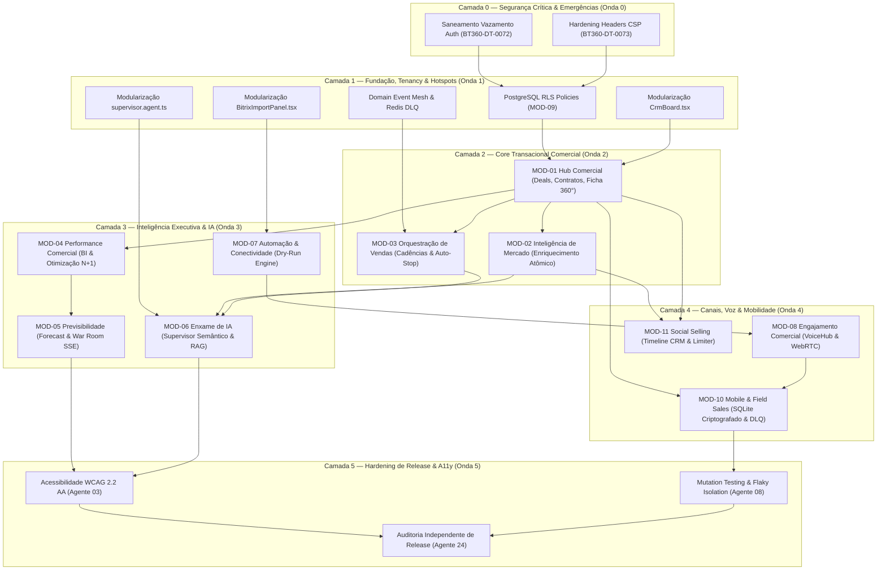

# MAPA DE DEPENDÊNCIAS ARQUITETURAIS DA RECONSTRUÇÃO (ONDA 00)
**Produto:** Birthub 360° — Sistema Operacional de Revenue Intelligence  
**Data:** 10 de Novembro de 2026  
**Autoridade:** Agente 00 (Supervisor Geral de Engenharia)  
**Em conformidade com:** `AGENTS.md` (Seções 13, 14, 19 e 21)  
**Status:** CONCLUÍDO — GRAFO DIRECIONADO SEM CICLOS BLOQUEANTES

---

## 1. Grafo Direcionado de Precedência Arquitetural

A ordem de reconstrução e saneamento é estritamente governada pelo princípio de dependência em camadas:

---

## 2. Slots Exclusivos e Regras de Concorrência (`AGENTS.md` §14)

Para garantir que a execução não gere conflitos nem sobreescrita de arquivos compartilhados:
- **Slots Exclusivos (Nunca rodam em paralelo):**
  - Agente 01 (Plataforma) $leftrightarrow$ Agente 01A (RLS e Retenção).
  - Agente 06 (Integrações) $leftrightarrow$ Agente 06A (Extrações Bitrix).
  - Agente 16 (Workers/Runtime) $leftrightarrow$ Agente 06/07 quando alterarem `src/lib/queue/**`.
- **Propriedade Exclusiva Inegociável (`AGENTS.md` §15):**
  - `prisma/schema.prisma` e migrações $
ightarrow$ Exclusivo Agente 01.
  - `src/App.tsx` e navegação principal $
ightarrow$ Exclusivo Agente 02.
  - `.github/workflows/**` e Dockerfiles $
ightarrow$ Exclusivo Agente 08 / 08A.
  - `k8s/**` e `infrastructure/**` $
ightarrow$ Exclusivo Agente 10.
  - `android/**` e `capacitor.config.ts` $
ightarrow$ Exclusivo Agente 09.
  - `.agents/reviews/**` $
ightarrow$ Exclusivo Agente 24.
  - `server.ts` e `package.json` $
ightarrow$ Exigem aprovação explícita do Agente 00.

---

## 3. Prevenção de Bloqueadores Mútuos e Ciclos

Nenhum módulo de nível superior (ex: Mobile ou BI) poderá introduzir campos no banco de dados sem passar pelo Agente 01 através de handoff formal em `.agents/handoffs/`. As integrações não criam migrações diretamente.
