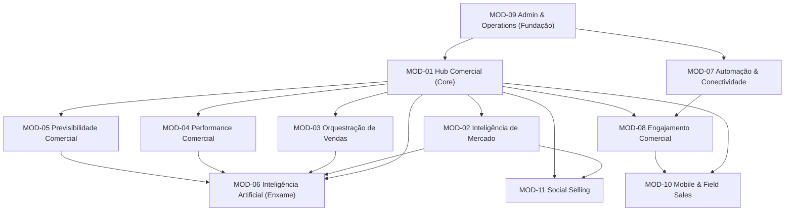

# PLANO PRELIMINAR DE ENGENHARIA PARA A FASE 02 (ENTREGA 07)
**Produto:** Birthub 360° — Sistema Operacional de Revenue Intelligence  
**Autoridade:** Agente 00 (Supervisor Geral)  
**Em conformidade com:** `AGENTS.md` (Governança Global, Ordem de Integração e Critérios de Release)  
**Data:** 10 de Novembro de 2026  
**Status:** PLANEJAMENTO PRELIMINAR (EXECUÇÃO DE CÓDIGO BLOQUEADA)

---

## 1. Diretriz Mandatória

**ESTE DOCUMENTO É ESTRITAMENTE DE PLANEJAMENTO ARQUITETURAL.**  
Nenhuma linha de código de produto, migração de banco de dados ou alteração de API pode ser iniciada antes da autorização expressa do proprietário da plataforma.

---

## 2. Arquitetura-Alvo e Padrões Estruturais

A reconstrução do Birthub 360° seguirá o padrão **Clean Architecture + Portas e Adaptadores (Hexagonal)** com separação estrita de camadas e isolamento de dependências:

```
┌─────────────────────────────────────────────────────────────────┐
│                    CAMADA DE APRESENTAÇÃO                       │
│  React 19 / Vite / Tailwind CSS / Radix UI / Design System      │
└────────────────────────────────┬────────────────────────────────┘
                                 │
┌────────────────────────────────▼────────────────────────────────┐
│                   CAMADA DE APLICAÇÃO (USE CASES)               │
│  Orquestração de Regras de Negócio / Commands / Queries / DTOs  │
└────────────────────────────────┬────────────────────────────────┘
                                 │
┌────────────────────────────────▼────────────────────────────────┐
│                    CAMADA DE DOMÍNIO PURO                       │
│  Entidades / Value Objects / Domain Events / Regras Inegociáveis│
└────────────────────────────────▲────────────────────────────────┘
                                 │
┌────────────────────────────────┴────────────────────────────────┐
│                 CAMADA DE INFRAESTRUTURA & ADAPTERS             │
│  Prisma / PostgreSQL RLS / Redis BullMQ / pgvector / APIs Ext   │
└─────────────────────────────────────────────────────────────────┘
```

### 2.1 Princípios Arquiteturais Inegociáveis
1. **Multi-Tenancy Nativo em Dupla Camada:**
   - Camada 1: Middleware de contexto que injeta `organizationId` em toda query Prisma.
   - Camada 2: Políticas ativas de PostgreSQL Row-Level Security (RLS) no banco de dados.
2. **Domain Event Mesh Desacoplado:**
   - Todas as transições entre módulos comunicam-se via eventos assíncronos imutáveis com envelopes tipados e garantia de idempotência no Redis (TTL 48h).
3. **Supervisor de IA como Portão de Governança:**
   - Nenhum agente de IA acessa o banco de dados diretamente; todo comando é intermediado pelo `RoleSupervisor` via `AgentBus`, com retenção obrigatória de ações de risco na fila `AIPendingAction`.

---

## 3. Matriz de Dependências entre os 11 Módulos



---

## 4. Roteiro Sequencial de Reconstrução em 6 Ondas de Engenharia

Seguindo a Ordem Oficial de Integração do `AGENTS.md` (Seção 19):

### ONDA 01 — Fundação, Tenancy e Schema Central (Slots: 01, 01A, 15)
- **Objetivo:** Estabelecer a base segura do banco de dados, RLS e autenticação.
- **Entregas:**
  - Migrações Prisma consolidadas sem locks exclusivos (`schema.prisma`).
  - Habilitação de RLS em todas as tabelas de domínio.
  - Middleware de sessão JWT (RS256) e injeção de tenant.
  - Setup do barramento de eventos Domain Event Mesh com chave de idempotência no Redis.
- **Gate Obrigatório:** Testes automatizados de cross-tenant data leak (`rls-leak-checker`) com 100% de sucesso.

### ONDA 02 — Hub Comercial & Contratos de Vendas (Slots: 01, 04, 18)
- **Objetivo:** Reconstruir o núcleo transacional da plataforma (MOD-01).
- **Entregas:**
  - Pipeline Kanban interativo com `@dnd-kit` e recálculo dinâmico de valor ponderado.
  - Ficha Cadastral 360° de Leads, Empresas e Contatos com linha do tempo unificada.
  - Motor de Propostas Comerciais com validação de travas de desconto por alçada (10% Closer / 20% Gestor / Diretoria).
- **Gate Obrigatório:** Testes unitários e de integração de mutação de deals e emissão de propostas.

### ONDA 03 — Prospecção, Enriquecimento e Orquestração (Slots: 05, 06, 17)
- **Objetivo:** Implementar o motor de descoberta de mercado (MOD-02) e cadências (MOD-03).
- **Entregas:**
  - ProspectingHub multi-fonte com deduplicação e scoring de ICP Fit.
  - Gerador de Dossiê 360° em 10 seções (`account-detective`).
  - CadenceHub multicanal com fila diária priorizada e mecanismo compulsório de `Auto-Stop on Reply`.
  - Mesa de Tratamento para triagem de leads inbound com SLA de 5 minutos.
- **Gate Obrigatório:** Testes de interrupção imediata de cadência ao receber webhook de resposta.

### ONDA 04 — Analytics, Forecast e Previsibilidade (Slots: 04, 10, 23)
- **Objetivo:** Construir a inteligência executiva (MOD-04 e MOD-05).
- **Entregas:**
  - Renderização otimizada dos 17 relatórios executivos em tempo de resposta < 800ms.
  - Motor de autópsia profunda de vitórias e derrotas (`Win/Loss Deep Autopsy`).
  - Forecast preditivo calibrado contra realizado histórico (MAPE < 8%) e classificação Commit/Best Case.
  - War Room com atualização de telemetria em tempo real via Server-Sent Events (SSE).
- **Gate Obrigatório:** Testes de carga com k6 (`load:k6:crm`) garantindo p95 < 200ms.

### ONDA 05 — Enxame de IA, Supervisor e Conectividade (Slots: 07, 12, 13, 16)
- **Objetivo:** Ativar o ecossistema autônomo governado (MOD-06, MOD-07 e MOD-08).
- **Entregas:**
  - Supervisor Central com despacho semântico para os 15 agentes nativos.
  - Fila de Aprovação Humana (`AIPendingAction`) retendo ações de risco HIGH.
  - Base de Conhecimento RAG em pgvector (1536 dimensões) com busca por similaridade de cosseno.
  - Conector Bitrix24 bidirecional resiliente com controle leaky bucket de 2 req/s.
  - VoiceHub Studio WebRTC com transcrição em streaming e bloqueio de cold call contra lista Não Perturbe.
- **Gate Obrigatório:** Verificação de bloqueio 100% eficaz de ações não autorizadas de IA e teste de rate limit do Bitrix24.

### ONDA 06 — Mobilidade, Social Selling e Hardening de Release (Slots: 03, 08, 08A, 09, 21, 24)
- **Objetivo:** Fechar os módulos complementares (MOD-10 e MOD-11) e certificar o produto.
- **Entregas:**
  - App Mobile Capacitor com SQLite criptografado e sincronização transacional offline-first.
  - Módulo de Social Selling com gerador de abordagens consultivas.
  - Portal LGPD para exercício dos direitos do titular com anonimização via blind index.
  - Auditoria completa de acessibilidade WCAG 2.2 AA em todas as telas e temas.
- **Gate Obrigatório:** Gate completo de release: `npm run lint`, `npx tsc --noEmit`, varredura de segredos (Gitleaks) e parecer APROVADO do Agente 24.

---

## 5. Matriz de Riscos Técnicos e Salvaguardas

| Risco Técnico Identificado | Impacto | Probabilidade | Salvaguarda Arquitetural Prevista |
| :--- | :---: | :---: | :--- |
| **Vazamento de dados entre clientes (Tenancy Leak)** | Catastrófico | Baixa | RLS compulsório no PostgreSQL + Testes automatizados de acesso cruzado em CI. |
| **Bloqueio de API por Rate Limit no Bitrix24** | Alto | Média | Fila de vazamento (token bucket) no BullMQ limitando a 2 requisições por segundo. |
| **Alucinação de Agente de IA em Proposta/Contrato** | Crítico | Baixa | Fila `AIPendingAction` com aprovação humana obrigatória para valores e descontos. |
| **Perda de dados em reuniões de campo sem sinal** | Alto | Média | Persistência local atômica em SQLite criptografado com sync transacional em background. |
| **Disparo indevido de e-mails de cadência pós-resposta** | Alto | Baixa | Evento `cadence.lead.replied` com trava síncrona no Redis pausando a inscrição em < 1s. |
| **Estouro de orçamento de tokens de IA da organização** | Médio | Média | Verificação prévia de saldo no ledger de quotas com corte de chamada e aviso aos 80%. |

---

## 6. Governança de Execução e Homologação dos Merges

1. **Isolamento de Branches:** Cada especialista trabalha em branch própria `agente/<numero>-<slug>` a partir de `integracao/onda-<n>`.
2. **Leva de Merges:** Integração controlada em lotes de 2 a 3 merges com execução do gate após cada lote.
3. **Auditoria Independente Compulsória:** O Agente 24 analisa todos os diffs antes do merge definitivo na branch principal.
4. **Critério de Pronto (DoD):** Nenhuma funcionalidade é dada como pronta sem teste de regressão, conformidade de tenancy e tipagem TypeScript estrita sem `@ts-ignore`.

**ESTE PLANO ENCONTRA-SE PRONTO PARA SUBMISSÃO AO PROPRIETÁRIO DO PRODUTO.**
