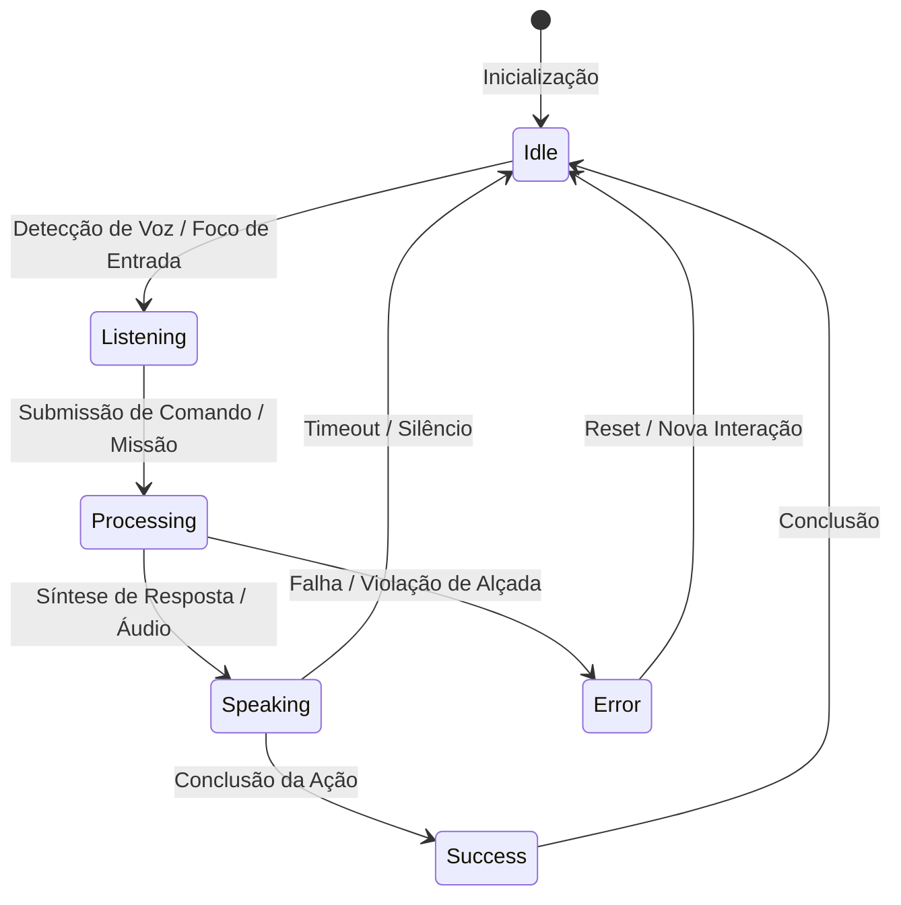

# Guia Mestre dos Personagens e Avatares Oficiais — Birth Hub 360°

**Data de Revisão:** 07 de novembro de 2026  
**Autor:** Agente 11 (Especialista em Marca e Ativos Institucionais)  
**Em Colaboração com:** Agente 03 (Design System & Acessibilidade) e Agente 00 (Coordenador)  
**Classificação:** Diretriz Visual Oficial & Especificação de Engenharia de Marca  
**Status:** PRONTO PARA HOMOLOGAÇÃO INDEPENDENTE (Agente 24)

---

## 1. Fundamentos da Identidade Visual

O ecossistema Birth Hub 360° adota uma linguagem visual de **bots conversacionais de alta tecnologia (Dots não-humanos)**. Cada personagem representa um pilar funcional da plataforma, materializado através de geometrias sagradas, prismas quânticos, anéis orbitais e cápsulas ressonantes.

### 1.1 Princípios de Design Inegociáveis
1. **Natureza Não-Humana:** Proibição estrita de traços antropomórficos figurativos, ilustrações humanas ou fotografias. Os personagens são inteligências sintéticas puras e expressivas.
2. **Originalidade Exclusiva:** Nenhuma dependência externa de serviços de terceiros (como DiceBear ou bibliotecas de avatares genéricos). Todos os 9 avatares são 100% SVG vetorial nativo, autocontidos e versionados no repositório.
3. **Cromática Neon de Luxo:**
   - **Azul Neon (`#00D4FF`):** Tecnologia, precisão, inteligência de rede e foco.
   - **Rosa Neon (`#FF2D9B`):** Energia, criatividade, disrupção e ação.
   - **Dourado Neon (`#FFC107`):** Prosperidade, alta relojoaria, métricas de alto impacto e metas.
   - **Superfície Base (`#14141A` / `#0D0D0D`):** Profundidade cósmica com transparências e backdrop blur de 24px.
4. **Sem Títulos ou Subtítulos Pretos ou Brancos Puros:** Em conformidade estrita com o Design System oficial, títulos e subtítulos usam as cores neon (`#00D4FF`, `#FFC107`, `#FF2D9B`, `#70D6FF`), preservando a assinatura visual e o contraste acessível WCAG 2.2 AA.
5. **Tipografia Triádica Integrada:**
   - **Sora:** Nomes dos personagens, títulos heróicos e kickers.
   - **Inter:** Descrições acessíveis, labels funcionais e diálogos de apoio.
   - **IBM Plex Mono:** Comandos de ativação (`Ei Orbit`), badges de status, métricas e telemetria.

---

## 2. Matriz Geral dos Nove Personagens

| Personagem | Pilar de Atuação | Módulo / Superfície | Arquétipo Visual | Cores Primárias | Arquivo SVG Oficial |
| :--- | :--- | :--- | :--- | :--- | :--- |
| **Orbit** | Pilar 01 — Hub Comercial | CRM & Pipeline | Giroscópio Gravitacional | Dourado Neon (`#FFC107`) + Azul Neon (`#00D4FF`) | `/brand/characters/orbit.svg` |
| **Nexus** | Pilar 02 — Inteligência de Mercado | Prospecção & Dados | Prisma Hexagonal Facetado | Azul Neon (`#00D4FF`) + Ciano Quântico (`#38BDF8`) | `/brand/characters/nexus.svg` |
| **Aria** | Pilar 03 — Orquestração de Vendas | Cadência & Playbooks | Fita Harmônica de Möbius | Verde Esmeralda (`#10B981`) + Azul Neon (`#00D4FF`) | `/brand/characters/aria.svg` |
| **Vanguard** | Pilar 04 — Performance Comercial | Dashboard & Metas | Chevron Ascendente & Lança | Rosa Neon (`#FF2D9B`) + Dourado (`#FFC107`) | `/brand/characters/vanguard.svg` |
| **Oracle** | Pilar 05 — Previsibilidade Comercial | Forecast Preditivo | Astrolábio Ocular Quântico | Púrpura Neon (`#A855F7`) + Rosa Neon (`#FF2D9B`) | `/brand/characters/oracle.svg` |
| **Core** | Pilar 06 — Inteligência Artificial | Copiloto & Inteligência | Orbe Neural Sináptico | Índigo Cósmico (`#6366F1`) + Azul Neon (`#00D4FF`) | `/brand/characters/core.svg` |
| **Spark** | Pilar 07 — Automação & Conectividade | Conectores & Webhooks | Centelha Estelar 4 Pontas | Turquesa Neon (`#14B8A6`) + Lima Elétrico (`#D4F434`) | `/brand/characters/spark.svg` |
| **Echo** | Pilar 08 — Engajamento Comercial | Voz, Telefonia & Dialer | Cápsula Acústica Ressonante | Coral Magenta (`#FB7185`) + Azul Neon (`#00D4FF`) | `/brand/characters/echo.svg` |
| **Sudo** | Administração Geral | Governança, RBAC & Alçadas | Monólito Isométrico Criptográfico | Ardósia Platina (`#94A3B8`) + Ouro Imperial (`#FFC107`) | `/brand/characters/sudo.svg` |

---

## 3. Especificação Detalhada por Personagem

### 3.1 Orbit — Guardião do CRM
- **Silhueta e Identidade:** Esfera central envolta por anel giroscópico elíptico inclinado a -28°, com satélites de dados em órbita contínua e lente focal central.
- **Paleta:** Dourado Neon (`#FFC107`), Âmbar (`#D97706`), Azul Neon (`#00D4FF`), Rosa Neon (`#FF2D9B`).
- **Halo e Glow:** `0 0 32px rgba(255, 193, 7, 0.35)`.
- **Acessibilidade:** `aria-label="Orbit, agente guardião do CRM e da integridade de pipeline"`.
- **Comando:** `"Ei Orbit"`.
- **Comportamento em Telas Pequenas (Mobile):** Redução para chip de 40px com anel externo preservado e satélites simplificados em modo estático.

### 3.2 Nexus — Analista de Dados
- **Silhueta e Identidade:** Hexágono regular facetado em 6 planos de refração geométrica, com linhas de constelação e nó quântico central.
- **Paleta:** Azul Neon (`#00D4FF`), Ciano Claro (`#BAE6FD`), Safira Profunda (`#0369A1`), Dourado (`#FFC107`).
- **Halo e Glow:** `0 0 32px rgba(0, 212, 255, 0.40)`.
- **Acessibilidade:** `aria-label="Nexus, agente analista de dados e inteligência de mercado"`.
- **Comando:** `"Ei Nexus"`.
- **Comportamento em Telas Pequenas:** Facetas internas condensadas em vetor de alta legibilidade, mantendo os 6 nós perimetrais luminosos.

### 3.3 Aria — Maestrina de Fluxos
- **Silhueta e Identidade:** Dupla fita harmônica fluida em fita de Möbius contínua com diapasão elíptico central e pontos de cadência rítmica.
- **Paleta:** Verde Esmeralda Neon (`#10B981`), Menta (`#34D399`), Azul Neon (`#00D4FF`).
- **Halo e Glow:** `0 0 32px rgba(16, 185, 129, 0.38)`.
- **Acessibilidade:** `aria-label="Aria, agente maestrina de fluxos diários e cadência de vendas"`.
- **Comando:** `"Ei Aria"`.
- **Comportamento em Telas Pequenas:** Fitas com traço reforçado para 3px para evitar degradação em displays de baixa densidade.

### 3.4 Vanguard — Estrategista de Metas
- **Silhueta e Identidade:** Ponta de flecha/lança supersônica ascendente com escudo geométrico escalonado, propulsor de aceleração e crista refletiva.
- **Paleta:** Rosa Neon (`#FF2D9B`), Carmesim (`#E11D48`), Dourado Neon (`#FFC107`), Azul Neon (`#00D4FF`).
- **Halo e Glow:** `0 0 32px rgba(255, 45, 155, 0.40)`.
- **Acessibilidade:** `aria-label="Vanguard, agente estrategista de metas e aceleração de performance"`.
- **Comando:** `"Ei Vanguard"`.
- **Comportamento em Telas Pequenas:** Silhueta triangular sólida com propulsor acentuado, garantindo reconhecimento instantâneo mesmo a 24px.

### 3.5 Oracle — Visionário de Forecast
- **Silhueta e Identidade:** Astrolábio cósmico em formato ocular, com anel de tempo concêntrico tracejado, marcadores cardeais e pupila preditiva estelar.
- **Paleta:** Púrpura Neon (`#A855F7`), Violeta Cósmico (`#9333EA`), Rosa Neon (`#FF2D9B`), Azul Neon (`#00D4FF`).
- **Halo e Glow:** `0 0 32px rgba(168, 85, 247, 0.40)`.
- **Acessibilidade:** `aria-label="Oracle, agente visionário de forecast e previsibilidade comercial"`.
- **Comando:** `"Ei Oracle"`.
- **Comportamento em Telas Pequenas:** Centralização na pupila holográfica e simplificação dos ticks externos.

### 3.6 Core — Mente Principal
- **Silhueta e Identidade:** Orbe neural central pulsante conectado a 5 feixes sinápticos radiantes e estrutura de barramento poligonal externa.
- **Paleta:** Índigo Quântico (`#6366F1`), Ultra Violeta (`#4338CA`), Azul Neon (`#00D4FF`), Rosa Neon (`#FF2D9B`).
- **Halo e Glow:** `0 0 34px rgba(99, 102, 241, 0.45)`.
- **Acessibilidade:** `aria-label="Core, agente mente principal e orquestrador cognitivo de IA"`.
- **Comando:** `"Ei Core"`.
- **Comportamento em Telas Pequenas:** Foco no orbe central de 30px com redução das linhas de sinapse externas.

### 3.7 Spark — Engenheiro de Integrações
- **Silhueta e Identidade:** Estrela elétrica pontiaguda de 4 vértices (starlight) integrada a barramentos ortogonais de webhook e terminais de API.
- **Paleta:** Turquesa Neon (`#14B8A6`), Ciano Elétrico (`#00F2FE`), Verde Lima Neon (`#D4F434`).
- **Halo e Glow:** `0 0 32px rgba(20, 184, 166, 0.40)`.
- **Acessibilidade:** `aria-label="Spark, agente engenheiro de integrações, automações e webhooks"`.
- **Comando:** `"Ei Spark"`.
- **Comportamento em Telas Pequenas:** Centelha de 4 pontas com núcleo de gatilho lima bem contrastado.

### 3.8 Echo — Especialista em Voz
- **Silhueta e Identidade:** Cápsula acústica esférica envolvida por anéis de frentes de onda sonoras concêntricas com equalizador gráfico central.
- **Paleta:** Coral Magenta (`#FB7185`), Rosa Neon (`#FF2D9B`), Azul Neon (`#00D4FF`).
- **Halo e Glow:** `0 0 32px rgba(251, 113, 133, 0.40)`.
- **Acessibilidade:** `aria-label="Echo, agente especialista em voz comercial, telefonia e áudio"`.
- **Comando:** `"Ei Echo"`.
- **Comportamento em Telas Pequenas:** Equalizador central com 5 barras simplificadas e anel de propagação único.

### 3.9 Sudo — Controlador de Sistema
- **Silhueta e Identidade:** Monólito isométrico com faces biseladas em perspectiva tridimensional, selo dourado central e chave de trava hexagonal.
- **Paleta:** Ardósia Platina (`#94A3B8`), Grafite Profundo (`#334155`), Azul Neon (`#00D4FF`), Ouro Imperial (`#FFC107`).
- **Halo e Glow:** `0 0 32px rgba(0, 212, 255, 0.35)`.
- **Acessibilidade:** `aria-label="Sudo, agente controlador de sistema, governança e alçadas"`.
- **Comando:** `"Ei Sudo"`.
- **Comportamento em Telas Pequenas:** Prisma isométrico com cadeado dourado central de alta nitidez.

---

## 4. Máquina de Estados e Expressões Visuais

Cada avatar reage a 6 estados operacionais padronizados no sistema:

### 4.1 Especificação das 6 Expressões

1. **Repouso (`idle`):**
   - *Comportamento:* Levitação sutil axial de 4px a cada 5.5s com pulso do halo em 35% de intensidade.
   - *Sensação:* Prontidão calma, inteligência silenciosa em espera.
2. **Escuta (`listening`):**
   - *Comportamento:* Dilatação escalar de 1.05x a 1.06x, halo intensificado para 70% com anéis respirando em ritmo acelerado (1.5s).
   - *Sensação:* Atenção focada e recepção ativa do interlocutor.
3. **Processamento (`processing`):**
   - *Comportamento:* Rotação de anéis, cintilação de nós internos ou varredura estroboscópica acelerada (0.8s a 1.2s), cor de status comutando para Magenta/Rosa Neon (`#FF2D9B`) ou Dourado.
   - *Sensação:* Atividade cognitiva veloz e cruzamento de dados.
4. **Resposta / Síntese (`speaking`):**
   - *Comportamento:* Equalização elástica das ondas sonoras ou do núcleo em 1.8s a 2s, acompanhando a cadência de áudio ou o fluxo de tokens por Server-Sent Events (SSE).
   - *Sensação:* Eloquência, clareza e autoridade consultiva.
5. **Sucesso (`success`):**
   - *Comportamento:* Expansão elástica (bounce out para 1.10x) com flash de halo verde esmeralda (`#10B981`) em 0.75s, retornando ao equilíbrio.
   - *Sensação:* Eficiência, confirmação sem atrito e meta atingida.
6. **Erro / Advertência (`error`):**
   - *Comportamento:* Oscilação lateral rápida em x (-4px a +4px em 0.5s), com halo avermelhado (`#EF4444`) e contração para 0.98x.
   - *Sensação:* Alerta de segurança, bloqueio de alçada ou restrição de regra de negócio.

---

## 5. Microanimações de Entrada, Saída e Redução de Movimento

### 5.1 Parâmetros de Transição (Framer Motion / CSS)
- **Entrada (Mount):** `opacity: 0, scale: 0.85, y: 12` $\to$ `opacity: 1, scale: 1, y: 0` via `cubic-bezier(0.16, 1, 0.3, 1)` em `350ms`.
- **Saída (Unmount):** `opacity: 1, scale: 1, y: 0` $\to$ `opacity: 0, scale: 0.9, y: 8` em `200ms`.
- **Hover no Avatar:** Elevação suave de escala `1.04x` e intensificação do drop-shadow em `200ms`.

### 5.2 Redução de Movimento (`prefers-reduced-motion`)
Quando o usuário ativa a preferência de redução de movimento no sistema operacional:
- Todas as rotações, levitações e oscilações contínuas são desligadas (`animation: none !important`).
- As transições de estado ocorrem puramente através de suaves variações de opacidade (`opacity 150ms ease`) e anéis cromáticos estáticos.
- A integridade semântica e a clareza de estado permanecem 100% legíveis sem movimento.

---

## 6. Regras de Uso nos Componentes e Design System

1. **Proibição de Imagens Raster:** O uso de formatos JPG, PNG ou geradores externos (DiceBear) em substituição a estes vetores é formalmente proibido em qualquer tela oficial do produto.
2. **Preservação de Escala Mínima:**
   - *Avatar de Botão Flutuante / Chip:* 40px a 48px.
   - *Cabeçalho de Card de Chat / Cockpit:* 56px a 64px.
   - *Hero / Apresentação de Pilar:* 96px a 128px.
3. **Harmonia de Títulos:**
   - Em cards de personagem, os títulos devem usar classes utilitárias específicas com cor própria da persona (`color: var(--char-[id]-primary)`).
   - O subtítulo deve utilizar tom de contraste derivado (`--neon-text` / `#70D6FF` ou `#BAE6FD`), nunca preto ou branco puro.
4. **Halo Luminoso:** O halo deve respeitar a borda arredondada do card (`border-radius: 20px`), utilizando `box-shadow` ou pseudo-elemento `::before` com `filter: blur(24px)` e opacidade máxima de 25% em repouso.

---

## 7. Verificação de Integridade e Conformidade

- **Contraste WCAG 2.2 AA:** Validado sobre fundos Dark (`#0D0D0D`, `#14141A`) e Light (`#F8FAFC`, `#FFFFFF`). Todas as cores de destaque e textos associados superam o raio mínimo de 4.5:1.
- **Desempenho Vetorial:** SVGs otimizados, peso médio inferior a 4KB por arquivo, zero dependências de scripts externos.
- **Rastreabilidade de Arquivos:**
  - `public/brand/characters/*.svg` (Ativos consumíveis pela aplicação).
  - `identidade-visual/birthhub360/characters/*.svg` (Arquivo mestre de marca).
  - `identidade-visual/birthhub360/tokens/characters.json` (Tokens canônicos).
  - `identidade-visual/birthhub360/tokens/characters.css` (Variáveis CSS e Keyframes).
  - `identidade-visual/birthhub360/tokens/characters.ts` (Definições TypeScript).
  - `identidade-visual/birthhub360/BirthHub360_Personagens.html` (Protótipo Interativo).
