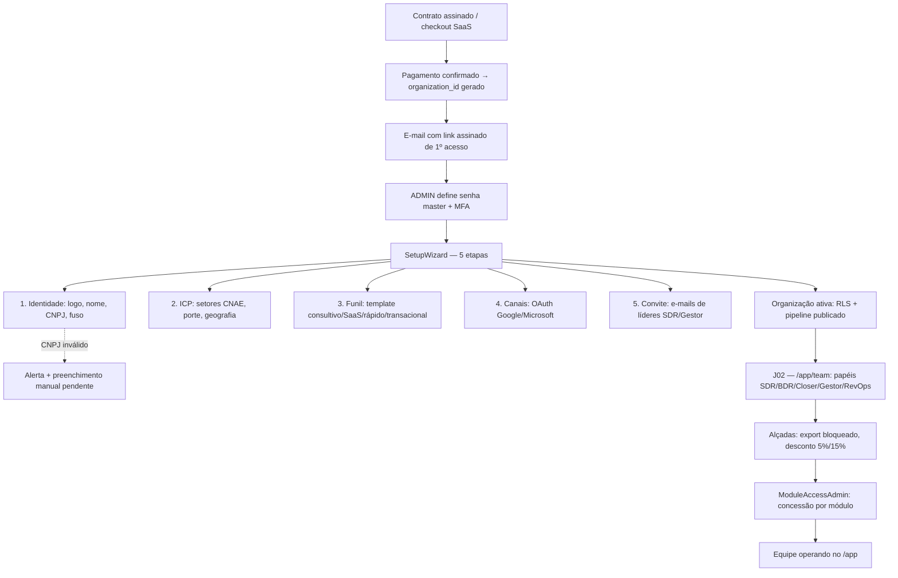
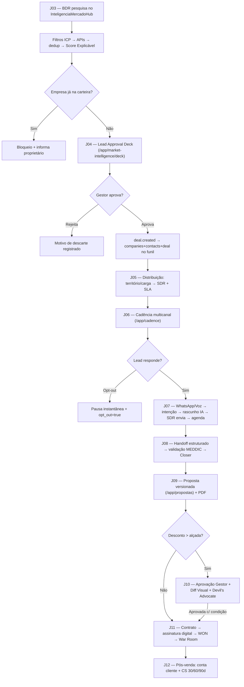
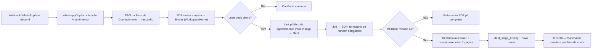

# 03 — Jornadas do Usuário

**Propósito:** resumir as 20 jornadas operacionais canônicas (J01–J20) com objetivo, entrada, etapas e exceções, e mapear em Mermaid as 3 jornadas principais.

**Escopo:** síntese de `BIRTHUB360_JORNADAS_OPERACIONAIS.md` v4.0.0 (08/11/2026 — "Especificação Mestra de Engenharia de Produto"). As jornadas são **especificação de produto**; a implementação parcial é indicada onde há evidência.

**Estado da informação:** CONFIRMADO como documento canônico; status de implementação varia por jornada (ver coluna). Data de referência: 2026-11-19.

**Fontes:** `BIRTHUB360_JORNADAS_OPERACIONAIS.md` (linhas citadas), `BIRTHUB360_CATALOGO_FUNCIONALIDADES.csv`, `src/App.tsx`, `src/components/layout/AppLayout.tsx`, `src/features/onboarding/components/SetupWizard.tsx`, `_FATOS-CANONICOS.md` §16.

**Documentos relacionados:** `inventario-de-telas.md`, `arquitetura-da-informacao.md`, `mapa-de-modulos.md`.

---

## 1. Mapa das 20 jornadas

Visão do ciclo (Mermaid canônico do documento, `BIRTHUB360_JORNADAS_OPERACIONAIS.md:26-43`): J01–J02 (provisionamento/governança) → J03–J04 (descoberta/entrada no CRM) → J05–J06 (atribuição/cadência SDR) → J07–J08 (resposta/handoff Closer) → J09–J11 (proposta/aprovação/fechamento) → J12 (pós-venda) — com J13–J20 transversais (performance, forecast, IA autônoma, sync Bitrix, mobile, social selling, reestruturação).

| # | Jornada | Objetivo (1 linha) | Entrada / gatilho | Etapas-chave | Exceções | Implementação |
|---|---|---|---|---|---|---|
| J01 | Onboarding SaaS | Empresa configura o Birth Hub 360° | Assinatura + pagamento → e-mail com link assinado | SetupWizard 5 etapas: identidade (logo/CNPJ/fuso), ICP (CNAEs/porte/geografia), funil (template), canais (OAuth Google/Microsoft), convite de líderes; agente gera 3 deals demo em sandbox | CNPJ inválido/suspenso → alerta + preenchimento manual pendente | **Parcialmente implementado**: `SetupWizard` existe (`/setup`, ADMIN); `OnboardingGate`/`OnboardingTour` no shell; agentes demo NÃO VERIFICADO |
| J02 | RBAC e equipes | Admin cria equipes e permissões | Necessidade de cadastrar colaboradores | `/app/team` → convidar (nome/e-mail/celular/papel SDR/BDR/Closer/Gestor/RevOps); alçadas (export bloqueado p/ SDR/Closer; desconto até 5% Closer/15% Gestor); `ModuleAccessAdmin` por módulo; token criptografado | Limite de assentos → modal de upgrade (`billingRevenue.agent`) | **Implementado**: rotas `/app/team`, `/app/module-access` (ADMIN); trilha `audit_logs` |
| J03 | Prospecção BDR | Identificar e qualificar empresa | BDR inicia pesquisa no `InteligenciaMercadoHub` | Filtros ICP → APIs (Google Places, Apollo, Hunter) → dedup `dataEnricher` → Score Explicável ICP (ex.: 88/100 com justificativas) → 3 decisores via `accountDetective` | Empresa já na carteira de outro vendedor → bloqueio + informa proprietário | **Parcialmente**: `/app/prospect`, `/app/prospect/inteligente`, `/app/market-intelligence/*` existem; orquestração de agentes externos NÃO VERIFICADA |
| J04 | Lead Approval Deck | Conta qualificada entra no CRM | Conta com ICP Score ≥ 70 submetida | Gestor abre `/app/market-intelligence/deck` → avalia dossiê → aprova (ou rejeita c/ motivo) → converte em `companies`/`contacts`/`deal` no 1º estágio → evento `deal.created` | Rejeição exige motivo de descarte | **Implementado (rota)**: `LeadApprovalDeck` em `/app/market-intelligence/deck` |
| J05 | Distribuição inteligente | Oportunidade recebe responsável e SLA | Evento `deal.created` | Algoritmo avalia território, carga, conversão por vertical → seleciona SDR → SLA 15min inbound/2h outbound → notificação push | Ninguém online → Fila Geral + alerta ao Gestor | **Parcialmente**: rotas existem; algoritmo de distribuição NÃO VERIFICADO |
| J06 | Cadência multicanal | SDR executa cadência de prospecção | SDR clica "Iniciar Dia de Prospecção" no Plano Diário | Inscrição em cadência (ex.: 12 etapas/21 dias) → e-mail → LinkedIn → ligação (Voice Hub WebRTC) → WhatsApp | Opt-out → pausa instantânea + `opt_out_communications=true` | **Parcialmente**: `/app/cadence` ativo; voice-hub 503 bloqueado (handoff 17→12) |
| J07 | Resposta do lead | Lead responde e inicia conversa | Webhook WhatsApp inbound | Classificação de intenção/sentimento → RAG na base de conhecimento → rascunho revisado pelo SDR → envio → link de agendamento → reunião com Meet | — | **Parcialmente**: mesa-tratamento é o destino liberado do P08; agentes whatsappCopilot NÃO VERIFICADOS |
| J08 | Handoff SDR→Closer | Oportunidade transferida ao Closer | SDR clica "Avançar para Demonstração/Handoff" | Formulário obrigatório (dores, orçamento, decisores) → validação MEDDIC por `qualification.agent` → reatribuição → resumo executivo de 1 página ao Closer | Critérios MEDDIC não atendidos → bloqueio | **Parcialmente**: fluxo descrito; implementação do formulário/validação NÃO VERIFICADA |
| J09 | Proposta comercial | Closer elabora proposta | Cliente solicita proposta formal | CrmBoard → "Criar Proposta" → itens + condições → `pricing.agent` calcula → desconto → `Versão N` imutável + PDF criptografado | — | **Implementado (rotas)**: `/app/propostas`, `proposal_versions`; cálculo por agente NÃO VERIFICADO |
| J10 | Aprovação de proposta | Proposta passa por governança | Desconto acima da alçada (ex.: 12% > 5%) | Deal bloqueado → tarefa ao Gestor → Diff Visual de Propostas → `devilsAdvocate` comenta → aprovação c/ condição → notificação ao Closer → status APPROVED | Desconto dentro da alçada → fluxo direto | **Implementado (rotas)**: propostas + diff; agente `devilsAdvocate` NÃO VERIFICADO |
| J11 | Fechamento | Negociação concluída (Won) | Minuta final para assinatura | `contractGuardian` gera contrato → DocuSign/ClickSign → webhook assinado → card → "Fechado Ganho" → efeitos War Room + metas atualizadas | — | **Parcialmente**: `/app/war-room` existe; assinatura digital/contrato NÃO VERIFICADOS |
| J12 | Pós-venda/CS | Cliente entra em relacionamento | Evento `deal.won` | Conta `is_customer=true` → kickoff CSM → plano de sucesso 30/60/90d → `churnPrevention` monitora uso/login | — | **NÃO VERIFICADO**: sem rota/tela dedicada identificada |
| J13 | Performance | Gestor acompanha gargalos | Reunião semanal de pipeline | Command Center → funil mostra queda → Win/Loss causal → motivos de perda catalogados → plano de ação → `SellerCoachAgent` | — | **Implementado (rotas)**: `/app/analytics`, `/app/winloss`, `/app/reports` |
| J14 | Forecast | Diretoria consulta projeção | Fechamento para conselho | Meta → 3 cenários (ponderado/commit/Monte Carlo 10k iterações c/ IC 90%) → simulação "e se" (ex.: +2 Closers) → relatório explicável | Meta não cadastrada → estado vazio | **Implementado (rotas, gated)**: `/app/forecast`, `/app/metas`, `/app/pipeline_ponderado` (`COMMERCIAL_INTELLIGENCE_ROLES`) |
| J15 | IA autônoma — riscos | Agentes identificam riscos | Varredura noturna de integridade | `pipelineHealthInspector` detecta SLA violado → `devilsAdvocate` cruza LinkedIn (champion saiu) → health score 85→25 → card de alerta no Workspace | Falso positivo → revisão humana (pendências em `/app/pending-actions`) | **Parcialmente**: `signals-risks`, `pending-actions`, `elite-agent` existem; agentes específicos NÃO VERIFICADOS |
| J16 | Supervisor anti-conflito | Coordenação entre módulos | BDR tenta cadência em filial de cliente ativo | `supervisor.agent` intercepta → consulta grupo econômico → bloqueia cadência fria → justifica → anexa ao deal principal | — | **NÃO VERIFICADO** como implementação; padrão coerente com gates existentes |
| J17 | Sync Bitrix24 | Automação sincroniza eventos | `deal.stage_changed` interno | `bitrixGuardian` + hash + `origin_system` → API Bitrix24 → webhook eco descartado (anti-loop) → <800ms | Falha de API → retry/DLQ (motor de automações existe) | **Parcialmente**: `/app/bitrix` (guia), `/app/automations`, `/app/integrations` existem; conector NÃO VERIFICADO |
| J18 | Mobile offline | Vendedor trabalha em campo sem sinal | Visita presencial em local sem internet | `FieldMeetingRecorder` grava → `mobileEdgeAi` transcreve on-device → edições em SQLite local → fila de sync ao reconectar → merge sem conflito | Conflito de timestamp → resolução no servidor | **PARCIALMENTE IMPLEMENTADO**: Capacitor/PWA/`OfflineBanner`/`SyncIndicator`/M10 existem; pipeline J18 é especificação |
| J19 | Social Selling | Sinal social vira pipeline | `socialSelling.agent` detecta post de decisor | Alerta no `SocialSellingHub` → `ApproachGeneratorCard` sugere comentário+mensagem → BDR revisa/publica → resposta → "Converter em Lead no CRM" | Módulo não concedido → `RequireModuleAccess` bloqueia | **Implementado (rota)**: `/social-selling` gated; agente NÃO VERIFICADO |
| J20 | Reestruturação org | Carteiras e permissões reorganizadas | Diretoria decide redistribuir territórios | `/app/team` → "Transferir Carteira em Lote" → matriz de redistribuição → regra de partilha → transação atômica → permissões revogadas + sessões invalidadas | Deal órfão → rollback transacional | **Parcialmente**: `/app/team` existe; transferência em lote NÃO VERIFICADA |

---

## 2. Mapa Mermaid — Jornada 1: Onboarding (J01–J02)

*Implementação: `SetupWizard` (`/setup`), `OnboardingGate`, `OnboardingTour`, `/app/team`, `/app/module-access` confirmados; geração de deals demo por agente = especificação.*

## 3. Mapa Mermaid — Jornada 2: Lead → Proposta → Fechamento (J03–J11)

*Rotas confirmadas: prospect, market-intelligence/deck, crm, cadence, mesa-tratamento, propostas, war-room. Agentes (pricing, contractGuardian, devilsAdvocate, qualification) = especificação.*

## 4. Mapa Mermaid — Jornada 3: Resposta → Handoff (J07–J08)

*Implementado: `/app/mesa-tratamento` (fila de respostas, único destino web do P08), `/app/knowledge`, `/book/:slug`, `/app/calendar`. Agentes whatsappCopilot/qualification/supervisor = especificação; validação MEDDIC NÃO VERIFICADA.*

---

## 5. Jornadas transversais (J13–J20) — resumo de leitura

- **J13–J14 (medição):** fecham o ciclo — o que aconteceu (Win/Loss causal) alimenta o que vai acontecer (Forecast Monte Carlo explicável). Telas: analytics, winloss, reports, forecast, metas, pipeline_ponderado.
- **J15–J16 (IA autônoma):** o sistema trabalha sem pedido — detecta risco (champion saiu da empresa), rebaixa health score, gera card de ação; o Supervisor impede ações conflitantes entre agentes. Telas: signals-risks, pending-actions, elite-agent, workspace.
- **J17 (conectividade):** Bitrix24 bidirecional com anti-echo — a plataforma é sistema de registro, não ilha.
- **J18 (campo):** offline-first com IA on-device — a jornada que justifica o M10 mobile-only.
- **J19 (social):** canal de entrada alternativo que termina no mesmo funil — prova de que jornadas convergem para o CrmBoard.
- **J20 (governança):** mudança organizacional como operação transacional — sem deal órfão, sem sessão zumbi.

## 6. Lacunas transversais

- Jornadas são **especificação v4.0.0**; cobertura de implementação é desigual — não há matriz jornada×tela×status verificada (recomendado [PROPOSTO] como item de `09-PLANO-DE-EVOLUCAO/`).
- Agentes citados (`onboarding.agent`, `dataEnricher.agent`, `qualification.agent`, `supervisor.agent`, `pricing.agent`, `contractGuardian.agent`, `devilsAdvocate.agent`, `whatsappCopilot.agent`, `socialSelling.agent`, `forecast.agent`, `pipelineHealthInspector`, `bitrixGuardian.agent`, `mobileEdgeAi.agent`, `success.agent`, `churnPrevention.agent`, `revenueIntelligence.agent`, `SellerCoachAgent`, `billingRevenue.agent`, `ops.agent`, `hunterProspecting.agent`, `ldrIntelligence.agent`, `voiceInCall.agent`, `QueryPlanner`, `accountDetective.agent`) são nomes de especificação — mapear para código real (`src/lib/` agents/swarm?) é trabalho de auditoria, não desta missão.
- J12 (pós-venda) e partes de J08/J11/J16/J17/J20 carecem de evidência de UI.

---
*Documento gerado na missão Brand System 03-PRODUTO. Evidências consolidadas em `../_FATOS-CANONICOS.md`.*
